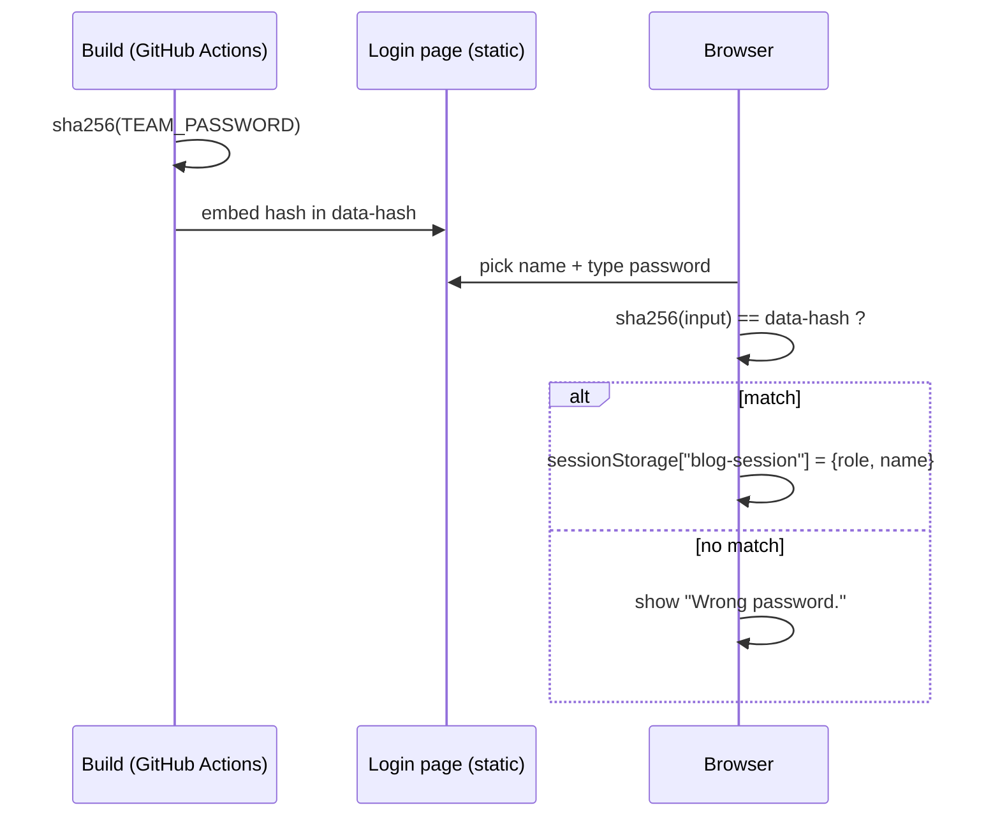
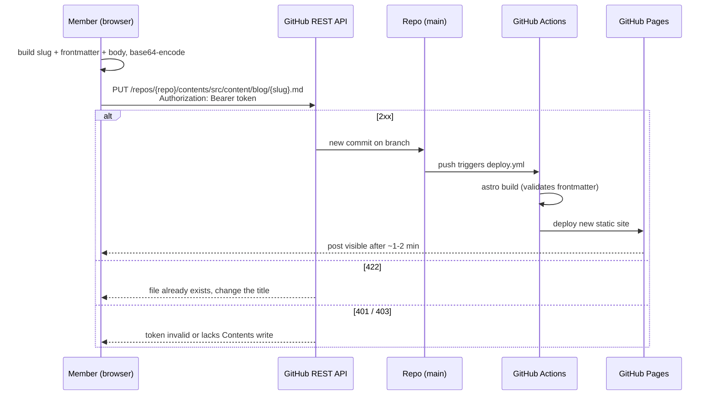

# Team Blog

A small static blog for our bachelor thesis team (Pham, Laura, Keanu). Built with [Astro](https://astro.build), hosted on GitHub Pages. Team members log in and publish posts from the browser; the teacher can read everything but cannot post.

## Using the blog

### Logging in
1. Open the site. You are redirected to `/login` if you have no session.
2. **Team members:** pick your name, enter the shared team password, click *Log in*. The name you pick becomes the author of your posts.
3. **Teacher:** click *Continue as teacher* (read-only, no password, no "New post" button).

The session lives in `sessionStorage`, so it ends when the tab is closed or you click *Log out*.

### Reading
The home page lists all posts, newest first. Use the category buttons (All / UX / DESIGN / DEVELOPMENT / FEEDBACK) to filter. Click a post to read it.

### Publishing a post (members only)
1. Click **New post**.
2. Fill in title, short description, category and the body (Markdown).
3. Paste your GitHub token (see [Getting your GitHub token](#getting-your-github-token) below). You only do this once per browser.
4. Click **Publish**. The post is committed to the repo, GitHub Actions rebuilds the site, and it appears on the feed after about a minute.

The author is taken from your login, and the date is set automatically. Two posts with the same title on the same day collide (the form tells you to change the title).

### Adding images
On **New post**, use the *Images* field. Each picked image is shrunk in your browser (max 1600px wide, WebP; GIFs are left as they are) and a Markdown link such as `` is inserted at the cursor in the text. Edit the alt text between the brackets so it describes the image. On **Publish** the images you still reference are committed to `src/assets/blog/` first, then the post. Astro optimises them at build time. Delete a link from the text if you don't want that image uploaded.

### Getting your GitHub token
To publish, the site needs a GitHub token that lets it add a file to the repo on your behalf. **Every teammate creates their own.** A token is tied to the GitHub account that created it, so don't share one: commits would all show up as the same person, and if it leaks everyone loses access.

**Before you start:** you must be a collaborator with write access on the repo (the repo owner adds you under Settings → Collaborators).

1. On GitHub, click your profile picture → **Settings**.
2. Scroll the left sidebar to the bottom → **Developer settings**.
3. **Personal access tokens** → **Fine-grained tokens** → **Generate new token** (direct link: https://github.com/settings/personal-access-tokens/new).
4. Fill in:
   - **Token name:** `team-blog`
   - **Expiration:** 30 to 90 days
   - **Repository access:** *Only select repositories* → pick this blog repo
   - **Permissions** → Repository permissions → **Contents: Read and write** (leave everything else)
5. Click **Generate token** and **copy it immediately**. GitHub shows it only once.
6. Log in to the blog, open **New post** and paste it into the *GitHub token* field.

**Good to know**
- After your first successful publish the token is saved in your browser (`localStorage`, key `blog-github-token`), so you don't paste it again. It is not saved anywhere else, and it is never in the repo or the website files.
- It is stored per browser and per device, so a new browser or device means pasting it again.
- When it expires, create a new one the same way and paste it over the old one.
- If it leaks, revoke it under Settings → Developer settings → Fine-grained tokens.
- Never post it in chat, issues or commits, and don't put it in `.env`.
- Errors: **401/403** means the token is wrong, expired, or lacks *Contents: Read and write* or access to this repo. **422** means a post with that title already exists today.

### Writing a post by hand
Add a file to `src/content/blog/` named `YYYY-MM-DD-some-title.md`:

```md
---
title: "My post"
description: "One-line summary shown on the feed."
category: UX            # UX | DESIGN | DEVELOPMENT | FEEDBACK
author: Laura           # Pham | Laura | Keanu
date: 2026-10-27T09:00:00.000Z
---

Markdown content here.
```

Frontmatter is validated at build time; a wrong category or author fails the build. The sample post `2026-10-27-welcome.md` can be deleted.

## Local development

```sh
npm install
cp .env.example .env     # then set TEAM_PASSWORD
npm run dev              # http://localhost:4321
npm run build            # output in dist/
npm run preview          # serve the build
```

`PUBLIC_GITHUB_REPO` in `.env` should be `owner/repo` if you want the *New post* form to work locally.

## How it works

### Stack
Astro 5, static output, no UI framework, plain CSS (`src/styles/`), and vanilla TypeScript for the client scripts. No server and no database: the Git repository is the database.

### Project layout
| Path | Purpose |
| --- | --- |
| `src/content/blog/*.md` | The posts |
| `src/content.config.ts` | Content collection and Zod schema; also exports `CATEGORIES` and `AUTHORS` |
| `src/pages/index.astro` | Feed with client-side category filter |
| `src/pages/blog/[id].astro` | Post page, generated per Markdown file via `getStaticPaths` |
| `src/pages/login.astro` | Login form |
| `src/pages/new.astro` | Post editor that commits to GitHub |
| `src/layouts/baseLayout.astro` | Shared shell: top bar, styles, session script |
| `src/lib/users.ts` | Build-time password hashing |
| `src/lib/session.ts` | Client-side session and route guard |
| `.github/workflows/deploy.yml` | Build and deploy to GitHub Pages |

### Content
Posts are Markdown files in a typed Astro content collection (`glob` loader). The schema requires `title`, `description`, `category`, `author` and `date`. To add a category or author, edit the arrays in `src/content.config.ts`; the forms and filters pick them up automatically.
### Login
The site is static, so authentication happens in the browser:
1. At build time `src/lib/users.ts` reads `TEAM_PASSWORD`, computes its SHA-256, and embeds only that hash in the login page.
2. In the browser, the login form hashes the input the same way with Web Crypto and compares it. On a match it stores `{ role, name }` in `sessionStorage` under `blog-session`, where `name` is whichever team member was picked (the password is shared, so the name is not verified).
3. `baseLayout.astro` loads `session.ts` on every page. With no session (and the page not marked `public`) it redirects to `/login`. It also fills in the user name, reveals member-only elements, and wires up logout.



**This is a convenience gate, not real security.** The built pages and the Markdown files are public on GitHub Pages and in the repo, and the hash is unsalted. Do not put anything confidential in posts.

### Publishing flow


`new.astro` builds the Markdown + frontmatter in the browser and calls the GitHub REST API (`PUT /repos/{repo}/contents/src/content/blog/{slug}.md`) with the user's token. The commit lands on the configured branch, which triggers the deploy workflow. The slug is `date-title`; GitHub returns 422 if the file already exists.

### Deployment
`deploy.yml` runs on every push to `main` (and manually): `withastro/action` installs and builds, then `actions/deploy-pages` publishes. `astro.config.mjs` derives `site` and `base` from `GITHUB_REPOSITORY`, so the site works under `https://<owner>.github.io/<repo>/` with no manual config; locally `base` is `/`.

## Setup checklist (one-time)
1. Push the repo to GitHub.
2. Settings → Pages → Source: **GitHub Actions**.
3. Settings → Secrets and variables → Actions: add `TEAM_PASSWORD`. The workflow sets `PUBLIC_GITHUB_REPO` and `PUBLIC_GITHUB_BRANCH` itself.
4. Add each teammate as a collaborator with write access, then have each of them create their own token ([Getting your GitHub token](#getting-your-github-token)).

Changing a password means updating the secret and re-running the workflow, since the hash is baked in at build time.
