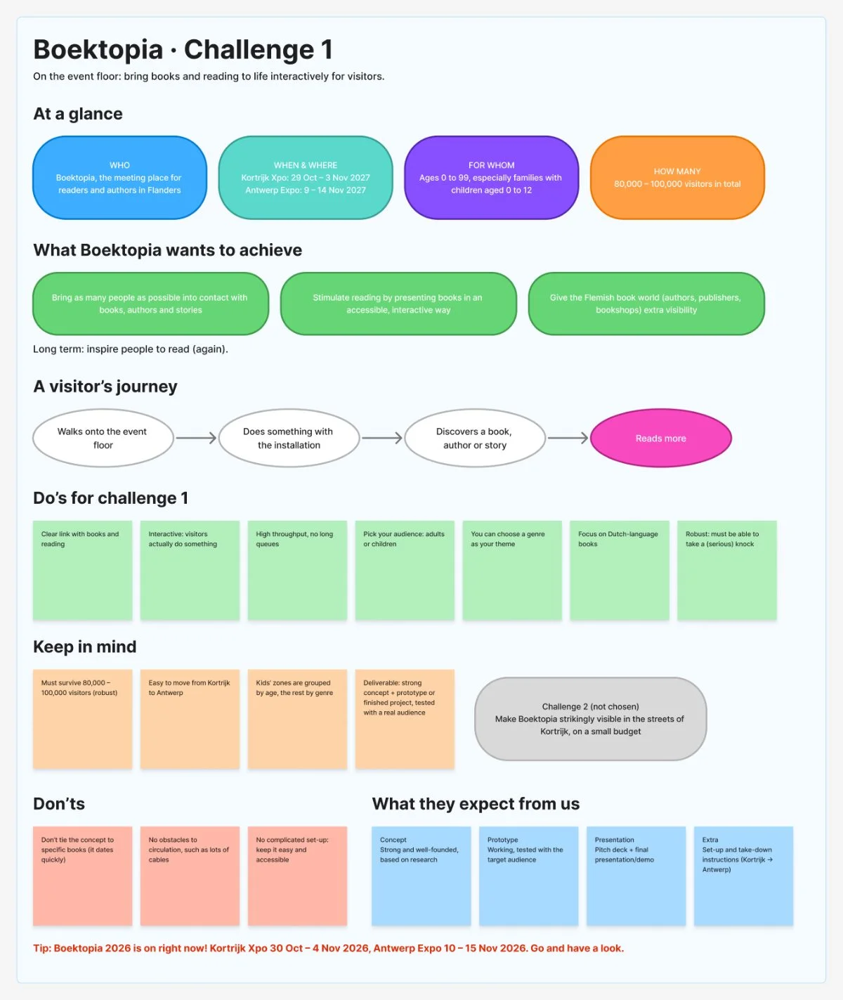
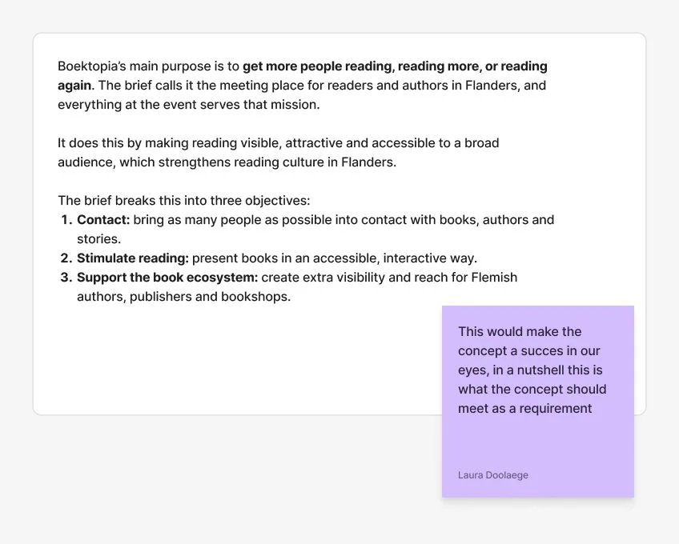
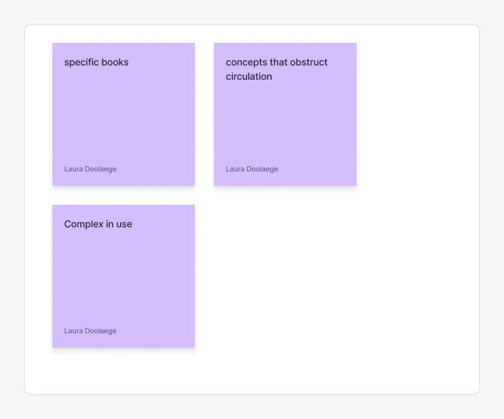
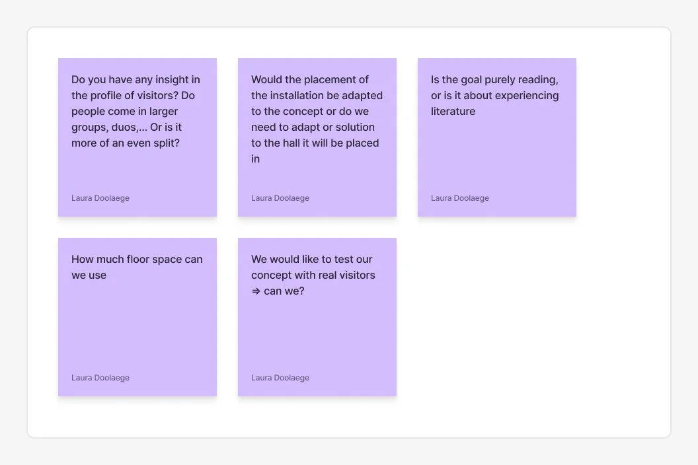

Our bachelor thesis starts from a real client: **Boektopia**, the book fair in Kortrijk Xpo that will move to Antwerp. The brief on Leho contained two challenges. As group 16 we chose **challenge 1: an interactive installation** that brings families into contact with stories and reading. Before choosing, we checked with Koen whether groups could pick their own case, so not every group would end up on the same one.

## What we did

We collected everything from the brief in one place on our FigJam board (BookTopiaBrief page): the original slides, a visual summary of the case and a checklist of the brief requirements, so everyone works from the same information.

From there we wrote down the main objectives of the installation:

The things the installation should definitely *not* do (no-go's):

And the questions we still want to ask the client:

## Key takeaways

- The installation must work for 80,000 to 100,000 visitors: high throughput, no long queues, robust.
- It must be easy to set up, take down and transport to Antwerp, with no cables on the floor.
- There has to be a clear link with books and reading, with a focus on Dutch-language books.
- Boektopia's long-term goal is to inspire people to keep reading, not just to sell books.

# AI usage in this step

## Tool and purpose
- **Tool / model:** Claude (Anthropic), working directly in our FigJam board and in the browser
- **Used for (research, design, code, writing…):** summarising the brief, building the overview and checklist, looking up visitor and accessibility info on the Boektopia website, drafting emails

## What we asked
> Go to Leho, find the Boektopia slides for the bachelor thesis and add screenshots to the BookTopiaBrief page. Add a clear checklist (we focus mainly on challenge 1) and a visual summary of the case. Afterwards: translate everything to English.

We also asked it whether the Boektopia website has data on the school groups that visit, and how Boektopia handles accessibility.

## What the AI answered
Claude placed the slides on the board, wrote a one-page case overview and a checklist of all brief requirements for challenge 1, and later translated it to English. It also drafted the email to Koen about choosing a case and the email to the other groups.

## What we used, changed or rejected
- **Used:** the slides, the case overview and the requirement checklist as our shared reference.
- **Changed:** the board was first in Dutch; we had everything translated to English. The emails were edited before sending.
- **Rejected, and why:** nothing major. The main objectives, no-go's and questions for the client were written by our team, not by the AI.

## How we checked it
- [x] Verified against a source (the original Leho slides are on the same page)
- [ ] Tested or tried out
- [x] Reviewed by a teammate

## Critical reflection
The AI was fast at turning a long slide deck into a clear overview, which saved us time. But a summary always leaves things out, so we kept the original slides next to it. The objectives, no-go's and questions needed our own judgement about what matters for our concept, so we wrote those ourselves.
