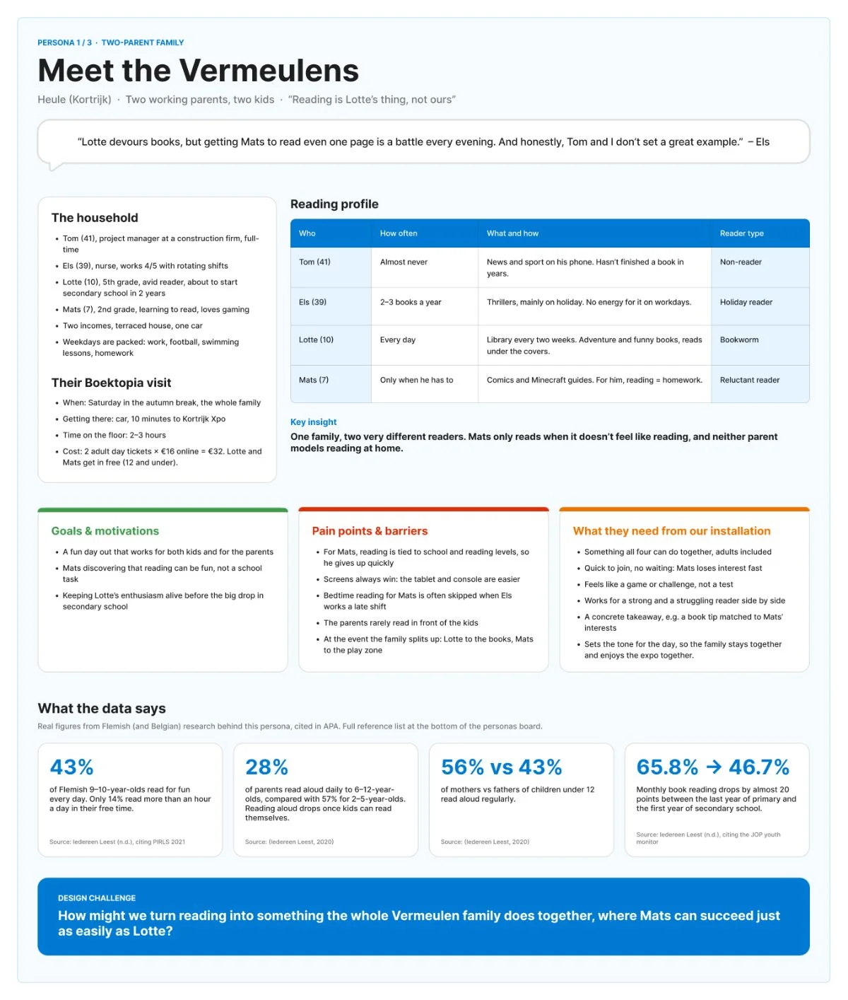
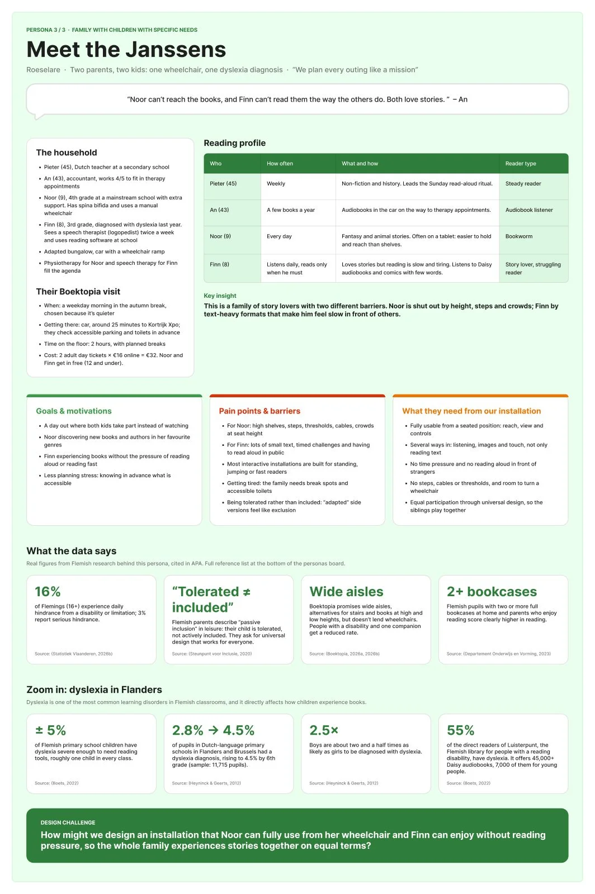

Boektopia welcomes families, so our installation has to work for a whole family at once, not just one child. To keep ourselves honest about who these families are, we made three personas of Flemish families, based on real statistics instead of assumptions. We focused on children of 6 and older and on households that are not always the "standard" picture.

## The three families

- **The Vermeulens (Kortrijk)**: a two-parent family. Lotte is a bookworm, her little brother Mats (7) is a reluctant reader who wants to play and win like in his games. At a fair, the family splits up: Lotte to the books, Mats to the play zone.
- **Sarah, Nora and Jonas (Antwerp)**: a single-parent family. Sarah can't split up, so she needs one activity where a 6-year-old and a 12-year-old can join in at the same time. Money is tight, so new books feel like a luxury, and Jonas thinks reading is "for kids".
- **The Janssens**: Noor uses a wheelchair and loves stories but often ends up watching from the sidelines. Her brother Finn has dyslexia and avoids anything that makes him read fast or out loud.

Every persona has a short story, goals, frustrations, what the family values, and statistics with sources in APA style (e.g. PIRLS, Iedereen Leest, Statistiek Vlaanderen, Gezinsbond, Steunpunt Inclusie and Statbel). We wrote our own reflection next to each persona.

## Key takeaways

- One family = very different readers: a beginner, a bookworm, a teen and sometimes a parent who never reads.
- Single parents can't split up, so an activity for "one age" doesn't work for them.
- Accessibility is not a side issue: around one child in every class has dyslexia, and children with a disability often only get "passive inclusion".

# AI usage in this step

## Tool and purpose
- **Tool / model:** Claude (Anthropic), working in our FigJam board, with web search
- **Used for (research, design, code, writing…):** researching Flemish statistics, writing and designing the personas, formatting the sources

## What we asked
> Generate personas of three families: a regular Flemish two-parent household, a single-parent household and a family with a child with special needs. Make them more detailed and professional, based on real data and sources about Flemish people. Put the sources in APA.

Follow-ups: make the non-wheelchair child in the Janssen family dyslexic and add statistics about dyslexia, and replace the Brussels figure on single-parent households with figures for Antwerp and Kortrijk.

## What the AI answered
Claude searched for Flemish data on reading motivation, family types, poverty, disability and dyslexia, then built three persona cards in our board, each with the sources in APA style.

## What we used, changed or rejected
- **Used:** the three families, the statistics and the APA source list.
- **Changed:** the first version was too simple, so we asked for more detail and real data. We changed the second child of the Janssens to have dyslexia, and asked for local figures (Antwerp, Kortrijk) because Boektopia takes place in Kortrijk and Antwerp.
- **Rejected, and why:** a Brussels statistic, because it didn't fit our location.

## How we checked it
- [x] Verified against a source (every figure links to a source in the list)
- [ ] Tested or tried out
- [x] Reviewed by a teammate

## Critical reflection
The AI makes realistic-sounding personas very quickly, which is also the danger: a persona can feel true without being true. That is why we insisted on real Flemish sources and checked them. The personas are still made-up people, so we want to test our assumptions with real families and with Boektopia later on.
