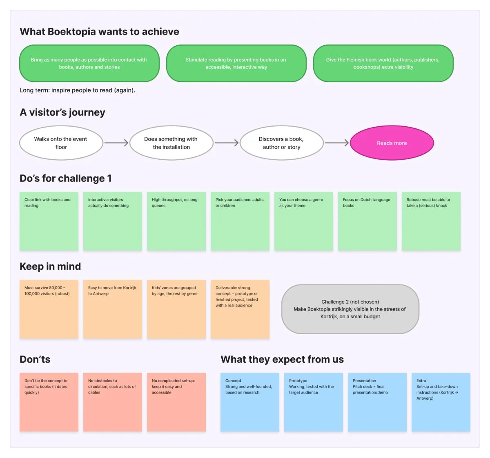
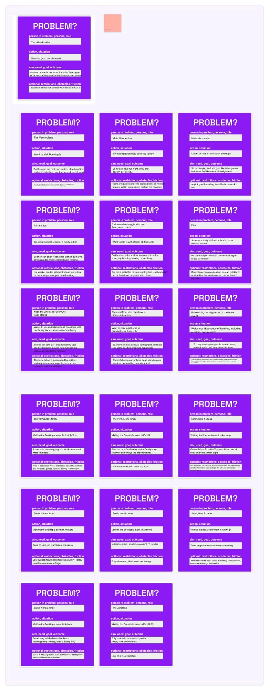

With the personas in place, we looked for the concrete problems these families run into at Boektopia. Each of us wrote problem cards in the same structure: **people, situation, aim/need and restriction**, so we could compare them later.

## Keep in mind

First we put the most important constraints from the brief and our research next to each other, so every problem card could be checked against them.

## The problem cards

A few examples of what came out of it:

- Mixed reading levels: the weaker reader falls behind, while the strong reader gets bored.
- Mats wants to play and win; a lot of reading feels like a school assignment to him.
- Sarah needs one activity that a 6-year-old and a 12-year-old can join at the same time.
- Noor watches from the sidelines when there are cables, steps or standing-only controls.
- Finn drops out as soon as an activity asks him to read quickly or out loud.
- Queues and long explanations make kids lose interest within minutes.

We also highlighted what these families value: doing something *together*, free access, and not being singled out.

## Key takeaways

The problems are not just about "reading". They are about **families splitting up, kids feeling tested, and some kids being left out**. That shaped the next step: ranking which problems to solve first.

# AI usage in this step

## Tool and purpose
- **Tool / model:** Claude (Anthropic), indirectly
- **Used for (research, design, code, writing…):** the "Keep in mind" summary is based on the brief overview and personas from steps 1 and 2, which were made with AI

## What we asked
> No new prompt in this step. We reused the AI-made brief summary and personas as input.

## What the AI answered
Not applicable: the problem cards themselves were written by our team.

## What we used, changed or rejected
- **Used:** the brief requirements and persona facts as a checklist for the "Keep in mind" list.
- **Changed:** we rewrote and grouped the points in our own words.
- **Rejected, and why:** we did not let the AI write the problem cards, because this is where our own understanding of the families has to come in.

## How we checked it
- [x] Verified against a source (the brief and the persona sources)
- [ ] Tested or tried out
- [x] Reviewed by a teammate

## Critical reflection
This was the step with the least AI, on purpose. Writing the problem cards ourselves forced us to really think through each family's situation. The risk is that our cards depend on the personas, which are partly AI-made, so any blind spot there carries over into the problems.
