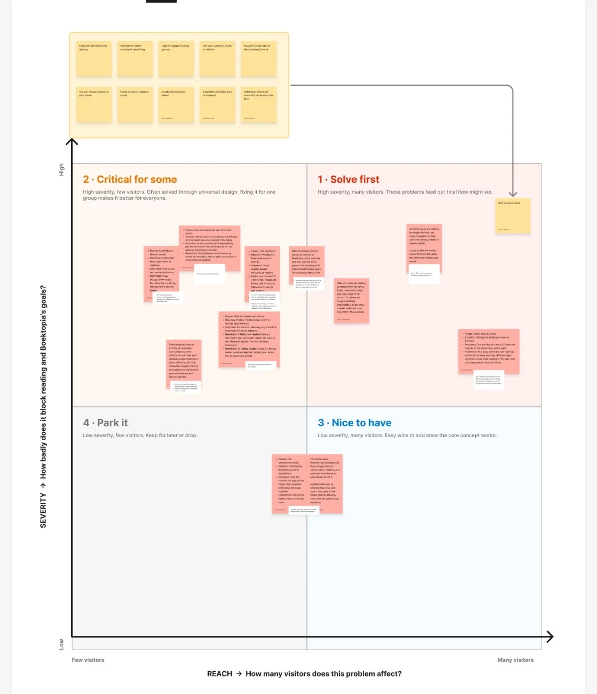
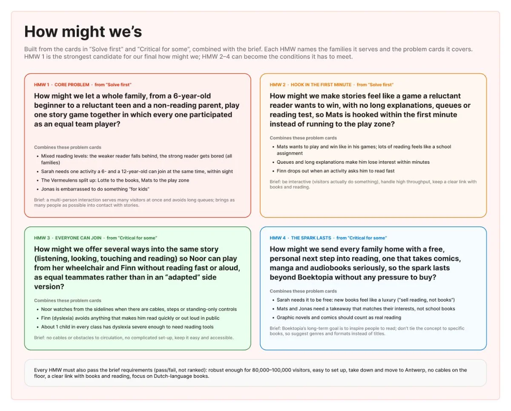
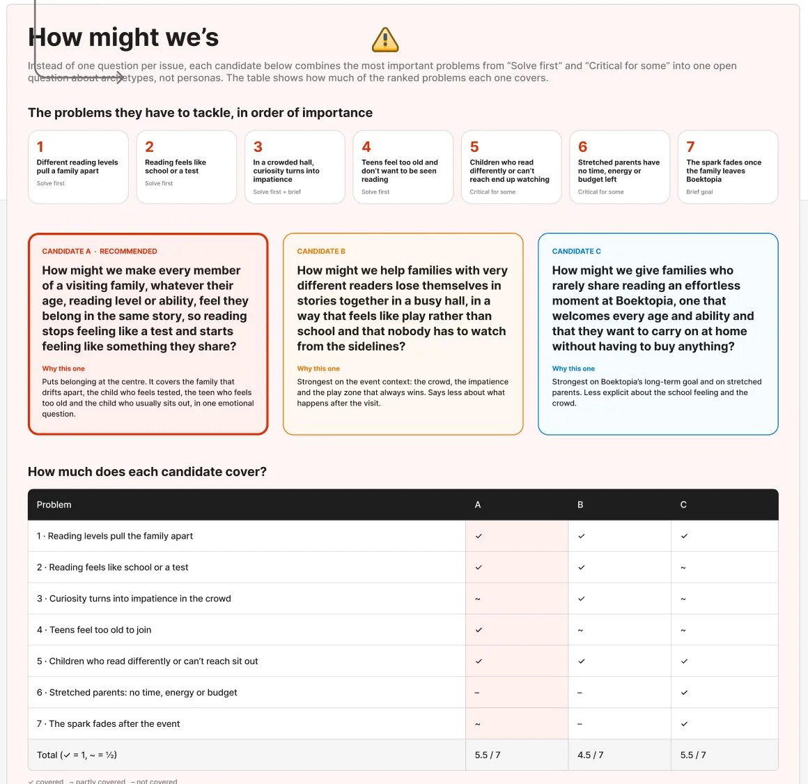
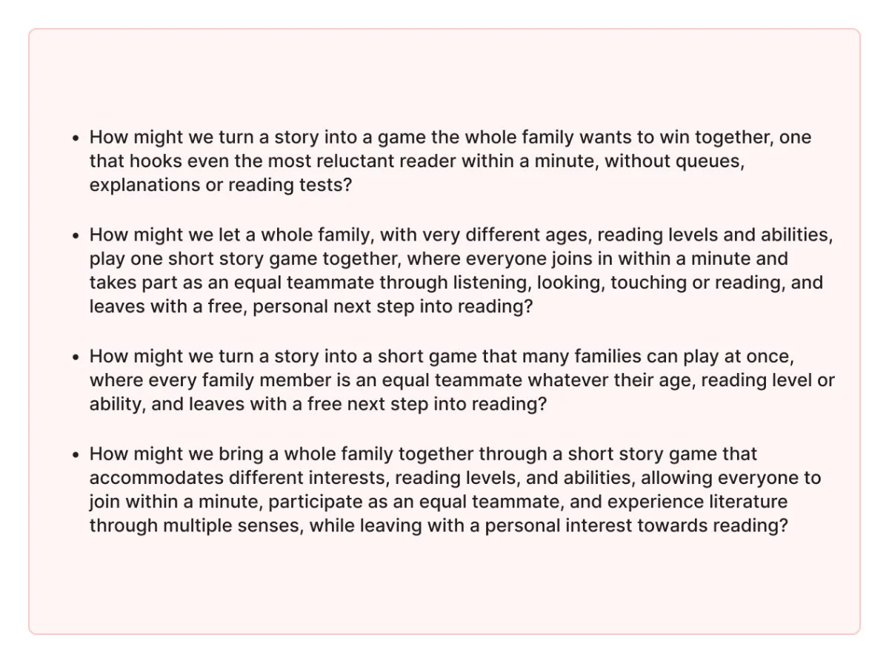
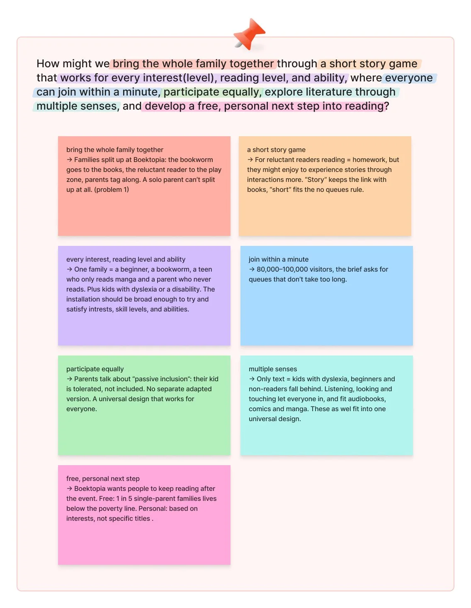

We had more problems than we could solve, so we needed to decide which ones matter most. We did this in two parts: a problem severity grid, then how might we (HMW) questions.

## The problem severity grid

We placed every problem card on a 2x2 grid:

- **Severity:** how badly does it block reading and Boektopia's goals?
- **Reach:** how many visitors does the problem affect?

That gives four zones: **Solve first** (severe, many visitors), **Critical for some** (severe, fewer visitors, often solved with universal design), **Nice to have** and **Park it**. The brief requirements sit above the grid as pass/fail conditions.

## From problems to how might we questions

From the "Solve first" and "Critical for some" zones we wrote HMW questions. The first round each focused on one problem:

That was too scattered. We wanted questions that describe archetypes instead of our personas, and combine the most important problems into one. So we compared combined candidates and checked how many of the ranked problems each one covers:

Then we wrote our own versions as a team:

## Our final how might we

> How might we bring the whole family together through a short story game that works for every interest (level), reading level, and ability, where everyone can join within a minute, participate equally, explore literature through multiple senses, and develop a free, personal next step into reading?

We highlighted each part of the question and explained in a matching colour why it is there and which problem it comes from:

# AI usage in this step

## Tool and purpose
- **Tool / model:** Claude (Anthropic), working in our FigJam board
- **Used for (research, design, code, writing…):** building the empty grid, analysing the grid into HMW suggestions, comparing HMW candidates, highlighting the final HMW

## What we asked
> Make a scale in the problem severity frame (four-quadrant axis). Based on the positions of the problems in our current quadrants, write a few good how might we questions, not basic ones.

Follow-ups: make them deeper and about archetypes rather than specific personas, so they spark an empathic question; then combine them into one HMW that tackles the most important problems. Finally: mark parts of our final HMW and explain why each part is there, with the explanation in the matching colour, in our own board style ("don't make it look too AI-ish").

## What the AI answered
Claude drew the grid and axes (empty, without placing anything). After we placed the cards, it wrote four HMWs per problem area, then three combined candidates with a table showing how many of the 7 ranked problems each covers. At the end it highlighted the parts of our final question.

## What we used, changed or rejected
- **Used:** the grid structure, the coverage table as a way to compare candidates, and the highlight layout.
- **Changed:** the AI's candidates were starting points. We wrote our own versions and our final HMW is a team formulation. We also restyled the highlights to match our board.
- **Rejected, and why:** the first single-issue HMWs (too narrow) and HMWs that named our personas (too specific; we wanted archetypes).

## How we checked it
- [ ] Verified against a source
- [ ] Tested or tried out
- [x] Reviewed by a teammate (placing the cards and choosing the final HMW was a team discussion)

## Critical reflection
The AI was good at seeing patterns across all cards and making many variations, and the coverage table helped us compare objectively. But its first questions were either too narrow or too long and "AI-sounding". Placing the problems on the grid and choosing the final wording had to be our own decision. Our final HMW is long; we want to check that it stays usable as a test for our concepts.
