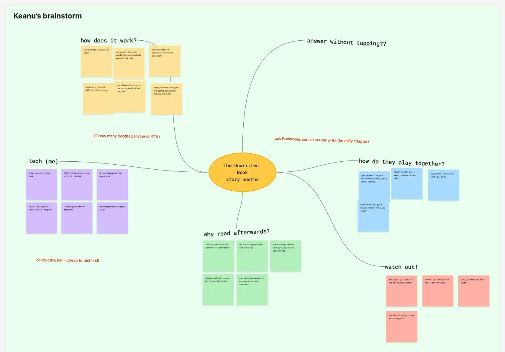
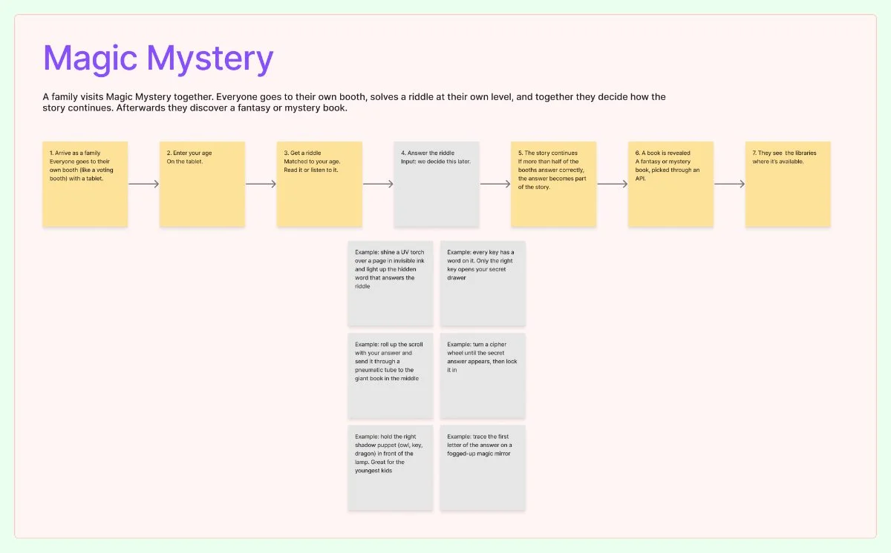

With our final how might we as a guide, each of us started brainstorming concepts in our own frame. This post is about **Keanu's brainstorm** and the concept that came out of it: **Magic Mystery**.

## Brainstorm

The starting point: the family needs a **shared goal**, the input has to be more interesting than pressing buttons, and it must include text, without feeling like a reading test. Riddles turned out to be a good fit: you have to read (or listen) to solve them, but it feels like a game.

## The concept: Magic Mystery

A family solves a mystery together by walking past booths at Boektopia:

1. At each booth the family solves a riddle. The difficulty is based on age, so a 6-year-old and a 12-year-old can both contribute.
2. Every solved riddle gives a word, and the words together build a story.
3. When the family has visited more than half of the booths, they go to the final booth (a tablet / voting booth) to solve the mystery together.
4. At the end, they get suggestions for mystery and fantasy books, with the regular price and the libraries where they can borrow them for free, so the story continues at home.

For now we focus on the **user flow**. The exact input (how the family answers a riddle) is something we'll work out later.

# AI usage in this step

## Tool and purpose
- **Tool / model:** Claude (Anthropic), working in our FigJam board, with web search
- **Used for (research, design, code, writing…):** generating first concept ideas, organising the brainstorm, looking up book/library data sources, drawing the user flow

## What we asked
> Based on the context you have, help brainstorm some concepts. Think about the input, word keys, an enemy with HP, the technical side. Add it in Keanu's brainstorm.

Follow-ups: "I didn't really like any of those concepts", a shared common goal, input more interesting than buttons, riddles; then the booth/riddle/majority idea; make it look more like a brainstorm; show random mystery and fantasy books with price and libraries; and finally "you're going way too far with the possibilities, stay with what I did, the user flow is most important".

## What the AI answered
Claude's first concepts were rejected. After Keanu described his own idea (booths, riddles that build a story, age-based difficulty, more than half of the booths, a final booth), Claude organised it as a mind map, looked into book data sources such as the Flemish library catalogue (Cultuurconnect), and drew the Magic Mystery user flow.

## What we used, changed or rejected
- **Used:** the mind-map layout, the research on book/library APIs, and the visual user flow.
- **Changed:** the AI kept adding extra features. We cut the flow back to Keanu's own idea and removed the emojis so it matches our board style.
- **Rejected, and why:** the AI's first concepts (didn't feel like a shared family goal) and the extra possibilities it added to the flow (too much for this stage).

## How we checked it
- [ ] Verified against a source
- [ ] Tested or tried out
- [x] Reviewed by a teammate

## Critical reflection
The AI was useful as a sparring partner and for making the brainstorm visual quickly, but the core idea came from us. It tended to overdo things, adding features and possibilities we didn't ask for, so we had to keep steering it back. Next step: score the concepts of the whole team and test whether the riddles really work for every age.
