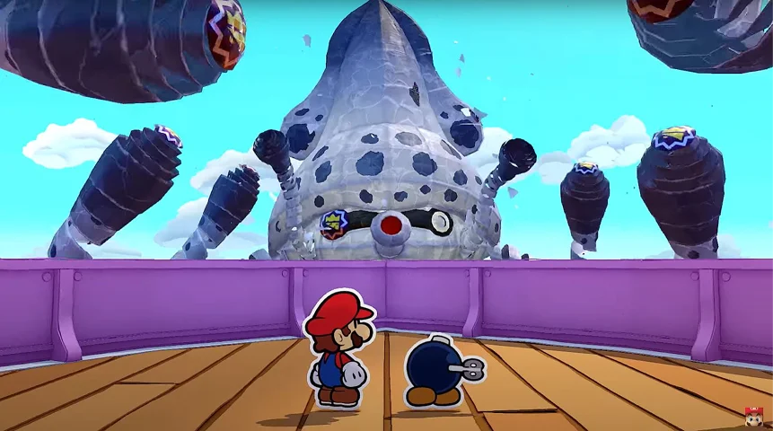
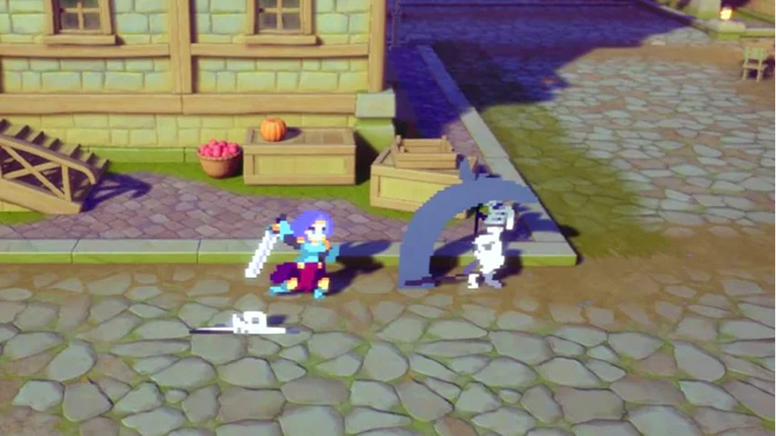
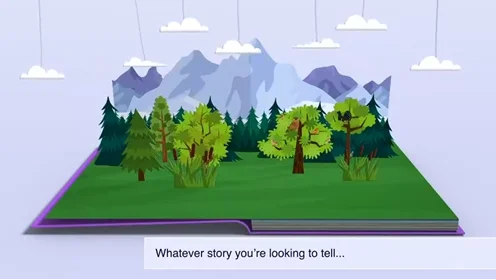
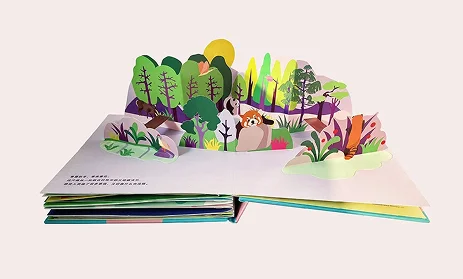
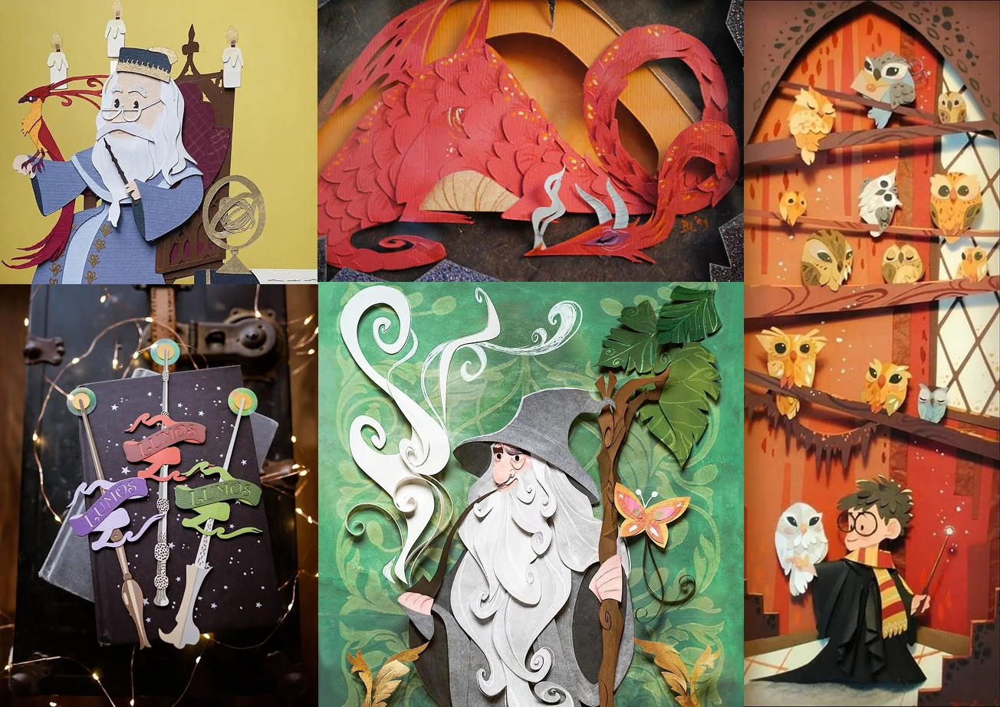
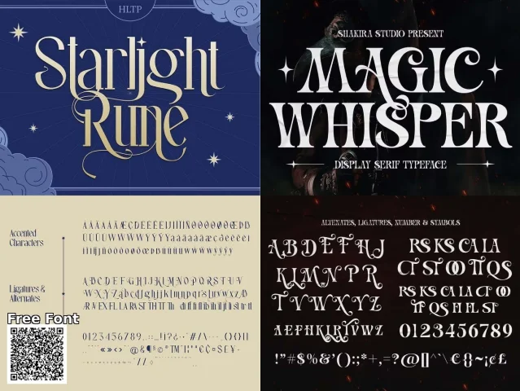
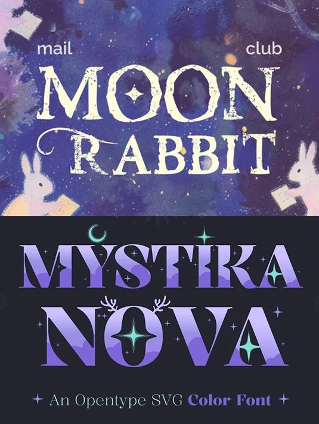
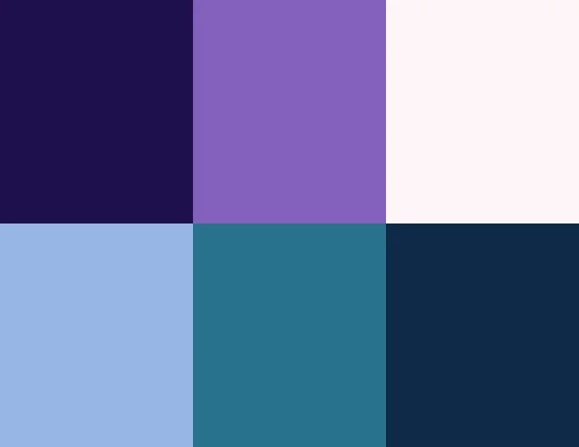
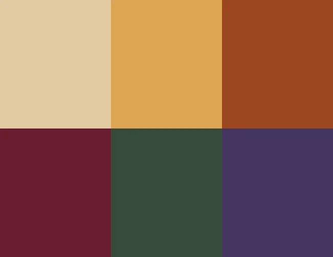
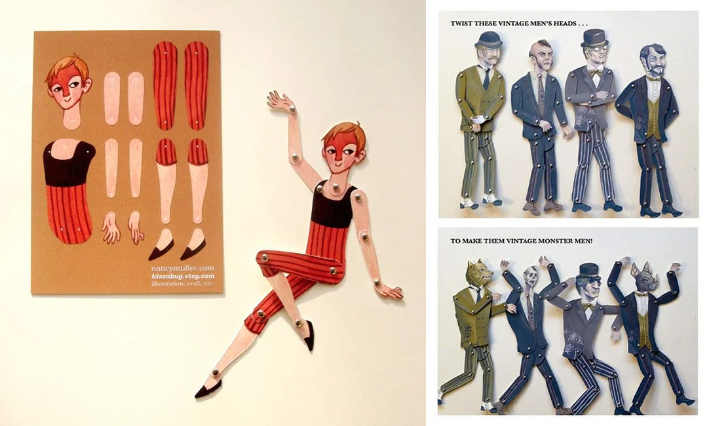

## Is it technically possible?
At first, once we agreed on the rough concept of the game, we were discussing on the technical possibility of some design ideas.

###The questions we had
All 3 of us sat together and brought up our ideas:
- Can we create a hologram projection?
- Can we make 3d design and export it as png and mp4?
- Can we build a 3d environment within the website?

###Those options were not suitable
**After a long time discussing, we decided to work on non of the paths above because**
- **Hologram projection:** Might be over the budget, also not robust nor easy to transfer
- **3d model in blender and export it as png and mp4:** This might be very time-consuming since we will work on a detailed dragon. This might take a long time to model, apply materials, animate and especially render the animation. This can be a big obstacle for us, especially when we have to test out the website multiple times within limited time.
- **3d models and 3d environment within the website:** Keanu already did something like this, so we know it's plausible. However, this might not meet our goal for visual design since the engine Keanu use can only support simple shapes/ take a long time to load if we want more complex shapes.  

## Our solution

### 2d/3d hybrid
We decided to design 2d elements, character standing on 3d ground. In this way, we can:
- Save time in animating, rendering, exporting
- Achieve detailed illustration
- Achieve an immersive experience 

**Example of 2d/3d hybrid in other games**

###How would we apply it
The game environment will resemble an open pop-up book to visually connect the game with books and reading.
Only the ground will be 3d. Other elements will be 2d.

The game elements will be designed to look like paper cut-outs from a pop-up book, matching the overall game environment.

## Making it accessible

###Typography
While looking for inspiration for typography, we were gonna go with this:

It looks beautiful and definitely has a magical fantasy vibe. However, it was not so readable, especially for kids and for people with dyslexia. That's why we ended up with more rounded, readable, and less intricate but still stylised fonts for the headers.

###Color palette
This is our first option for the color palette:

However, this is a cool tone color palette, this might make the game look a bit more scary and less welcoming, especially for kids. That's why we changed the color palette into this:

## Future plan for animation:
- We plan to animate the introduction video and the ending scene of the game on After Effects. 
- We want the scenes to be open and closed like a pop up book.
- For the movement of each character and the dragon, we plan to animate them like jointed paper puppets.
**Example jointed paper puppets**

