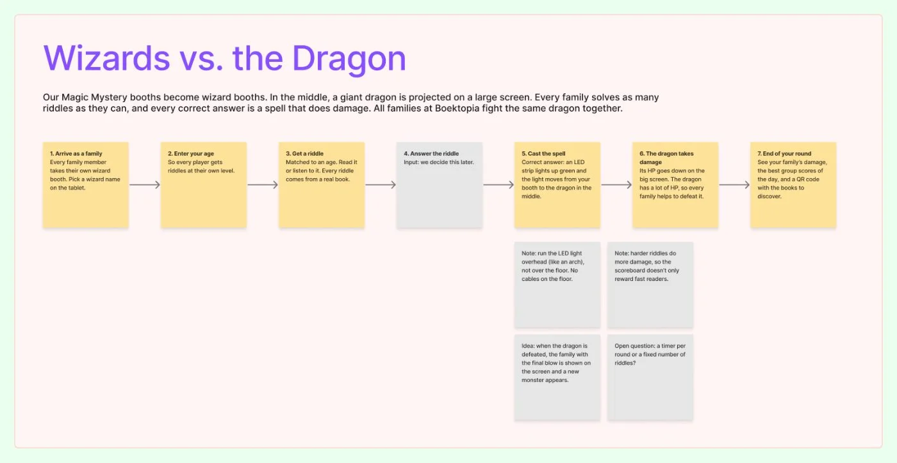

After the first round of brainstorming we had Magic Mystery: family members each solve a riddle in their own booth, and the answers build a story together. It worked on paper, but the interaction still felt flat. So we went back to a blank sheet.

## What we did

**A blank sheet.** First we collected new, "interesting" concepts: a spell table with word tiles, a walk-in locked book with roles for every family member, shadow theatre, a sound studio, drawings that come alive, and a story train.

**Reality check.** Most of these were too big for a team of three students with a small budget (projection worlds, a ride-on train, animated drawings). So we did a second round with ideas that are buildable from cardboard, cheap electronics and a simple web app: a wolf you interview with question cards, whispering phones, a dark cave with UV torches, mystery feel boxes, word fishing and a book hospital.

**The idea that stuck.** Then we "Dungeons & Dragons-ified" our own Magic Mystery idea. The booths become wizard booths, and a big monster stands on a screen in the middle. Every correct riddle is a spell: an LED strip lights up green and the light travels from your booth to the monster. That became **Wizards vs. the Orc**, which the team later renamed to **Wizards vs. the Dragon**. As a group we decided that this concept had the most potential, so we continued with it.

**The riddles.** For the game we need a lot of riddles linked to real books. We made a JSON file with 106 "Wie ben ik?" riddles in three age groups (6–9: animals from picture books, 10–14: comic and children’s book characters, 15+: characters from Flemish literature and crime novels). Each riddle has three clues from hard to easy and a bookId with the ISBN, so the game can later show the book behind every character.

## Unhappy flow: what didn’t work

- **Too ambitious.** The first set of concepts looked great but wasn’t realistic for us. We had to start over with buildability as a rule.
- **Quiz questions are not riddles.** The first riddle file was full of trivia questions (“Who wrote...?”). Those are questions, not riddles. We switched to “Wie ben ik?” riddles about characters, so families can solve them even if they don’t know the book.
- **Generic riddles lose the link with books.** Popular riddles from the internet are fun, but they don’t lead anyone to a book. That’s why every riddle is about a real character.
- **One booth, one family or one player?** We kept mixing this up in our documents. In the end: every family member has their own podium.

# AI usage in this step

## Tool and purpose
- **Tool / model:** Claude (Anthropic), in the chat and directly in our FigJam board
- **Used for (research, design, code, writing…):** generating concept ideas, feasibility checks, writing the riddle file, looking up book data (ISBNs via Open Library), adding the concept flow to FigJam

## What we asked
> Back to brainstorming, a blank sheet: come up with interesting concepts. The concept can be cool, but it must be doable for 3 students with limited resources.

Later: “What if we Dungeons & Dragons-ify it a little?” (Keanu’s own idea), and “make a JSON file with over a hundred riddles from Flemish books, in three age groups, with a bookId”.

## What the AI answered
Claude gave two rounds of concepts (one ambitious, one cheap and buildable), then gave feedback on the orc idea: strengths, risks (cables on the floor, a fair scoreboard, the link with reading) and a simple user flow. It wrote the riddle file and looked up ISBNs.

## What we used, changed or rejected
- **Used:** the feasibility check, the feedback on the orc idea and the riddle file.
- **Changed:** the riddles had to be rewritten completely, because the first version was quiz questions. Booth = one player, not one family.
- **Rejected, and why:** all the AI concepts. The concept we kept was Keanu’s own idea, built on our earlier Magic Mystery.

## How we checked it
- [x] Verified against a source (ISBNs via Open Library, uncertain facts via web search)
- [ ] Tested or tried out
- [x] Reviewed by a teammate

## Critical reflection
The AI was good at generating lots of options quickly and at pointing out what is buildable, but its ideas were either too big or generic. The concept that won came from us. With the riddles, the AI first did exactly what we asked in a literal way (questions from books) instead of what we meant (real riddles). Writing clear prompts matters. Some facts in the riddles still need a check by a teammate.
