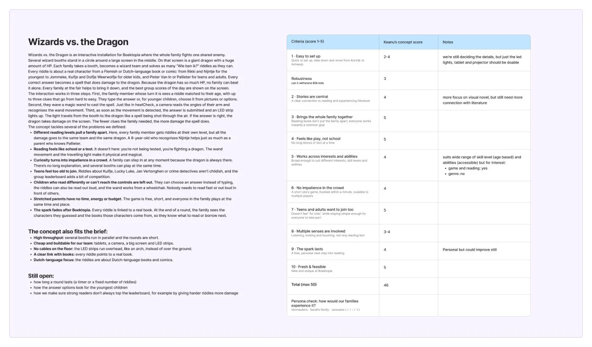
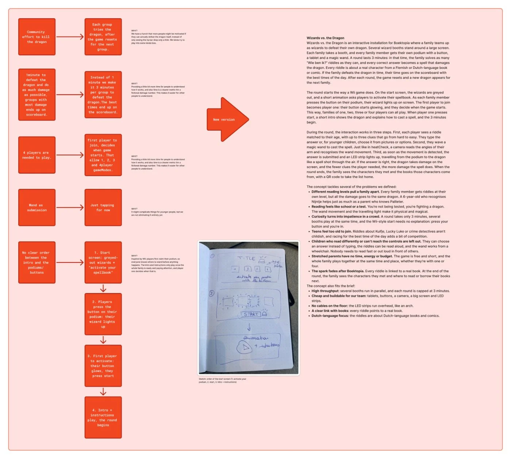

With one concept chosen, we checked it against the scoring matrix we made earlier. The criteria come from the brief and from our persona insights, so the concept is judged on both.

## Scoring

Wizards vs. the Dragon scored **46 out of 50**. Strong points: it brings the whole family together (5), it feels like play, not school (5), teens and adults want to join too (5), and it’s fresh and feasible (5). Weaker points: robustness for 80,000 kids (3), multiple senses (3–4) and setup (2–4), because we hadn’t decided all the details yet. The link with stories (4) and the take-home step (4) can still improve.

## Feedback and changes

Next to the matrix we wrote feedback on stickies: the dragon should be beatable, reading-strong players still have an advantage (maybe hints), a headset for the voice-over in a noisy hall, and the question “how is the user flow going to work?”. From that, we made these changes:

- **One shared dragon → a dragon per family.** Each family tries to defeat its own dragon, and the game resets for the next family. We have a hunch that people stay more motivated if they can actually win, instead of seeing a shared HP bar drop only a little.
- **1 minute → 3 minutes.** More time to understand how it works. And a time (“defeated in 2:14”) is clearer on the scoreboard than a made-up damage number.
- **4 players needed → 1 to 4 players.** The first player to join decides when the game starts, so small families and single parents can play too.
- **Wand as submission → just tapping, for now.** The wand might complicate things for the youngest. We’re not dropping it yet.
- **No clear order → a Wii-style start.** Start screen with greyed-out wizards, each player presses the button on their podium and their wizard lights up, player one presses start, then the intro plays. Everyone knows where to stand before anything happens.

## Unhappy flow
- The shared “community” dragon sounded nice, but nobody would ever see it die. That killed the motivation, so we dropped it.
- Requiring exactly 4 players would have excluded the single-parent family from our own personas.
- Setup and robustness score low because we simply didn’t know enough yet. That pushed us to work out the technical side next.

# AI usage in this step

## Tool and purpose
- **Tool / model:** Claude (Anthropic)
- **Used for (research, design, code, writing…):** writing the first concept summary that we placed next to the matrix

## What we asked
> Make a summary of our concept in a clear block of text with different paragraphs. It should clearly explain which problems it’s already solving.

## What the AI answered
A structured concept text: what the game is, how the interaction works (riddle, wand, LED spell) and which of our 7 problems it tackles.

## What we used, changed or rejected
- **Used:** the structure of the summary.
- **Changed:** the team rewrote it for the new version (dragon instead of orc, a dragon per family, 3 minutes, Wii-style start).
- **Rejected, and why:** nothing. The scores, the feedback and all the changes are our own decisions.

## How we checked it
- [ ] Verified against a source
- [ ] Tested or tried out
- [x] Reviewed by a teammate

## Critical reflection
Scoring our own concept is biased: we like it, so the scores are probably too high. The real test is with families. The AI summary helped us explain the concept quickly, but every change in this step came from discussing it as a team.
