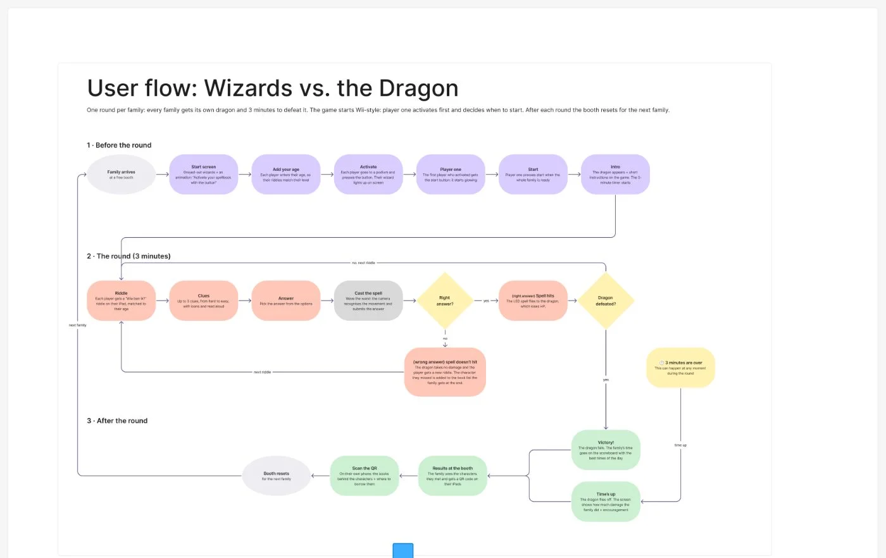
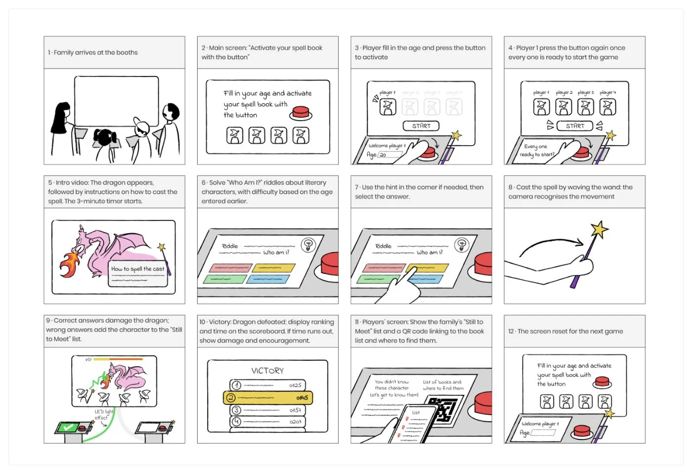
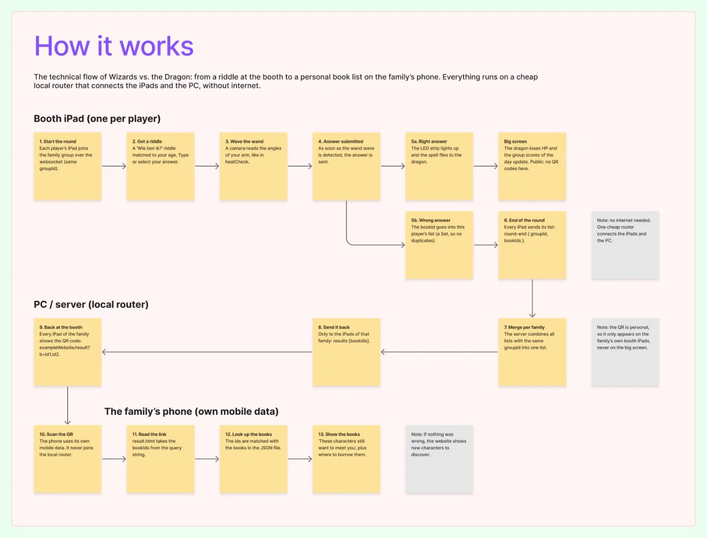
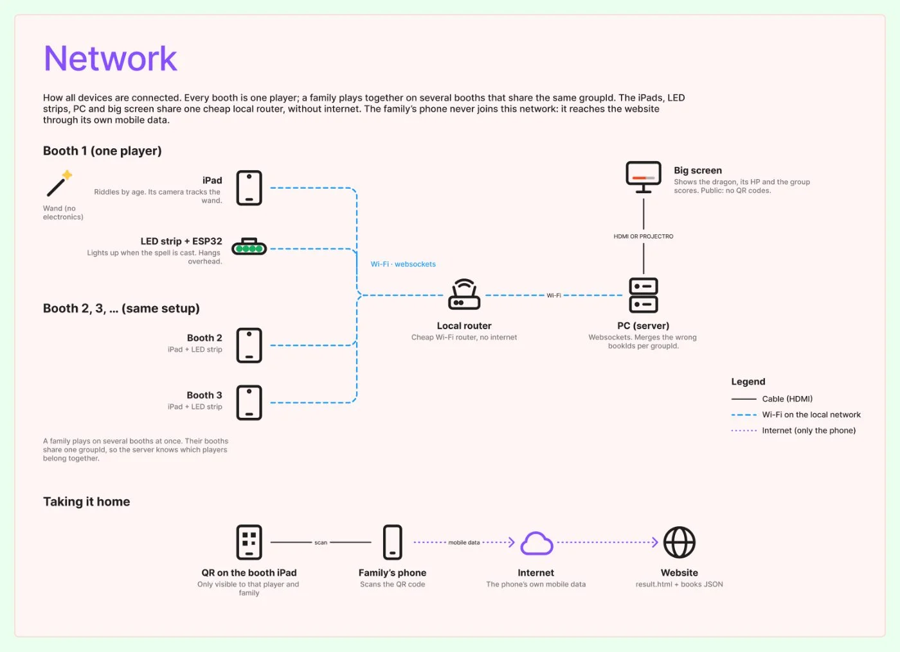
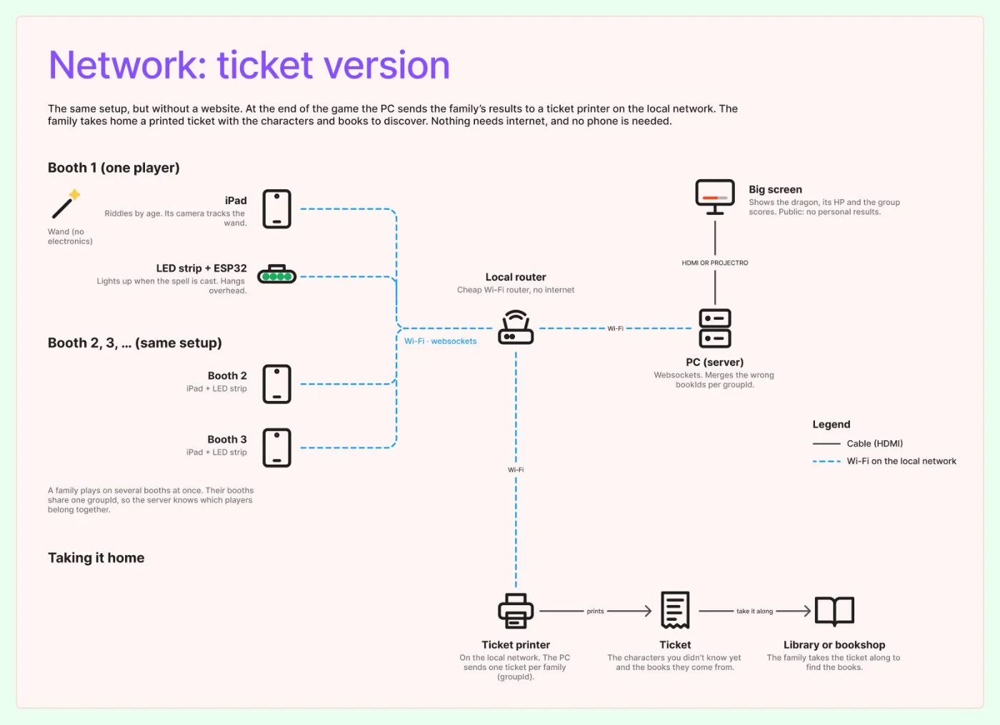
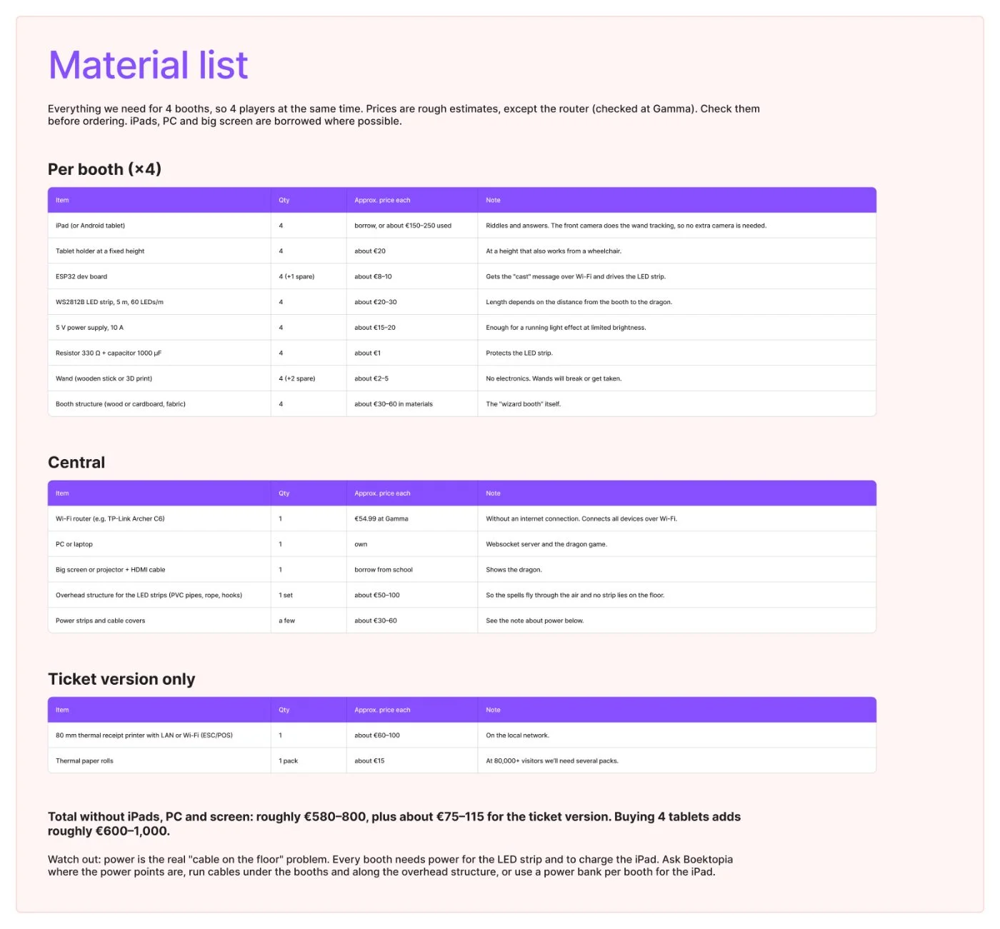
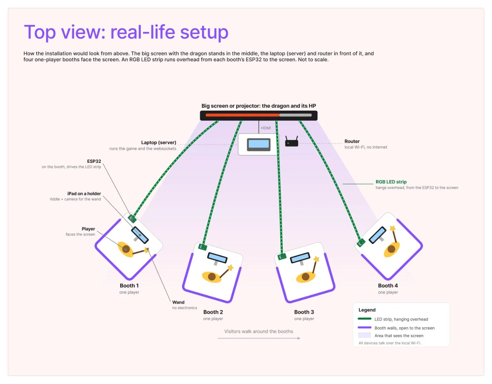

After the changes, the big question was: how does this actually work, for the family and technically? In this step we worked that out from the user’s side and from the developer’s side.

## User flow and storyboard

We mapped one round from start to finish: before the round (start screen, add your age, activate your podium, player one starts, intro), the round itself (riddle, clues, answer, cast the spell, right or wrong) and after the round (victory or time’s up, results at the booth, scan the QR, the booth resets). The unhappy paths are in there too: a wrong answer means the spell fizzles, the character goes on the family’s “still to meet” list, and the player gets a new riddle.

Then we sketched the storyboard by hand, panel by panel.

## The technical flow

Everything runs over websockets on a local network. Each player’s iPad keeps a list of the bookIds they got wrong. At the end of the round, every iPad sends its list to the server (the laptop). The server combines the lists of the same family (groupId) and sends the result back to that family’s iPads only. The iPad turns it into a QR code: a link to our website with the bookIds in the query string. On the phone, the website reads the ids, looks them up in the JSON file and shows the books.

## Network

All devices (iPads, ESP32s for the LED strips, laptop) are connected to one cheap Wi-Fi router **without internet**. It’s only there so the devices can find and talk to each other. The family’s phone never joins this network: it reaches the website through its own mobile data.

We also made a second version without a website: a ticket printer on the local network prints the family’s book list. No phone or internet needed.

## Material list and top view

A material list for 4 booths, with rough prices (only the router was checked): about €580–800 without the iPads, laptop and screen, which we hope to borrow.

And a top view of how it would look in real life: the screen with the dragon in the middle, the laptop and router in front of it, four one-player booths facing the screen, and an LED strip running overhead from each booth to the screen.

## Unhappy flow

- **The QR can’t carry everything.** We first thought of putting all right and wrong answers in the link, but that’s far too much data. Now only the bookIds of the wrong answers go in the link.
- **The QR is personal.** It must never appear on the big screen, only on the family’s own iPads.
- **Our drawings had mistakes.** The first network drawing showed one booth per family and a ticket printer in the website version. Both were wrong. We fixed it and made the ticket version a separate drawing.
- **Ethernet or Wi-Fi?** The first drawing connected the laptop with a cable. We switched to Wi-Fi to keep it simple.
- **Power is the real cable problem.** Every booth needs power for the LED strip and the iPad. That’s still open.

# AI usage in this step

## Tool and purpose
- **Tool / model:** Claude (Anthropic), in the chat and directly in our FigJam board
- **Used for (research, design, code, writing…):** technical advice (websockets, getting data to the phone), the technical flow, both network drawings, the material list and the top-view drawing

## What we asked
> Since everything works with websockets: each station builds an object with right and wrong answers, the server merges them, and the users get their data through a QR code. How do we get the data from the screen to their phone if they’re not on our router?

Then: make a visual of how it works in FigJam, a networking drawing with real icons, a version with the ticket system, a material list for 4 booths and an SVG top view of the real setup.

## What the AI answered
Claude advised letting the server combine the data per family instead of sending everything to everyone, and putting only small ids in the QR link. It drew the technical flow, the two network drawings with icons, the material list table and the top view.

## What we used, changed or rejected
- **Used:** the technical flow, the network drawings, the material list and the top view.
- **Changed:** Keanu corrected several mistakes: one booth is one player, not one family; the website version has no printer; the laptop connects over Wi-Fi, not Ethernet. The idea to send only bookIds was Keanu’s own.
- **Rejected, and why:** email as a way to send results (needs internet and collects personal data).

## How we checked it
- [x] Verified against a source (router price at Gamma)
- [ ] Tested or tried out
- [x] Reviewed by a teammate

## Critical reflection
The AI was fast at turning our technical idea into clear drawings, but it made assumptions that didn’t match our concept, like one family per booth. Without checking every drawing ourselves, those mistakes would have ended up in our pitch. Most prices in the material list are still estimates, and nothing is built or tested yet.
