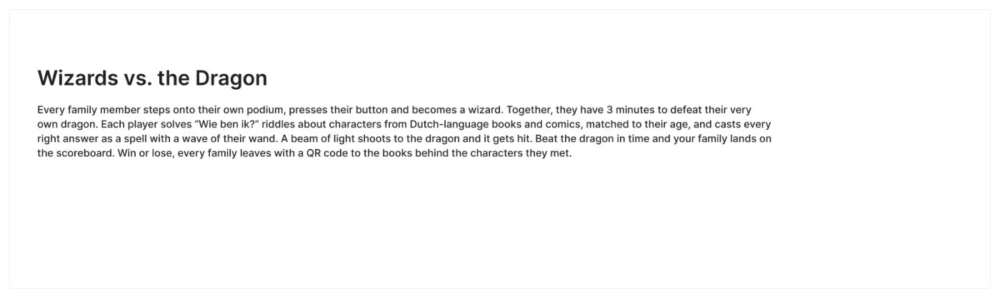
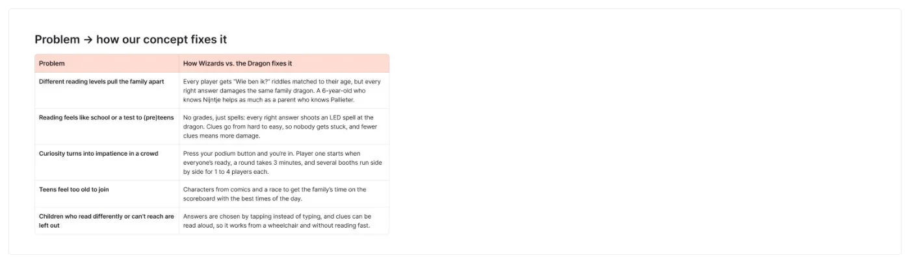
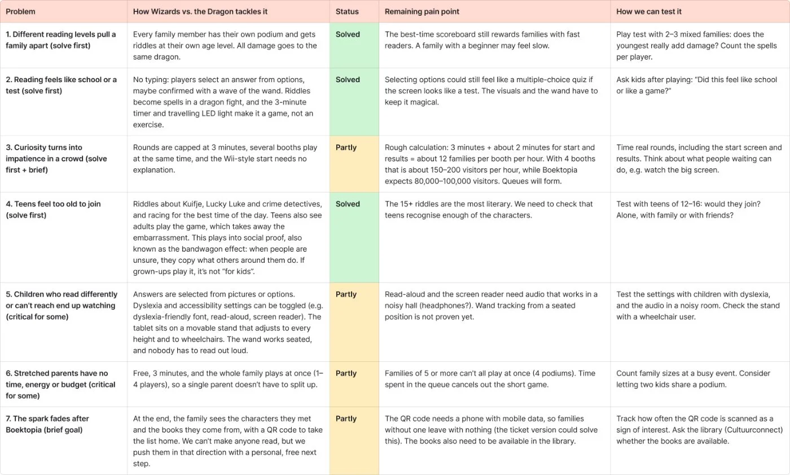
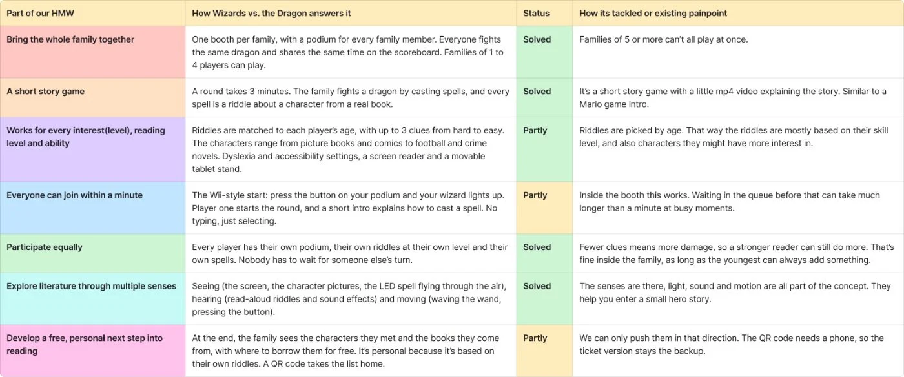

With the concept and the technical side in place, we started building our pitch and checked honestly how well the concept answers everything we set out to solve.

## Pitch structure

The pitch follows our process: a hook (a busy event pulls families apart: one kid runs to read, the other to the play zone; what if we brought them back together by turning reading into play?), our how might we question, the concept in text, the storyboard, why it works, how it works, and what it will look like.

“Why it works” links every problem and every brief requirement to a part of the concept:

## Project validation

The pitch shows why it works. The validation shows where it doesn’t work yet. We checked the concept against our 7 problems, the brief and every part of our how might we question, with a status (solved, partly, open), the remaining pain point and how we can test it.

**Solved:** bringing the family together, everyone participates equally, it doesn’t feel like school (no typing, just selecting an answer, maybe confirmed with the wand), and teens join because they see adults play too. That last one plays into **social proof**, also called the bandwagon effect: when people are unsure, they copy what others around them do.

**Still partly solved:**
- **Queues.** With 3-minute rounds and 4 booths we can handle roughly 150–200 visitors per hour. Boektopia expects 80,000–100,000 visitors, so queues will form.
- **Accessibility.** Dyslexia and accessibility settings, a screen reader and a movable tablet stand help, but read-aloud needs audio that works in a noisy hall.
- **The story.** It’s a short game, but the story is thin: the riddles are separate characters, not one story.
- **The spark after Boektopia.** We can’t make anyone read, we can only push them in that direction with a free, personal next step. The QR code needs a phone, so the ticket version stays the backup.

## Unhappy flow
- The first validation was too negative on some points because it was based on an older version of the concept (with typing, and without accessibility settings). We corrected it.
- None of these statuses are tested with families yet. They’re our own judgement, and the next step is to test them.
- Our coach asked us to show the unhappy flow in the blog too. That’s why every post from now on has this section.

# AI usage in this step

## Tool and purpose
- **Tool / model:** Claude (Anthropic), directly in our FigJam board
- **Used for (research, design, code, writing…):** making the project validation tables and pain points

## What we asked
> Look for the new concept in “Changes we made” and validate how we solve the problems we defined yesterday, and where there are still pain points. Then validate it against our how might we question.

## What the AI answered
Three tables (problems, brief, how might we), each with a status, the remaining pain point and a test idea, plus six stickies with the biggest pain points: throughput, a fair scoreboard, input, sound, the camera at a children’s event, and taking it home.

## What we used, changed or rejected
- **Used:** the structure of the validation and most of the pain points.
- **Changed:** Keanu corrected the AI where it used old information: there’s no typing, there are dyslexia and accessibility settings, a screen reader and a movable stand, and teens see adults play (social proof). We also reframed the spark fading: you’re never fully convinced, you can only push families in that direction.
- **Rejected, and why:** the pitch structure itself was built by the team, not by the AI.

## How we checked it
- [ ] Verified against a source
- [ ] Tested or tried out
- [x] Reviewed by a teammate

## Critical reflection
The AI was useful as a critical second look: it found pain points we hadn’t written down, like the camera at a children’s event and the number of visitors per hour. But it was sometimes too strict because it worked with an older version of our concept. The visitors-per-hour number is a rough estimate we still need to check by timing a real round.
