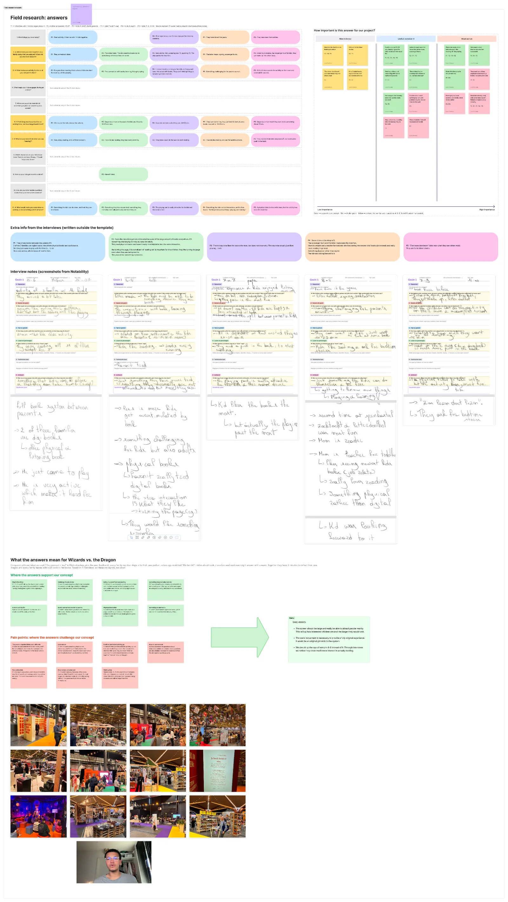

Why field research?

After ideation we had a clear concept but it was still built on our own assumptions. So before building anything, we went to Boektopia 2026 and interviewed five families on the floor.

We deliberately didn't pitch our concept. Instead, we asked what they expect from an activity they do as a family, how long they would wait, what their kids think of reading, and what would make them remember an activity. Afterwards, we compared their answers with our concept.

We grouped the answers into insights and placed them on an importance axis: nice to know, useful and must act on.

