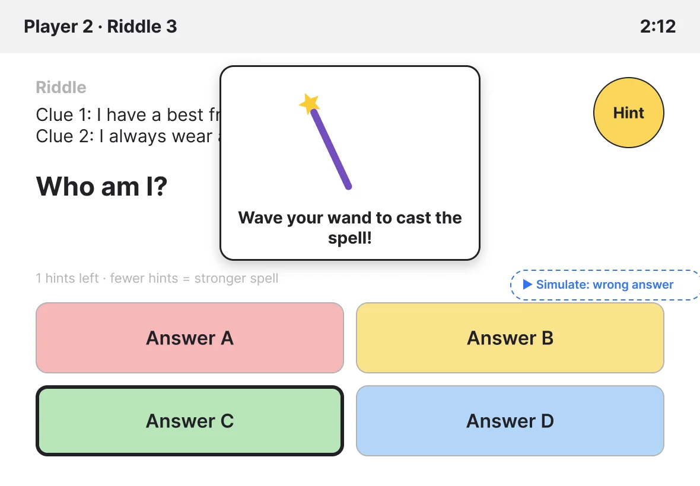

we turned our storyboard into lo-fi wireframes with a clickable prototype in Figma. The goal of this prototype is to check the flow for "plot holes", things that are not as user friendly, and potential for development. 

Because the installation uses several screens at once, we laid the file out as a timeline: the big screen on top and the tablets on the podiums below, so you can see what happens on both at every moment.

I made the basic screens and used claude to quickly prototype them using figma animations.

