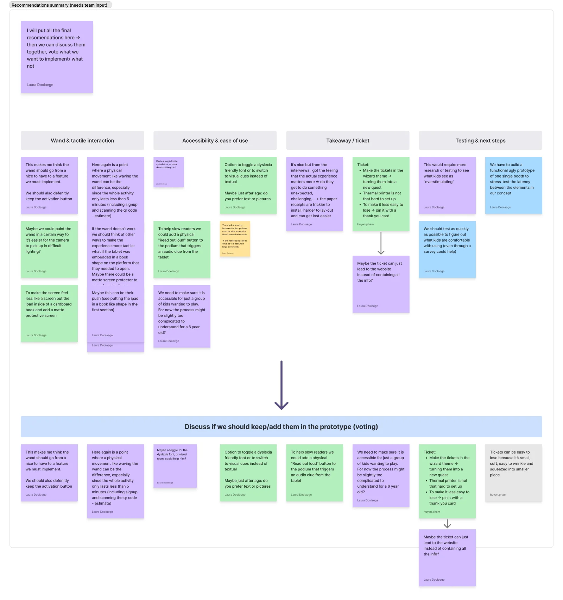
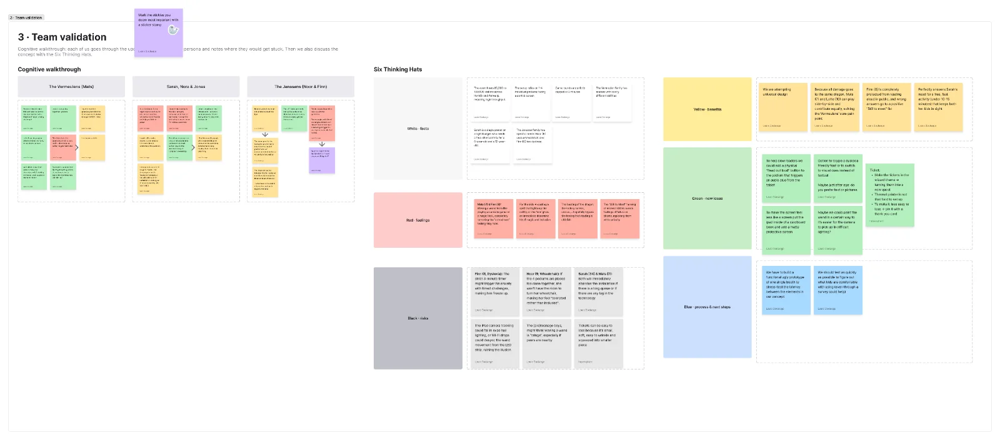

- I set up the structure of the validation phase on our [UX] Validation page, with an intro and clear steps along the process: first low-fi prototype → must act on → team validation → client feedback → final decisions → new low-fi prototype.

- I translated the most important field research insights into concept decisions, such as making the wand a must-have and keeping the activation button.

- I prepared the validation with a cognitive walkthrough, where I went through the prototype as each of our personas, and as a team we did the Six Thinking Hats to discuss the findings from different angles.

- I collected all the team’s suggestions literally in a recommendations summary, grouped into four themes: wand and tactile interaction, accessibility, takeaway/ticket, and testing.

- I selected the suggestions I can implement in the next prototype (dyslexia font or picture toggle, read-aloud option, a simpler start for young kids, the wand step and Pham’s ticket idea) and put them up for a team vote.

- I cleaned up the layout and numbering of the validation page so the process is easy to follow for readers.

