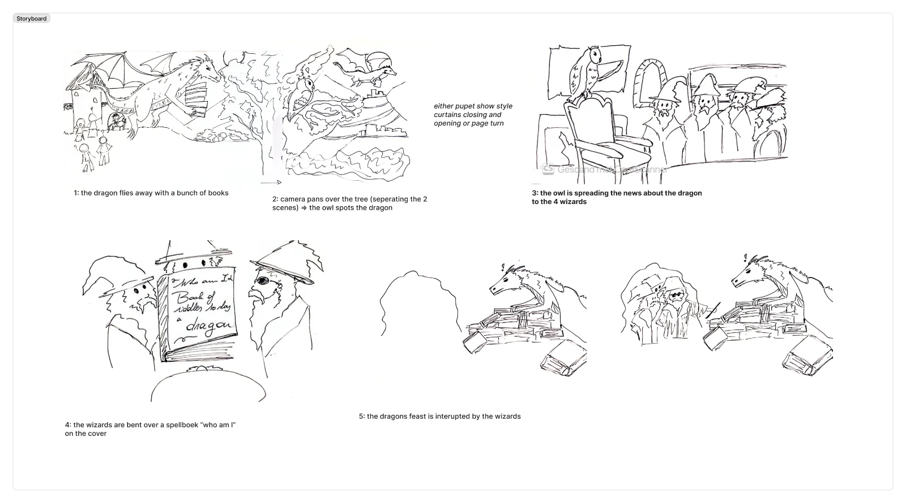

- I came up with a concept for the intro video that explains why the families attack the dragon.

- I took on the challenge of making the story clear without sound or subtitles, since the expo hall is noisy and young kids can’t read yet. 

- I made a storyboard

- I looked into transitions using references such as a 3D parallax tutorial and the Kung Fu Panda 2 intro

