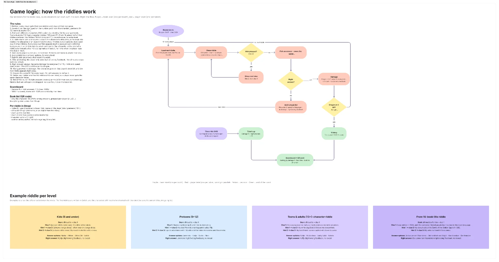
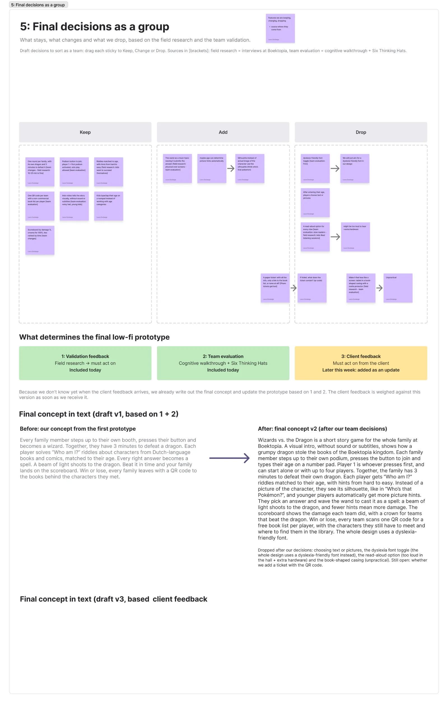

Yesterday's goal was to come to decisions for our final concept. Three things shape our final low-fi prototype: the field research, our team's evaluation of the first prototype, and the client feedback. Since we don't know yet when the client feedback will arrive, we started with the first two.

Together with my team, I sorted all suggestions into **Keep**, **Add** and **Drop**:
- **Keep:** one round per family against their own dragon, 3 minutes, the podium button to join, and typing your age on a number pad.
- **Add:** the wand as the way to submit an answer, a silhouette of the character instead of an image, and picture clues for young kids.
- **Drop:** choosing between text and pictures, a dyslexia font toggle (we use a dyslexia-friendly font everywhere instead), read-aloud (too loud in the hall) and a book-shaped tablet casing (unpractical).

I then wrote out our old and new concept side by side, so the changes are easy to follow.

## A clear game logic for development

Our developer told us he was stuck: he had screens, but no clear rules for how the riddles work. So I made the remaining decisions one by one and turned them into a game logic overview with a flow:
- Every player gets their own riddles, at their own pace.
- **Three levels** based on age: kids (8 and under), preteens (9–12) and teens and adults (13+). From 16, about half of the riddles are about book titles instead of characters.
- A riddle starts with a **silhouette and clue 1**. Players can unlock two more clues with the hint button. Kids get a picture with every clue.
- Four answer options for everyone. Every right answer does the same damage, and the dragon needs **15 right answers**.
- A wrong answer adds the character to the player's book list, and the next riddle starts right away.
- After answering, players only get **right or wrong feedback**, so we don't need image rights to reveal characters.

## Processing developer feedback

Our developer also gave feedback on the prototype from a technical point of view. Ages can't be passed on to the book list, a map with a postcode isn't feasible, and the content should come from **Strapi**. I removed the ages, replaced the map with a list of all libraries plus a link to the library catalogue, and added a "Download as PDF" option and an optional ticket that only carries the QR code.

## A cleaner, consistent prototype

Finally, I rebuilt our second low-fi prototype so it's easy to update and stays consistent:
- **Reusable components with auto layout**, such as the wizards, answer options, clue cards, hint button and scoreboard rows. Changing a component updates every screen.
- **Real Figma overlays** for the riddle intro, the hints and the wand prompt, neatly centred. Every new clue first appears big, so it's easy to read for kids.
- **An iPad-style number keyboard** that slides up when you tap the age field.
- **One clean iPad flow**, with duplicate frames removed and overlays stacked under the screen that opens them.
- **Short example flows** for kids, preteens and 16+, so our developer can see exactly how each level works.

## Next steps

Once we receive the client feedback, we'll weigh it against this final concept. Then we'll prepare the prototype for our first testing rounds, using the testing goals and checklist I set up on our UX testing page.

