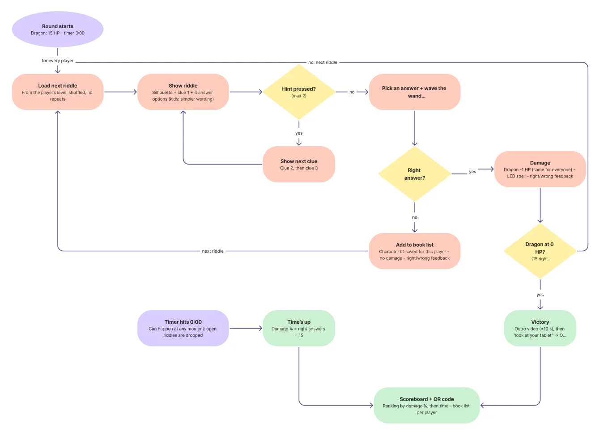

## 300 riddles in one file

I started from our flowchart: load a riddle, show the clues, pick an answer, deal damage or remember the character for the book list. The first need was content, so I put **302 riddles** in a single JSON file.

The riddles are grouped by the same age groups the iPad offers: 8–10, 11–13, 14–16 and 17+. The youngest players get characters from comics and picture books, like Jommeke, Nijntje and the Smurfs, in short, simple sentences. Older players get literature, from the Reinaert to *Het smelt*. Each riddle has three clues from hard to easy, four answer options, and space for a silhouette and an ISBN, which I still have to fill in.

My first plan was to keep a copy of the file on both the server and the iPads. I dropped that, as two copies drift apart the moment someone edits only one. Instead there is **one file in `shared/`**, which both the server and the iPad import, just like our socket event names.

## The server picks, the iPad shows

My main rule is that the server decides everything. So the flow works like this:

1. When the game starts, the server picks a random riddle from each player's age group, one they haven't seen yet.
2. It sends only the riddle's **ID** to that iPad.
3. The iPad looks up the riddle in its own copy of the JSON and shows it.
4. The player picks an answer and confirms. The iPad sends the answer to the server.
5. The server checks it. A right answer casts a spell and damages the dragon. A wrong answer is saved for the player's book list at the end. Either way, the server sends the next riddle.

The server only accepts an answer to the riddle it actually sent. That stops an iPad from answering the same easy riddle over and over.

## Hints and the confirm button

The first clue is the riddle itself. The hint button reveals the next clue, up to two times, and hidden clues show as locked cards, so players can see there's more to unlock. I added a separate confirm button, because later the answer will be confirmed by waving a magic wand instead. Swapping the button for the wand will then be a small change.

## Who ends the game?

At first, the big screen ended the game when the HP bar reached zero. That broke my own rule: if the screen happened to be refreshing at that moment, the game would never end. I moved that decision to the server, which now ends the round as soon as the dragon's HP hits zero. The dragon's HP and spell damage also moved to one shared settings file, so the server and the HP bar always agree.

## What I learned

- **Shadowing:** using the same name for a ref and for incoming data caused two bugs in a row. The inner name hides the outer one, so `riddleId.value = riddleId` silently broke.
- **Node only reads your code when it starts:** a server that seemed fine for days crashed after a restart, because of an unused import VS Code had added automatically. Running the server with `--watch` shows these errors straight away.
- **`computed` and `watch` in Vue:** `computed` works out a value, like the current riddle from its ID, while `watch` does something when a value changes, like resetting the hints for a new riddle.

## How I used AI

I wrote the riddle flow on the server, the answer handling and the hint logic myself. I used Claude Code to generate the riddle file, to style the riddle screen after my mockup, and to review my code, which caught several bugs before they reached the iPads. The riddles were written by AI, so I still need to fact-check them before the fair.

## Next up

The 3-minute timer, resetting the dragon between rounds, silhouettes, and the book list behind the QR code.
