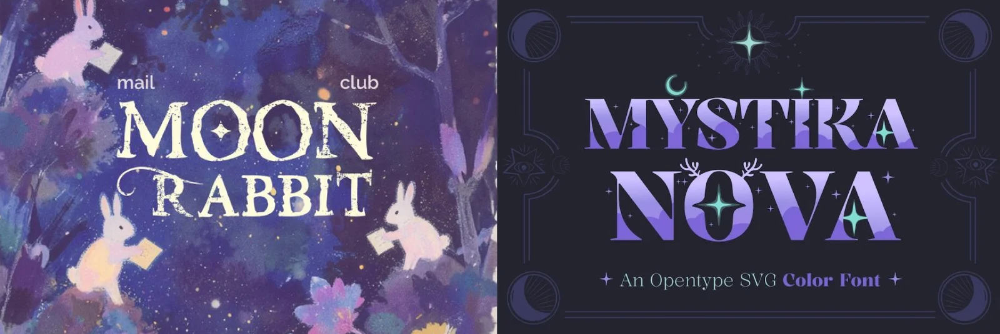
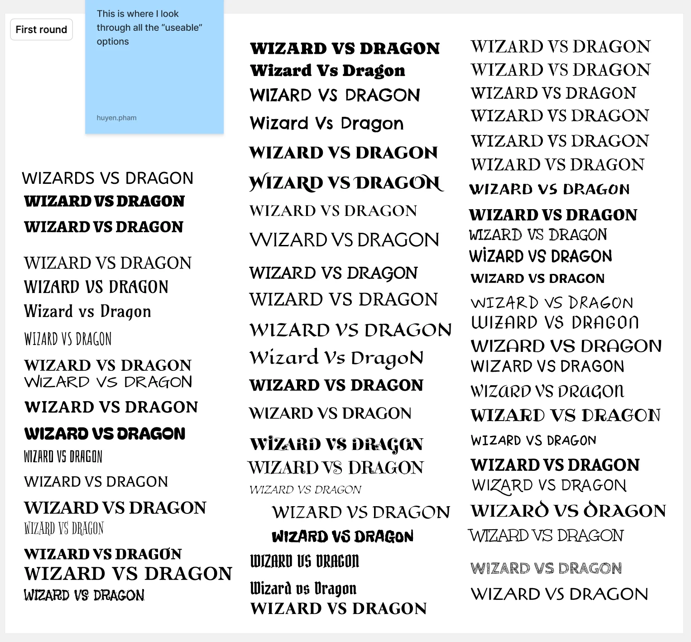
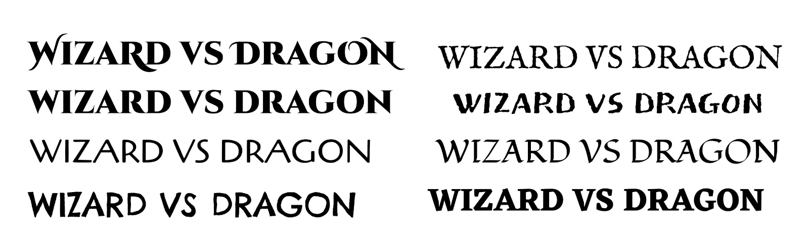
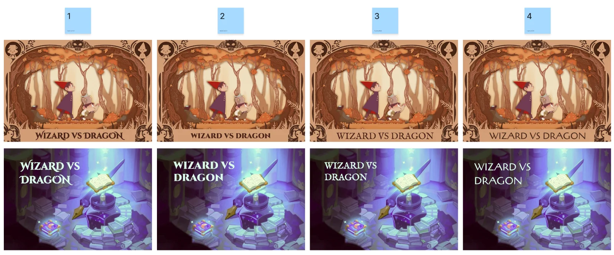
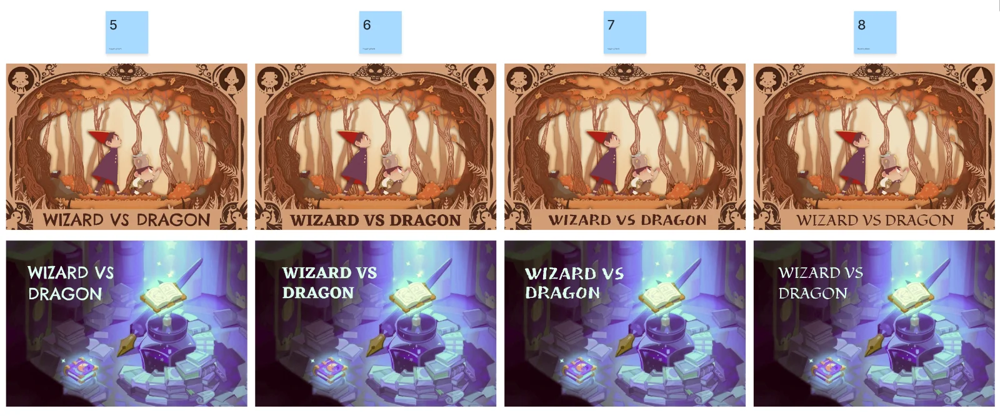
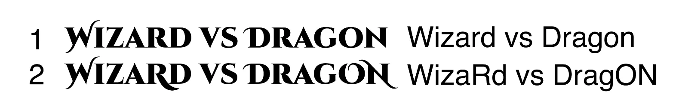
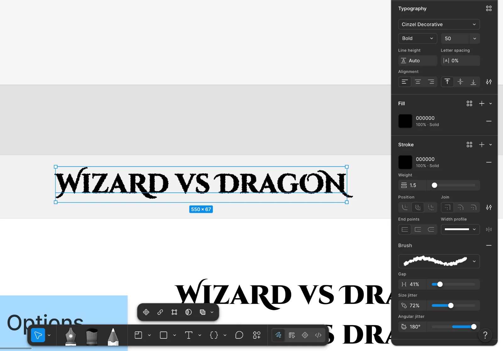
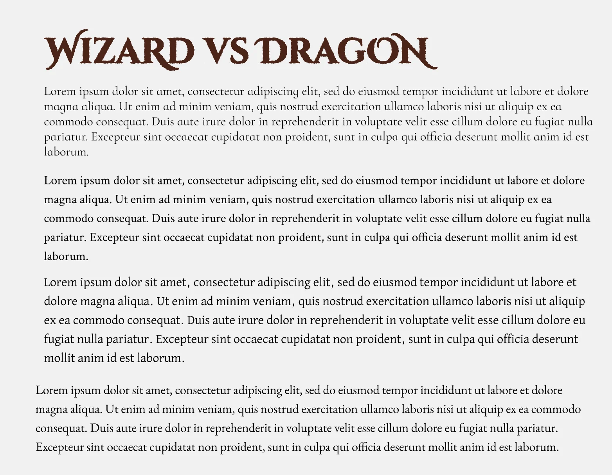
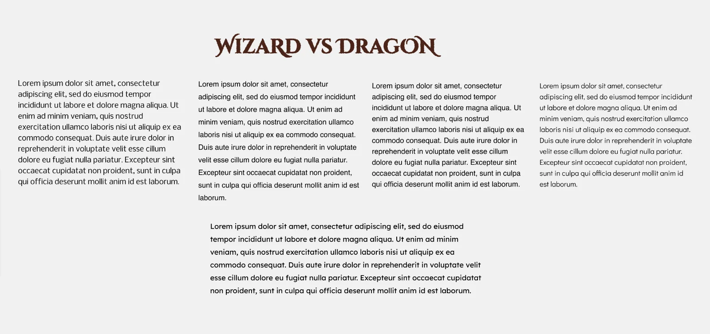

## Header

**Reference**

This is our reference for header from the style board. 
- Rounded
- Readable
- Less intricate

**Testing round 1**

For this round, I just tested different font with the title "Wizard vs dragon". I actually tried out every options Google Fonts have. These are the "usable" options. I know some didn't really look like the reference, but since they somewhat matched the vibe we were looking for, I still kept them for the first selection round.

**Testing round 2**

Out of all the fonts I selected for the 1st round, I picked the ones that are closest to our references. I ended up with 8 options:

I wanted to test these fonts with a magical AND paper-textured game environment but I couldn’t find any specific image that met both criteria. That’s why I tested each font with 2 different background to see:
- Does the font look like a part of a book?
- Does the font look magical?

**Final decision**
I gave my teammates the images above, and we all agreed to go with the first option with the font Cinzel Decorative.

Cinzel Decorative is beautiful but can be a little tricky to work with. Its lowercase letters are designed as small uppercase letters, while its uppercase letters feature additional decorative details.

As you can see, if I type "Wizard vs Dragon", the text seems heavier on the right side, since "W"' has bigger, more outstanding decorative details.

That's why the text is "WizaRd vs DragON" instead. This way, the decorative details of "O" and "N" balance out the "W". Now the title looks a lot more balanced.

I was inspired by the other fonts with more textures, so I also experiment a little bit with strokes and brushes.

## Body copy

**Trials with Serif fonts**

I was trying to find a readable Serif font to match with the header. However, I quickly realized that "readable to me" doesn’t mean "readable to others", especially to kids or people with dyslexia. That's why I switched to San-serif fonts, making sure that it's more readable to everyone.

**Trials with San-serif fonts**

I tried some fonts and different line spacing. However, I didn't feel like they are that readable nor suitable to the style we were trying to achieve. The I found Lexend, which moderately met the criteria 
- Accessibility: Even though Lexend wasn't a font designed specifically for people with dyslexia, it was created with the intention of making it easier for students to read by educational therapist Dr. Bonnie Shaver-Troup. 
- Visual Appeal: Despite being a san-serif font, the rounded shapes of Lexend still complement the Cinzel Decorative, unlike other options like Helvetica.

