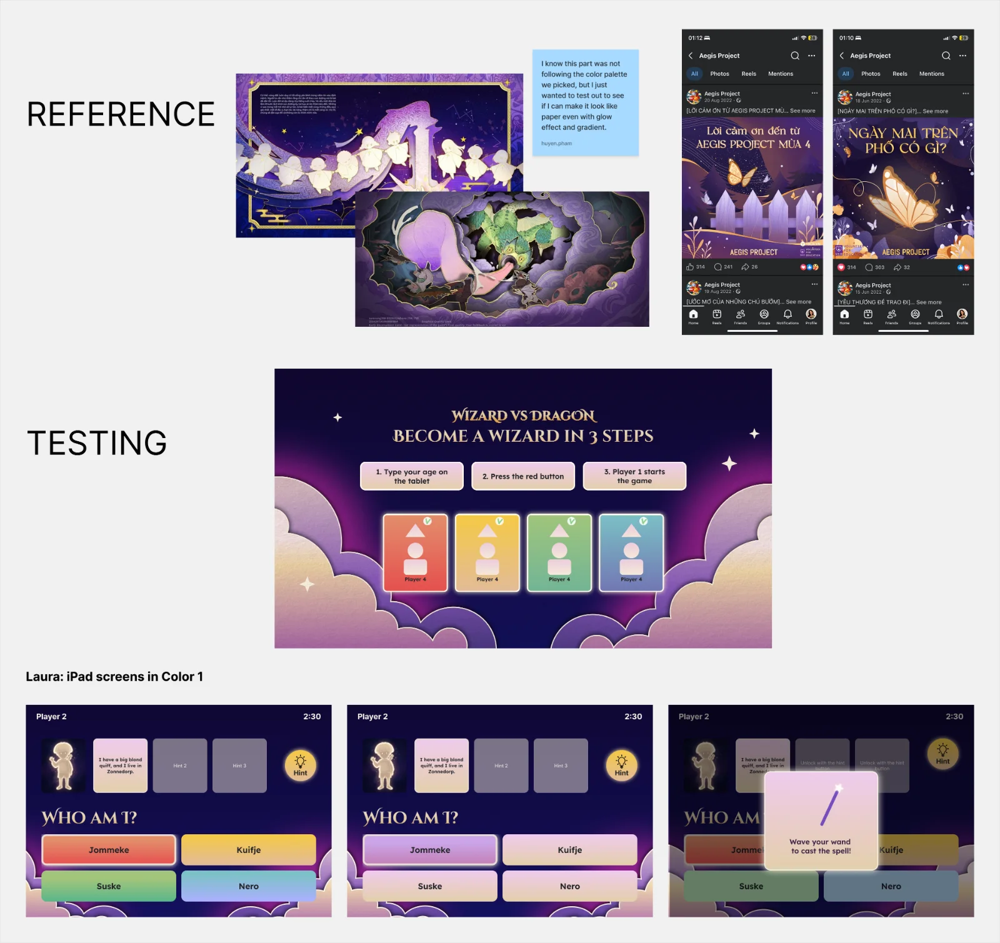
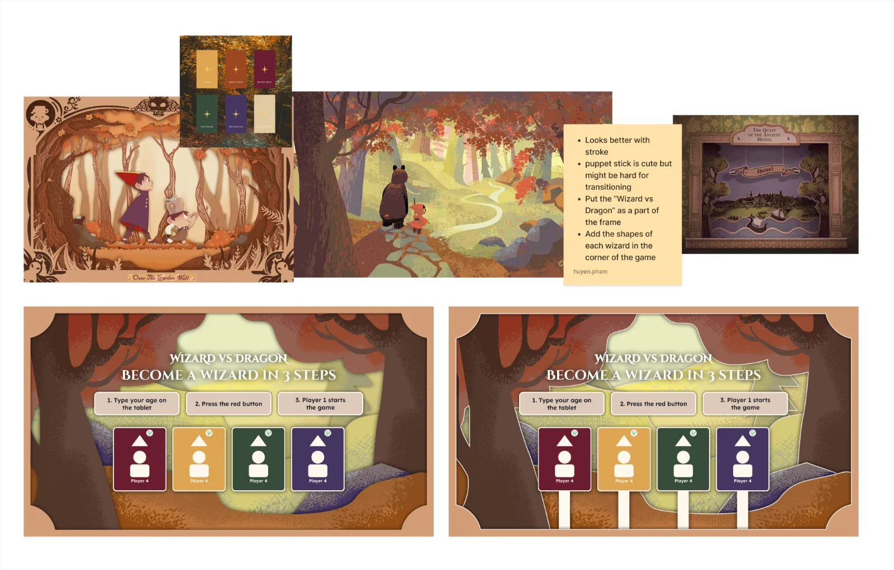
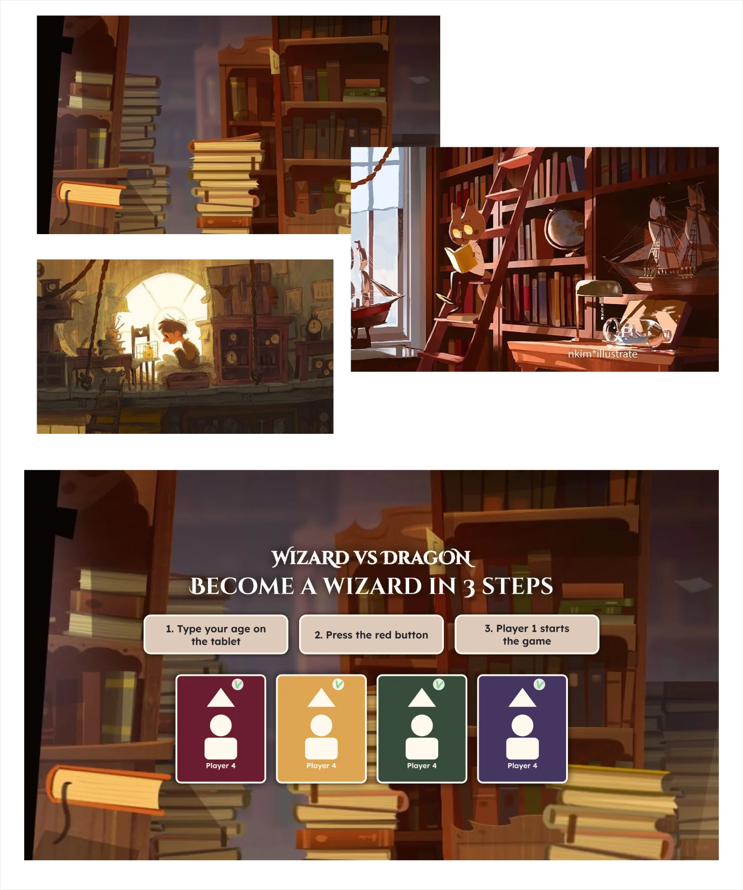
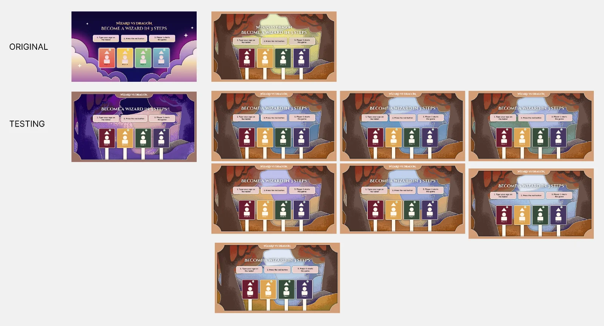
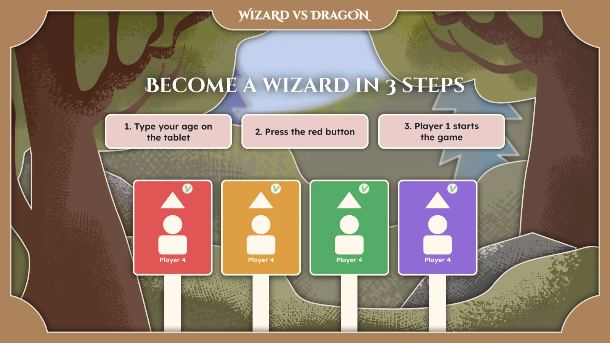
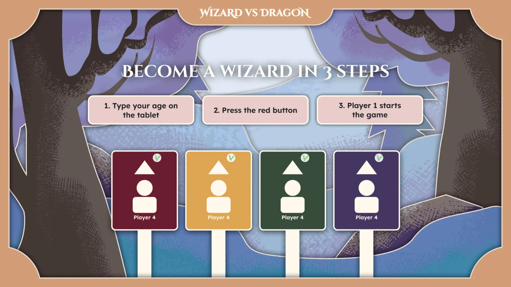
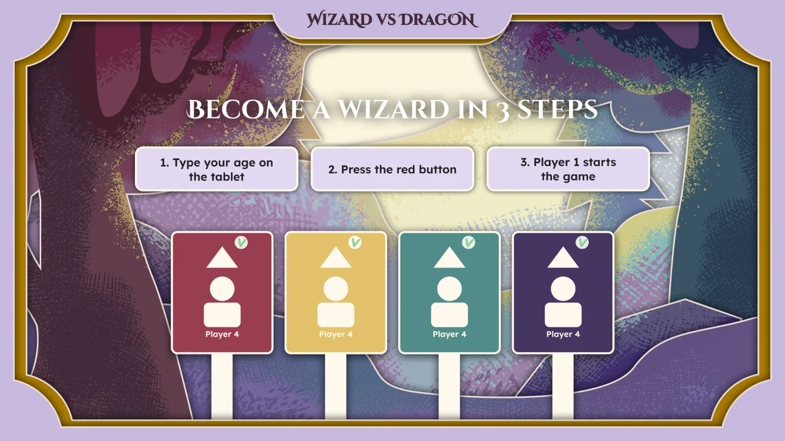

## First round of testing
In this round, I tested a lone before asking feedbacks from my team mates. I tried 2 different color palettes:
- Purple - Gradient color palette: This was not what we agreed on for the style board, but I still wanted experiment with this. I wanted to see if I can still create a "paper feeling" even with gradient.
- Warm - Autumn color palette: This is what we agreed on for the previous style board.

### COLOR PALETTE 1: Purple - Gradient color palette

The biggest frame was my trial, and the smaller frame was Laura's trial with different pages from the wireframe.

**What I learned from this:**
1. **Gradient effect:** Gradient effect can still create a "paper feeling" but only if I apply images of paper with more opacity settings.
2. **Glowy effect:** Glowy effect ONLY look "paper" when it gives an illusion of gradient piece of paper. For example: The glowy effect works when it's in between the clouds and the purple sky, because it doesn't only make the clouds look glowy but also adds gradient effect to the sky. In contrast, the glowy effect does not look "paper" when it's applied to the character cards.

### COLOR PALETTE 2: Warm - Autumn color palette

The images in the first row are the references. The images in the second row are my testings: 
- The left one doesn't have strokes
- The right one has strokes
I wanted to see if strokes were necessary to make it look like paper.

**What I learned from this:**
1. **Brush:** To create depth to the illustration while still keep it looking like paper, I used different brushes to draw the shadow. I used thick textured-strokes to make the color transition slightly smoother.
2. **Opacity setting:** To make it more vibrant and create more colour variations, I adjusted the opacity settings to reveal more colours in the overlapping areas.
3. **Strokes:** Strokes did help to make it look more like paper.

### Extra idea for COLOR PALETTE 2

I didn't design this, I just tested it with a reference photo.

**Why I tried this idea:**
Our initial idea for the introduction video was to have the dragon stealing books from the library. That's why I think the first page can have a library background, so we can create the transition from that to the introduction video later on.

## Feedback on the first round of testing:
My team had a meeting and discussed about my testings. Below is their feedbacks:
- Color palette 1 looks more magical but Color palette 2 has a better environment and looks more like “books”.
- Go with what we had for Color palette 2, but apply more purple to make it more magical.
- The extra idea for the Color palette 2 is not necessary anymore since we decided to cut that library part from the introduction video.

## Second round of testing

**What I did:**
1. Keep the Color Palette 1, but change the the illustration: This did not ended up so good.
2. Keep the illustration for Color Palette 2, but add bits of purple: This looks slightly better, but something still feels off. The colors don't look very cohesive because I was too stubborn about changing the original color palette, which made the purple feel forced.

## Third round of testing

### Replacing all the original colors

I had a call with the team again to discuss about this. Laura decided to adjust the color with me. Below is Laura's trial:

We decided not to go with this since it doesn't look stylized enough. On the other hand, I decided to go with something fully cool tone:

This is also bad, so no.

### Final design

**How did I get here:**
1. 60-30-10 formula: 60% of purple - 30% of teal/green - 10% of yellow.
2. Gradient effect: Apply subtle gradient effect to create smoother color transition, but still keep the brush strokes.
