## A. Initial sketches and reference

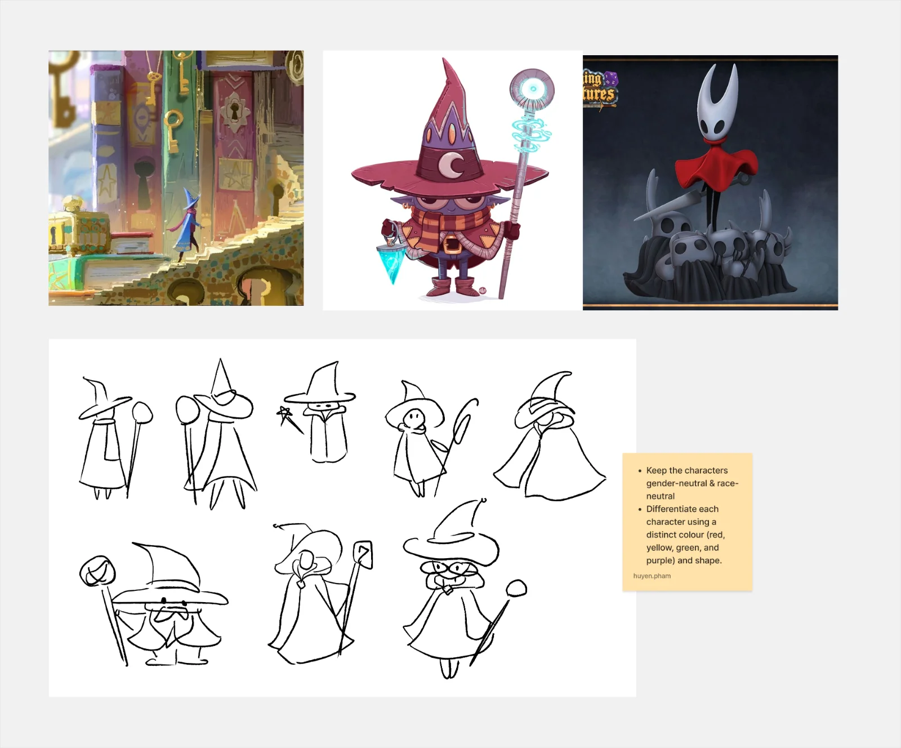

**Inclusive and Accessible**
After discussing with my team, we decided to:
- **Inclusiveness**: Differentiate each character using a distinct color (red, yellow, green, and purple) to keep the characters gender-neutral & race-neutral, making them inclusive and not biased
- **Accessibility**: Differentiate each character using a distinct shapes (triangle, circle, square and diamond) so each character still look different to color-blind people.

## B. Experiment: Distinct shapes applied to the whole silhouette

I want to whole silhouette of each character has different shapes, not only small details.

For this part, this is what I had as references.

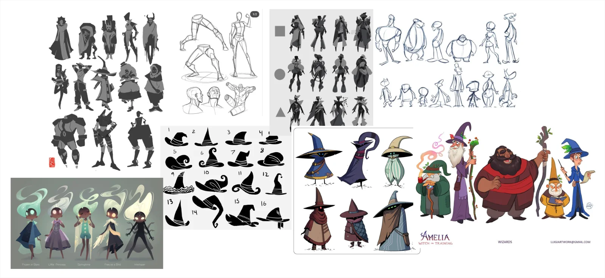

### Step 1: Create the shapes and silhouettes

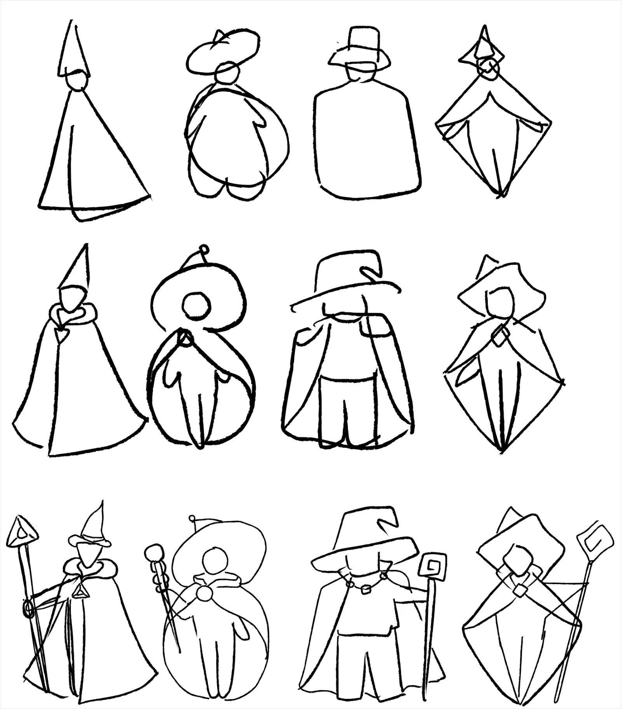

As a first step, I wanted to give each character a distinct silhouette using different shapes. Additionally, I also wanted the shapes to feel intentional and believable, considering how to construct elements such as the coat or hat to achieve the desired silhouette.

**Problem is:** The silhouettes were not expressive and dynamic at all. 

### Step 2: Exaggerate each character’s poses and features to emphasise the feelings conveyed by their shapes.

**Triangle**

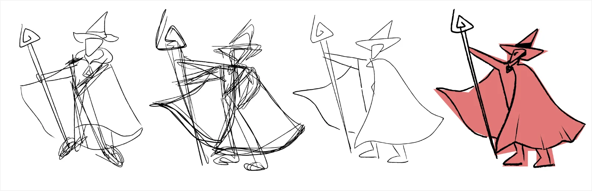

1. **Why red?**: The triangle shape gives off an edgy, ambitious yet grounded feeling. I felt that red was the perfect colour to convey this combination.
2. **Why this silhouette?**: 
- Face: The character looks upwards, with triangular eyes and furrowed brows to convey a sense of ambition.
- Staff and arm: - The staff is positioned diagonally, while the raised arm further emphasises the sharp, angular shapes of the triangle.

**Circle**

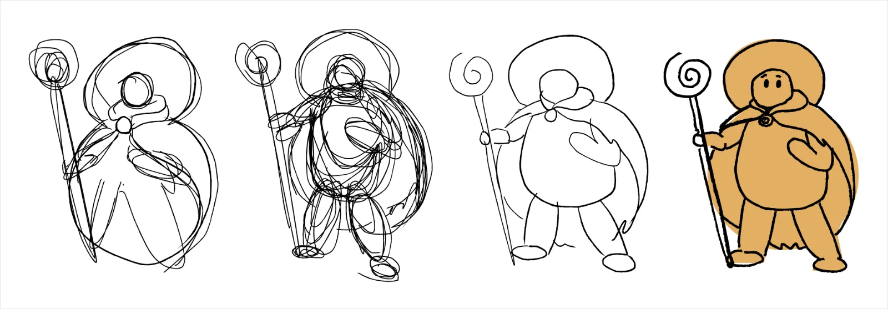

1. **Why yellow?**: The circle shape gives off a soft, warm, and comforting feeling, reminding me of the sun.
2. **Why this silhouette?**: 
- Face: The facial features, including the eyes and eyebrows, are softer compared to the triangular character, creating a more caring, gentle, and less intimidating expression.
- Pose: The arms are kept close to the body, creating a defensive rather than an aggressive pose.

**Square**

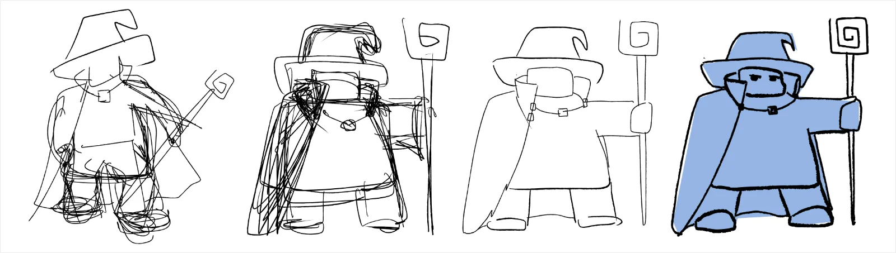

1. **Why blue?**: Blue conveys a sense of safety.
2. **Why this silhouette?**: 
- Face: The eyebrows keep the expression from looking either aggressive or defensive, giving the character a grounded and slightly sceptical look.
- Pose: The staff is held upright, while the arm is positioned parallel to the ground. Removing the diagonal angles creates a more grounded stance, as if the character always stands its ground.

**Diamond**

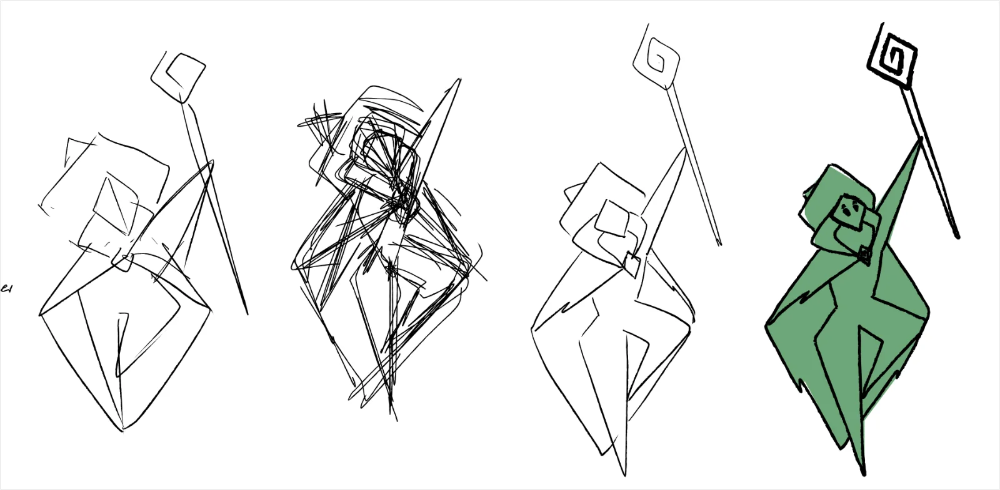

1. **Why green?**: The diamond shape reminds me of a green leaf.
2. **Why this silhouette?**: 
- Face: The face is tilted to further emphasise the sharp, angular shape.
- Pose: The staff is held diagonally upwards, with one leg raised to complement the overall diamond silhouette and create a sense of freedom.

## C. Safer Choice: Distinct shapes applied to the head, hat, and staff

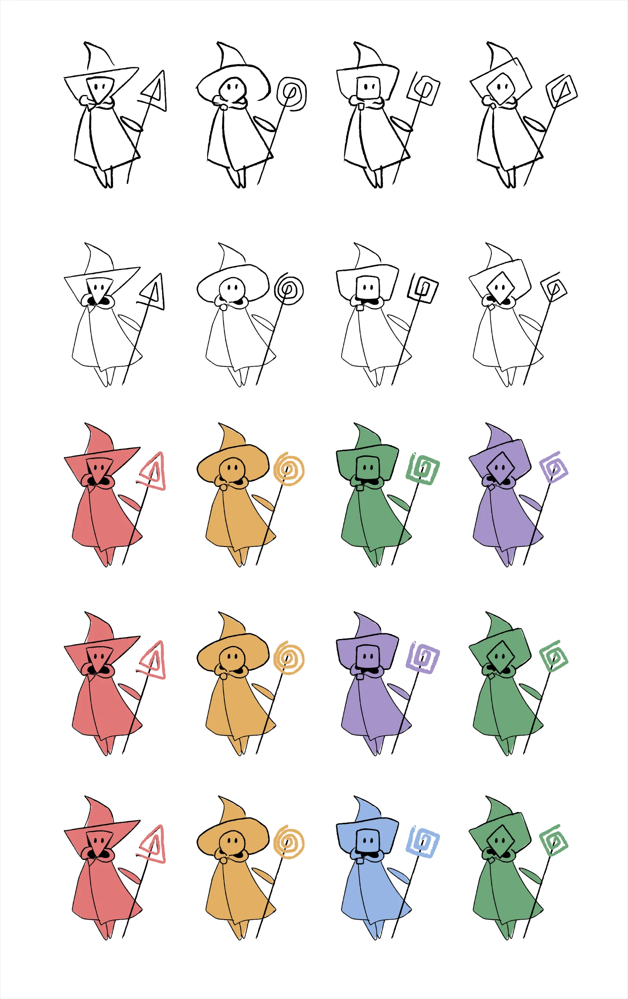

This version is closer to my original sketches. My teammates also approved of the initial sketch before I developed it into four distinct characters.

At this stage, I had only applied the distinct shapes to the head, hat, and staff, rather than incorporating them into the character's overall silhouette as I did above, keeping the designs simpler.

**Why do I apply the distinct shape to the hat?**
In the battle scene, players view the characters from behind to help them feel immersed in the game. Without the distinctive hat shapes, colour-blind players may have difficulty telling the characters apart.

## D. Team's decision

The team decided to go with the safer, simpler version. Throughout the game, the characters are only shown from the back, and they appear in different poses only in the introduction video. The game also doesn't require each character to have distinct skills or personalities.

## E. Finalizing the character

### Step 1: Create the base color

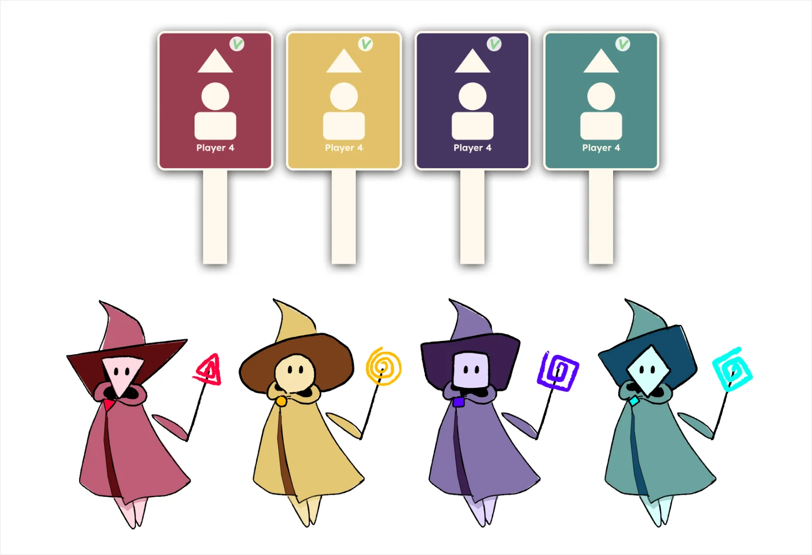

1. I updated the characters to match the new color palette.
2. I changed the staffs into wands to match with what we have for the players.
3. The team felt that floating arms were a bit too stylized, so I decided to replace them with coat sleeves in the next iteration.

### Step 2: Adding details

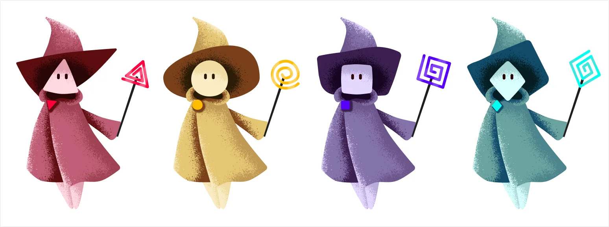

1. For the triangle character, I flipped the face upside down because an upright triangle (with the tip pointing upwards) is more recognisable.
2. I added shadows and highlights using brush strokes to better match the characters with the landscape.
3. I replaced the floating arm with a coat sleeve.

### Step 3: Testing with the landscape

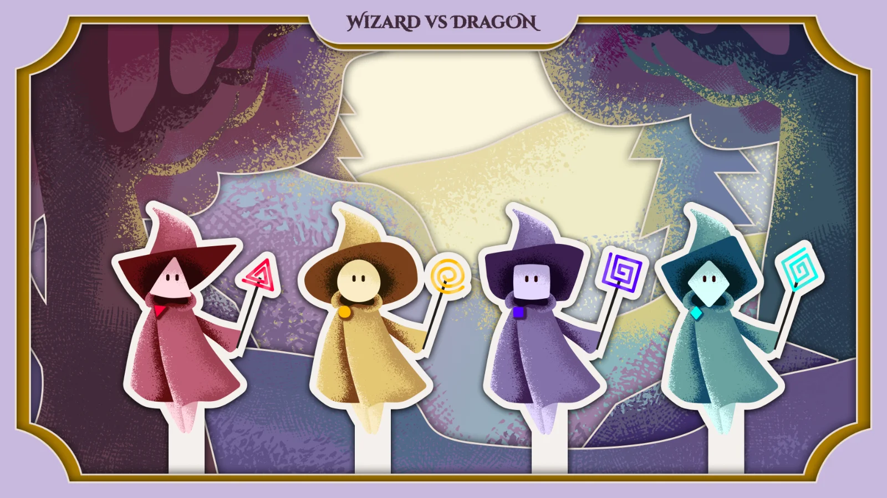

The characters now have thicker outlines to help them stand out more clearly.

Overall, they look cohesive with the landscape, so we consider the character designs complete.

## F. Reflection

It was really fun experimenting with character design. Even though this exploration was eventually rejected and didn't make it into the final version, I don't feel like my time was wasted. It gave me the opportunity to start with more elaborate designs and gradually simplify them, which is a much easier process for me.

I had never considered that character design could also involve accessibility. This experience definitely broadened my perspective.
