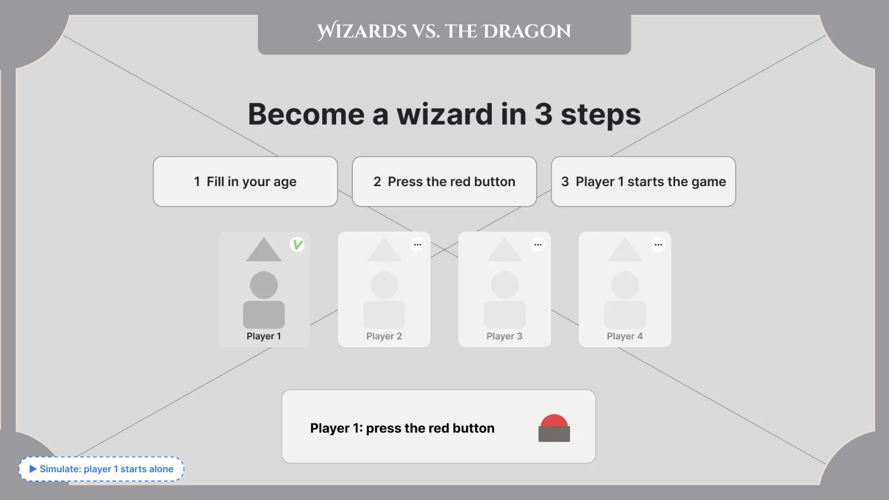
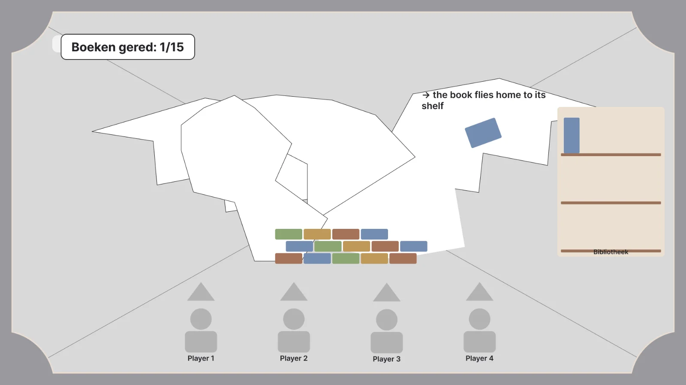
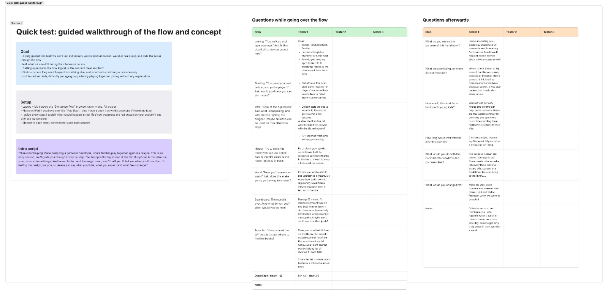
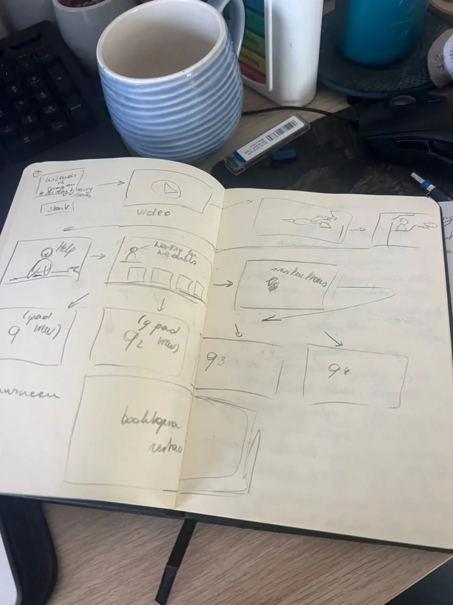
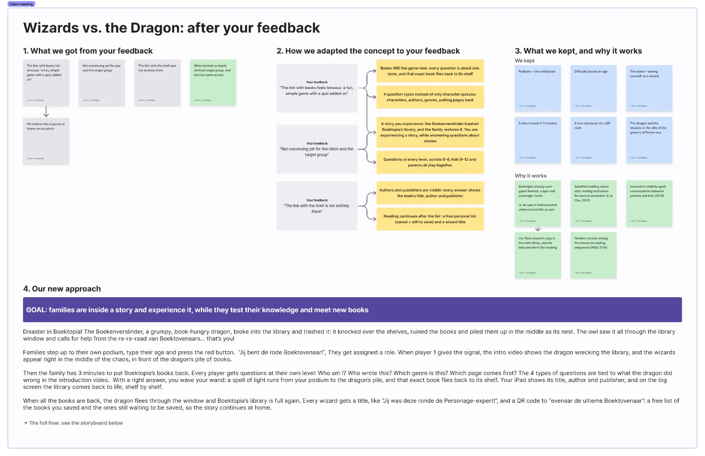
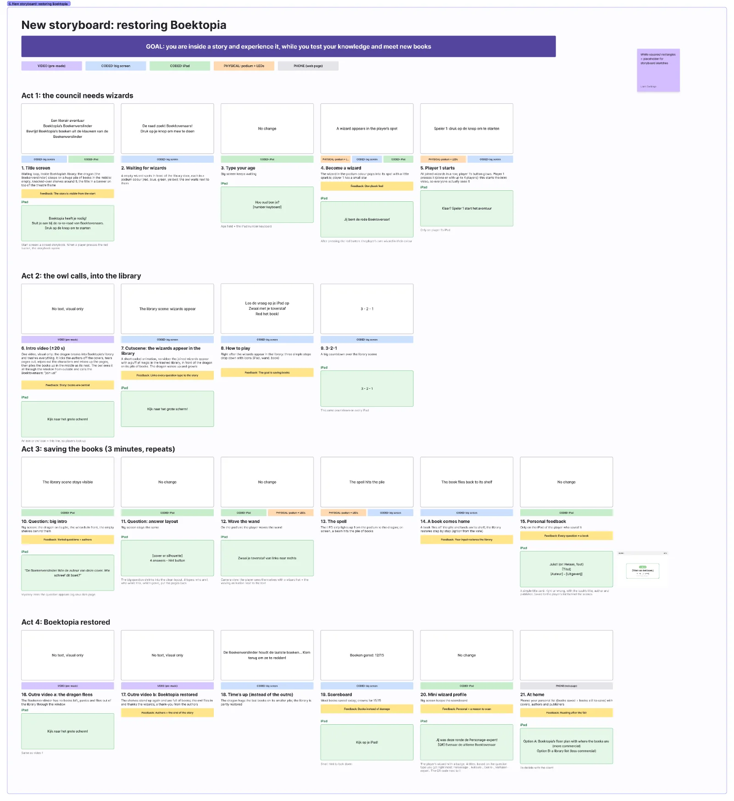
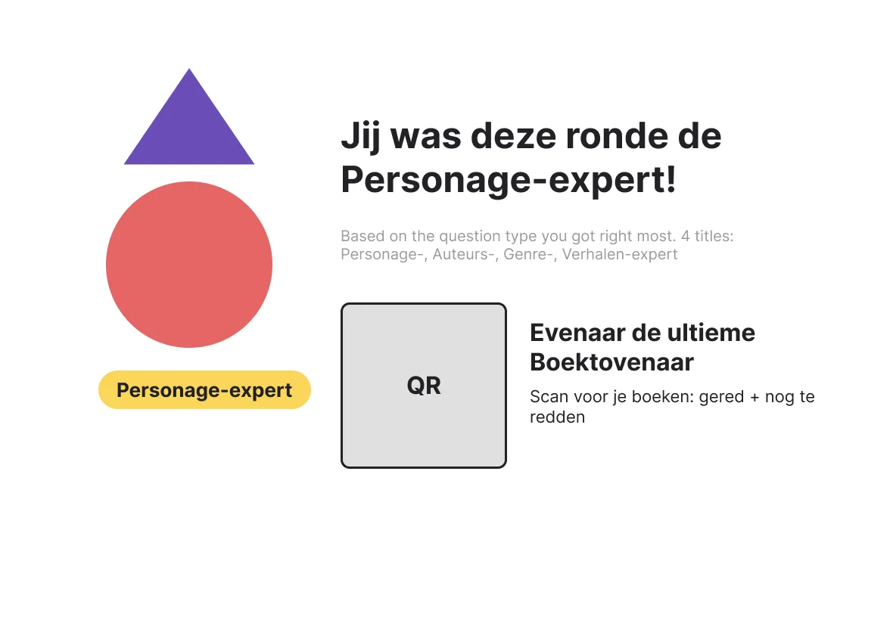

Since the last update, a lot changed: we received the client feedback. After a team call, I reworked the concept around it, and I rebuilt the storyboard and wireframes to match.

A more polished prototype (Wireframe 3)

Before the feedback arrived, I kept refining the prototype:

- A theatre frame on the big screen: every big screen now sits inside the decorative frame our team designed, made into one component, so a change updates every screen.
- A matching layout: the joining screens, the countdown, the spell screens and the scoreboard now all use the same scene as the battle screen (background, dragon silhouette, frame).
- An iPad start screen with the title, and a camera view for casting the spell. Players see themselves with a wizard hat, with a subtle animation that shows how to wave the wand, and a cancel button to go back.

Preparing a guided test

=> Since the podiums, buttons and wand don’t exist yet, I prepared a guided walkthrough for 1 to 3 adults outside the team:

The laptop shows the big screen and a phone shows the iPad.
I wrote a script, guided steps with questions, an observation sheet, and a sync guide showing which big screen goes with which iPad screen.

I also made a copy of the iPad flow adapted to a landscape phone, so the prototype is readable and tappable during the test.

The first testing round gave me a first list of things to watch for, like whether it’s clear that player 1 can start alone, and whether players need visible feedback when the wand wave is detected.

The client feedback

Then the feedback arrived. In short:

- The link with books felt tenuous: “a fun, simple game with a quiz added on.”
- Not convincing yet for the client and the target group.
- The link with the brief was not entirely there.

I analysed the full scoresheet, leaving out the presentation part. Our target group was the only “+”, and research, fit with the brief, originality and feasibility were all neutral rather than negative. The fun came across, but the meaning didn’t. That told us we didn’t need a new concept, but a clearer story and a stronger link with books.

Research and a team decision

=> To prepare the client call, I:

- collected evidence for why the concept can work: Boektopia already uses game formats like quizzes and scavenger hunts, studies show gamified reading can raise children’s reading motivation, interactive exhibits spark conversations between parents and kids, and Flanders scores low on reading enjoyment.

- highlighted the research we had already done: our personas based on Flemish data, the field research with 5 families, and the team validation.
compared my response with Keanu’s, so we could see where we agreed and where we differed, as a starting point for a team call.

=> The new concept: restoring Boektopia’s library

After the team call, I wrote out the refined concept and game logic:

- The story: the Boekenverslinder, a book-hungry dragon, broke into Boektopia’s library and trashed it. The owl saw it all through the window and calls the Boektovenaars for help. Together, the family restores the library.
- Books are the game now: every question is about one book, and with a right answer and a wave of the wand, that exact book flies back to its shelf.
- Four question types instead of only character quizzes: Who am I?, Who wrote this?, Which genre?, and putting the pages back in order.
- Authors and publishers are visible: after every answer, the iPad shows a title card (right or wrong) with the book’s title, author and publisher.
Two kinds of feedback: personal on the iPad and group progress on the big screen, where the library restores step by step. I set up a vote so the team can choose how to show this.
- A personal ending: every player gets a wizard title, like “Jij was deze ronde de Personage-expert!”, and a QR code with a free list of the books they saved and the ones still to save.
- Target audience: parents with children aged 6 to 12, with levels for kids 6–8, kids 9–12 and parents.

Validation: storytelling in UX

I measured the new concept against five takeaways from a podcast on storytelling in UX:

mapping the unhappy path
non-linear flows
progressive disclosure
a red thread across touchpoints
story listening

For each, I noted what the concept already does and what’s still to do, like fallbacks when the wand isn’t detected, or a shorter intro for families who play a second time.

A new storyboard

I rebuilt the storyboard in the order families actually experience it, in 21 frames across 4 acts:
- Each frame shows whether it’s a pre-made video, coded on the big screen or iPad, physical at the podium, or on the phone.
- Each frame has a detailed description, so Pham knows exactly what to draw.
- Along the way, we made the flow more logical:
- Player 1 triggers the intro video, so every family actually sees it.
- There’s one intro video instead of two, followed by a short coded cutscene where the wizards appear in the library.
- We removed the team spell at the end, which didn’t add enough.

Wireframe 4

=> Finally, I built a fourth wireframe based on the new concept, numbered exactly like the storyboard.

