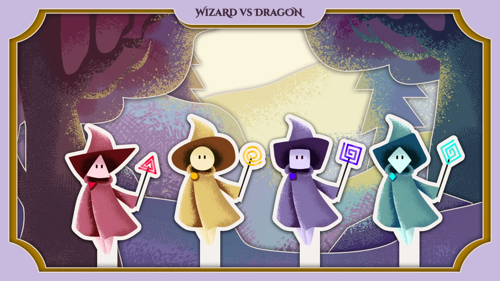
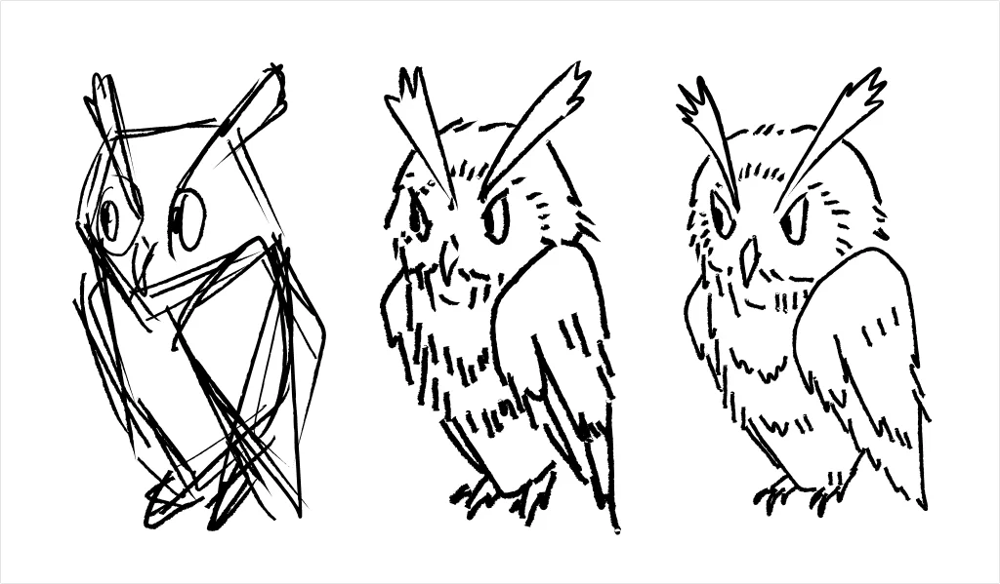
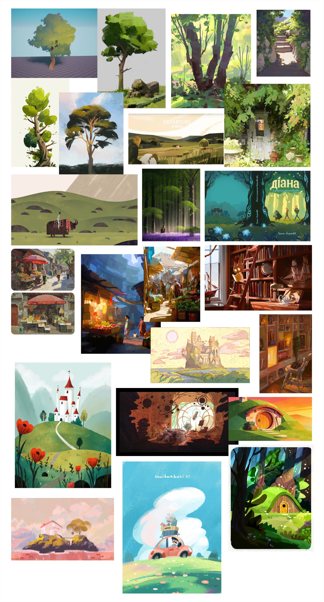
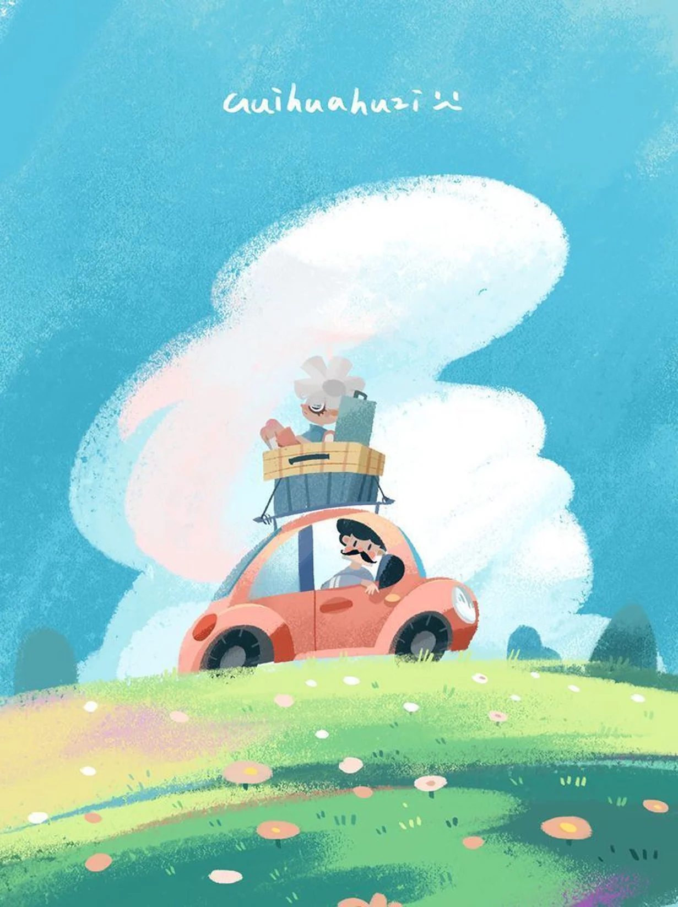

We had a meeting with the client at 11:40 on Tuesday, 10 November. Afterwards, we explored some alternative solutions and approaches before reaching out to the expert desk for feedback that same afternoon.

## Feedback from client 

The client mentioned that the pop-up book idea is quite top-of-the-mind and that another group has already worked on something similar. We should either refine our concept and execute it really well or consider switching to a different style.

However, the client liked the owl sketch and appreciated its hand-drawn, artistic feel.

## Alternative styles and references before presenting to the Design Expert Desk

After receiving the client's feedback, we had some time to explore new inspirations before presenting our work to the expert desk.

Since the client mentioned that she liked the owl sketch and its hand-drawn feel, I decided to look for styles with similarly expressive brushstrokes.

## Feedback from the Design Expert Desk

I updated Gitte, our Design expert, on our progress and the client's feedback, and showed her our new inspirations. Here is her feedback:

**1. Style:**

- Out of all the references, Gitte recommended going with this style, featuring bright colors, textured brushstrokes, and rounded, bubbly, cute shapes.
- She also recommended us to do more research on children's book to have a clearer view of the style and colors that kids like.

**2. Platform:** Gitte recommended using Adobe Illustrator instead of Procreate, as the final result would be more scalable.

**3. Characters:** The characters' outfits should also be visually differentiated, rather than relying only on differences in colour, face shape and hats.

**4. Font for the body copy:**
- Lexend might not be the most readable option, even though it has a modern look. The letter "a" has a rounded shape without a teardrop, which can make it look similar to the letter "o" from a distance.
- We should experiment with serif fonts. Although serif fonts are commonly considered less readable, this is not necessarily true for modern, high-resolution screens. We should explore whether a serif font could offer better readability for our design.
