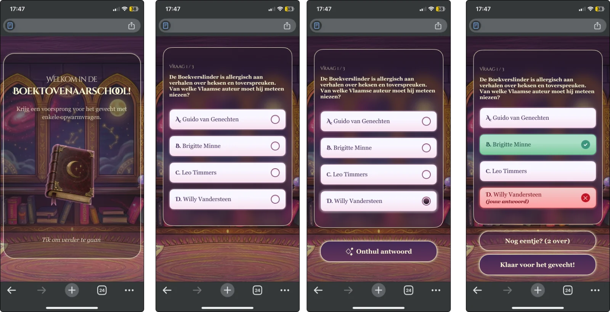
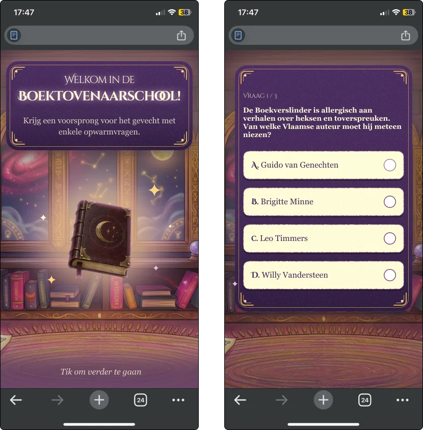
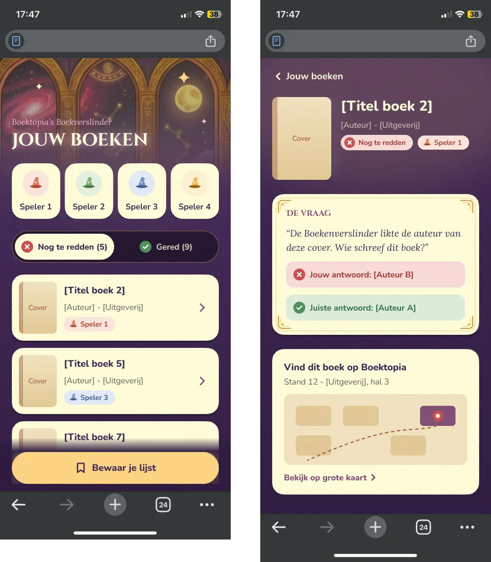
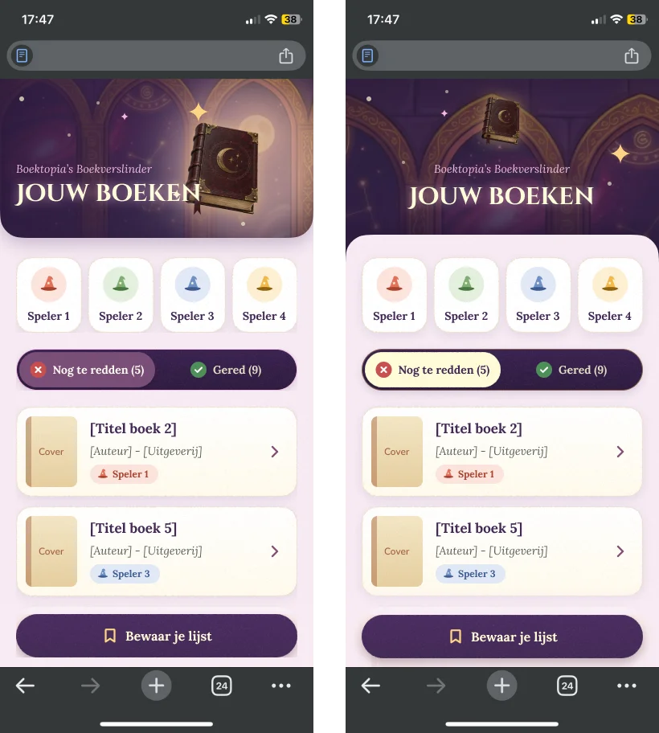
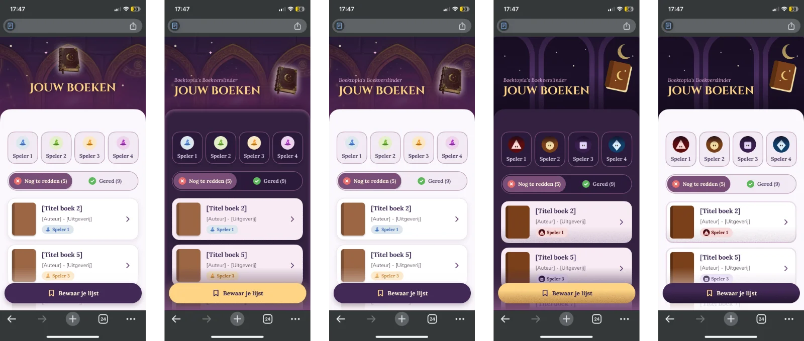
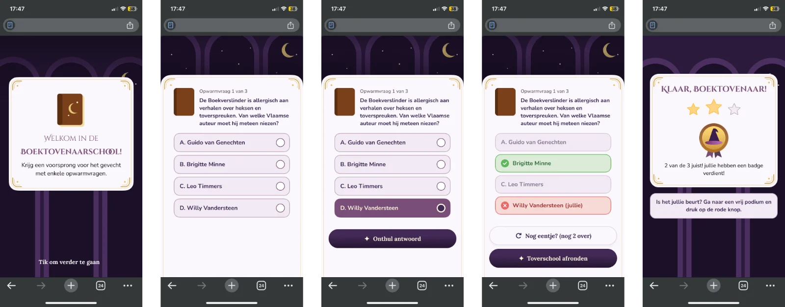

The starting point

=> Pham made a styleboard with a painterly night library, plum and mauve, butter yellow, cream and warm brown. My first styled screen was the book list, with a glowing night header and cream cards.

Feedback round 1: no glass

Pham liked the colours and the glow, but not the glass, blurry, see-through cards. Next, I tried:

solid plum cards with a soft glow;
paper grain, gold borders and corner ornaments, like a spellbook;
more of the library scene visible.

The bright edges on the cards were too much, so they went.

Combining the strongest parts

I combined a light and a dark version into one direction:
- Layout: the content now scrolls over the background and title as a sheet, instead of the title sitting in a card.
- A dark palette: cream book cards on dark plum.

=> I compared my two favourites on UX, legibility and cognitive load, and logged the findings. Dark was quicker to scan and had one clear main action. Light was calmer in bright halls. Both had three problems:

- the book illustration overlapped the title;
- author and publisher were in italic serif, which is harder for Finn and for young readers;
- red and green player colours clashed with right and wrong.

The team wanted something lighter

My team felt a lighter version might suit parents better, and some preferred the centred title. I made four explorations: a centred or left title, each in dark and light.

The team loved it, and prefered the light version. The header stays dark, so the night world of the game is still there.

The warm-up in the same style

I brainstormed how the queue warm-up could match:

- the same header and light sheet;
- answers in the same selection pattern as the players and the toggle;
- a start screen and a final screen as calm cards over the night scene;
- stars plus a badge as the reward.

=> The final screen shows no drawing of the red podium button, because the button is an optional feature and it might conflict instructions on the ipad.

Fine-tuning
- Buttons: on the dark background the plum buttons disappeared. I tested yellow, mustard, pink and cream, but in the end the original plum works best on a light surface.
- One standard for secondary buttons: same height, an outline, a soft shadow and small icons with a clear meaning (a circle arrow for “Nog eentje?”).
- Ornaments: I redrew the corner ornaments so their curves follow each card’s corner.

