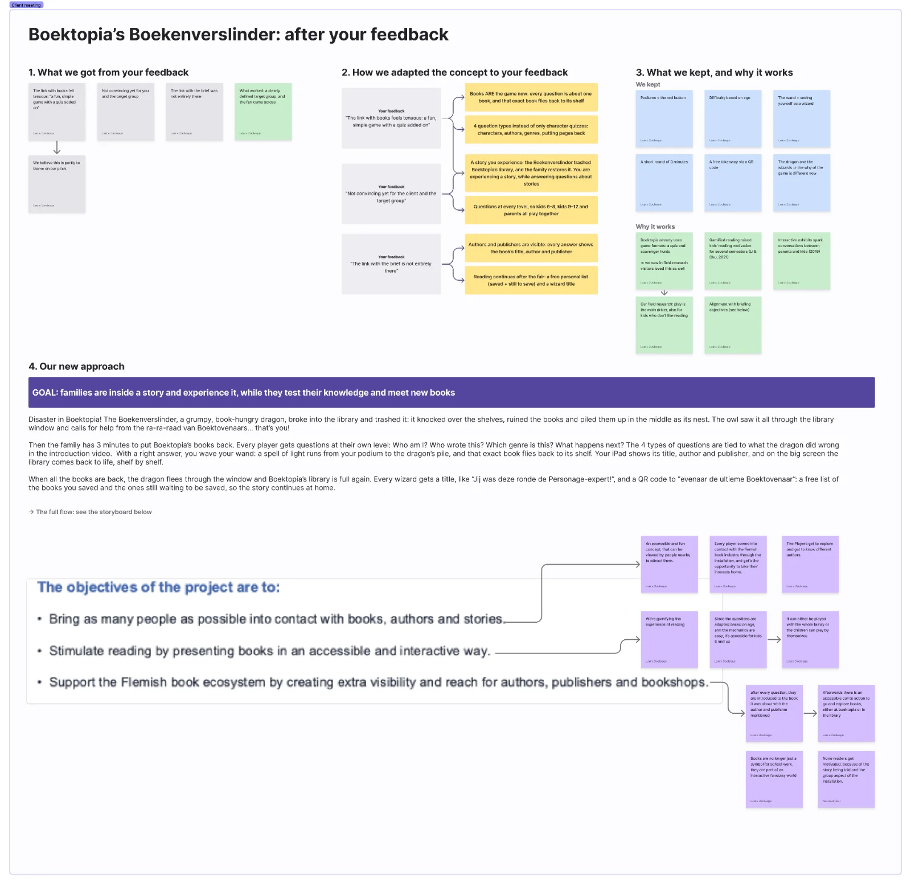
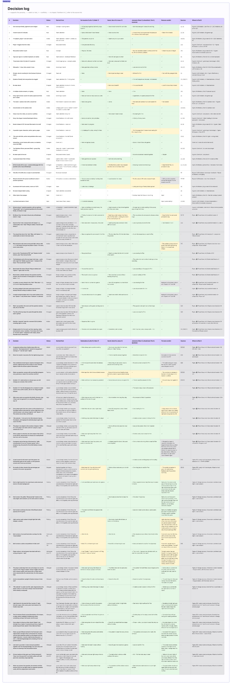
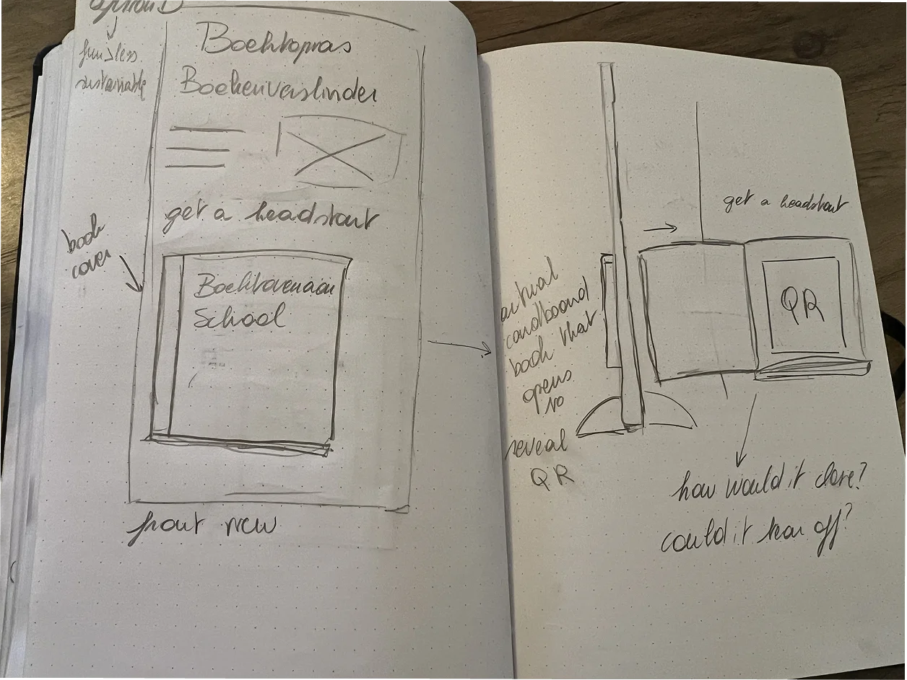
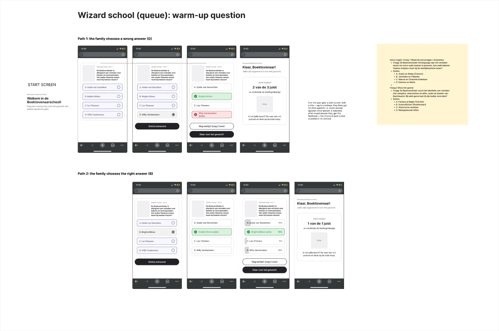
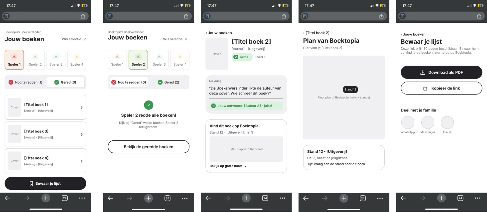

Client call 1
=> After the new concept, we presented the restored-library story to the client. To prepare, I:

rebuilt the “Client call 1 preparation” board. It sets out each piece of feedback, what we changed, what we kept and why, the new storyboard, and our questions for the client;
moved the objectives to the top, so the call stayed focused on what we needed to decide.

The call gave us clear boundaries for the content: book covers are allowed, classics are not, and the commercial goal of Boektopia has to stay visible. The link with books is now the core of the game, not an extra.

Feedback from the UX teachers

The teachers looked at the concept from a wider angle. Their main points:

- Secondary stakeholders: think beyond the family, for example the publishers and the stand holders who benefit from the book list.
- Clear links between personas and decisions: every choice should show which persona it helps.
- Saved and not-saved books: the list after the game should show both, so families also see the books they can still “rescue”.
- The map: help families find the book at the fair, not only remember it.

=> These points directly shaped the phone flow and the decision log.
I set up a decision log in FigJam, so every choice is traceable:

- Personas at a glance: the Vermeulens, Sarah with Nora and Jonas, and the Janssens with Noor (wheelchair) and Finn (dyslexia).
- For every decision: where it started (tester, client, teacher, team or my own review), a check against each persona, sources and where to find it in Figma.
- Holistic angles and a source list. I only kept sources from 2021 or later, and I didn’t force a source where my own reasoning was clear enough.

User flow v2 and the queue

=> I redrew the user flow for the new concept. One new touchpoint: the wizard school in the queue.

- Families scan a QR code on a cardboard stand and answer a warm-up question together while they wait.
- One question for the whole family, with up to two optional extra ones.
- First select an answer, then confirm with “Onthul antwoord”. This prevents accidental taps.
- Right and wrong are always green ✓ and red ✕: the colour never carries the meaning alone.
- I added a start screen, so the intro no longer pushes the question screens up and down.
- We dropped showing other families’ results (percentages per answer). We decided this together with Keanu: it needs an extra server, adds cost and makes the installation less robust, for a small extra.

The book list after the game

The phone flow went through six iterations. The biggest steps:

- Two filters: who (per player) and what (“Nog te redden” or “Gered”). Players are told apart by colour and name.
- The player row adapts: it works for 1 to 4 players. Solo players see no player filter at all.
- “Wis selectie”: a clear way back to everyone, placed where it doesn’t shift the layout.
- Book detail: where to find the book at Boektopia (stand, hall and a mini map).

A cleaner design system

Before handing over to Keanu, I refactored the mid-fi screens:

- spacing, radius and colour variables;
- text styles with a minimum size of 12 px;
- components with clear states (answer option, player card, book card);
- Auto Layout everywhere;
- calm Smart Animate transitions instead of bouncy ones.

=> The result is on a separate DEV: ready mid-fi prototypes page, with one prototype flow per section.
