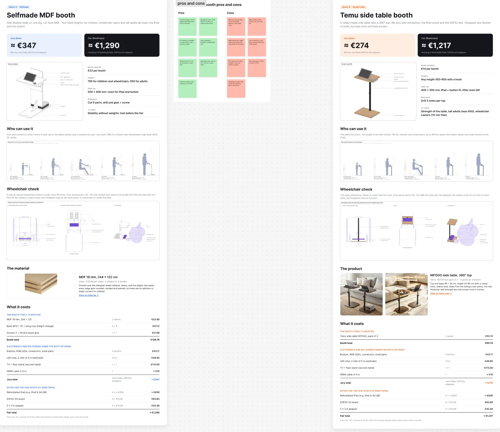

Until this week, our booth only existed as drawings. Before Boektopia can say yes, they need to know what it actually costs, and what they get for it. So I put everything in one place: a hardware list, two booth options, and a pros and cons board for the next client call.

## The hardware list

I started with the electronics, because those are the same whatever booth we choose. Per booth that's a 60 mm arcade button, a small addressable RGB LED inside it, a piece of LED strip for the spell beam, and a few small parts. On top of that, one big screen for the whole installation.

Two things surprised me:

- **Small parts add up, but not much.** All the buttons, LEDs,  for four booths come to about €35.
- **The screen is the big cost.** The cheapest new 55" TV I found was €379, plus about €99 for a stand. In the end we found a TV for €75 and a stand for €40 on Facebook Marketplace. That alone saved more than €360.

I also split the total in two. **For the jury**, we can use our own iPads, ESP32s and adapters. **For the fair**, the installation has to run on its own, without our laptops, so Boektopia needs four iPads, four ESP32 boards and four 5 V adapters of its own. Refurbished iPads make up most of that difference.

## Two booth options

We had already designed our own booth: one shallow desk on one leg, with two heights, so children, wheelchair users and tall adults can all use it. To make it as cheap as possible, I switched it from plywood to **MDF**, and dropped the weights and the separate ESP32 sleeve. The ESP32 box is now screwed straight under the desk.

The second option is a **side table from Temu**: a ready-made table with a 360° top, where we only drill five holes for the button and the iPad stand.

| | Selfmade MDF booth | Temu side table |
|---|---|---|
| Booth materials (4 booths) | €129 | €56 |
| Jury demo | ≈ €347 | ≈ €274 |
| Fair | ≈ €1,290 | ≈ €1,217 |

The difference in price is smaller than it looks, because the electronics and iPads are the same for both. The real difference is in the details: the selfmade booth fits tall adults and wheelchairs better and has no unknowns, the Temu table is faster to build but has a small top and leaves only 15 mm for wheelchair casters.

## Pros and cons for the client

For the next client call, I put two presentation cards side by side, with the prices, our drawings of the users and the wheelchair check, and the material and product photos. Next to each card, there's a pros and cons board.

Writing those down made me think about safety in a way the drawings didn't. **MDF splinters and has sharp edges**, which matters when the main users are children, so every edge has to be rounded, sanded and painted. And now that we dropped the weights, both booths stand on one leg or pole. That has to be tested before the fair, by leaning on the desk the way a child would.

## Working with AI

I used Claude Code for the research and the Figma work. It searched Belgian shops for prices, built the hardware list and the client cards in Figma, and kept the totals consistent every time something changed. I made the decisions: Marketplace instead of new, MDF instead of plywood, no weights, and splitting the jury and fair totals.

Two things I had to correct. It first left the LED strip out of the total, because the length wasn't measured yet. I wanted an estimate in there anyway, so the number doesn't look better than it is. And when I removed the weights, it only updated the labels in our drawings, not the drawn pavers themselves, so I still have to fix those by hand.
