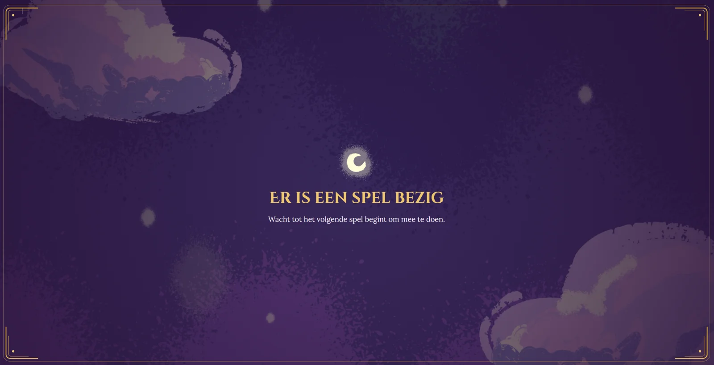

# Making the iPads look like a wizard's game

This branch was mostly styling. The booth app worked, but it still looked like a debug page: grey buttons and default fonts. Our UX designer had finished the designs, so I went through every iPad screen and made it match them.

## One look for every screen

Every screen now has the same purple background, a gold frame with corner brackets, and the same fonts: Cinzel Decorative for titles and Lora for text. Both fonts are bundled with the app, because the fair has no internet. Each booth also has its own character (triangle, circle, square or diamond), so a kid recognises "their" wizard from the moment they join. On the age screen, a dragon flies away in the background with a simple CSS animation.

## A bit of logic

A few small things changed besides the styling:
- **The intro video moved to the big screen.** On the hotspot it loaded badly on every iPad, and the iPads weren't in sync. Now the laptop plays it once and tells the server when it ends.
- **A toggle to change your answer:** on the camera screen, you can open and close the answer list. It slides open with a CSS transition.
- **A fallback button:** if waving the wand doesn't work, a "Tik om te versturen" card appears after 2 seconds. I wrote that with a `watch` and `onCleanup`, which is like returning a cleanup function from `useEffect` in React.

## Working with AI on styling

I used Claude Code for most of the CSS, by giving it screenshots of the designs. It was fast, but I had to correct it a lot. The first gold corners were guessed and looked nothing like the design. It also liked clever tricks and pixel values. So I added rules to our `AGENTS.md`: only `rem` and `%`, simple CSS, short comments, and styling tasks never change logic. After that, the CSS was much easier for our team to read.

## what I did.

I implemented logic in places where it needs it. The design expected the ipads to display the time left for example, so I added that logic by passing to the screen and Ipads. Same for booth number logic, each booth now has it's designated character attached to it.
