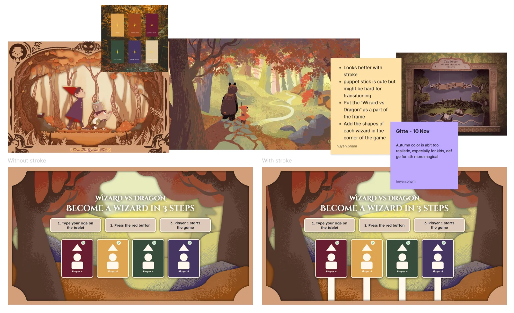
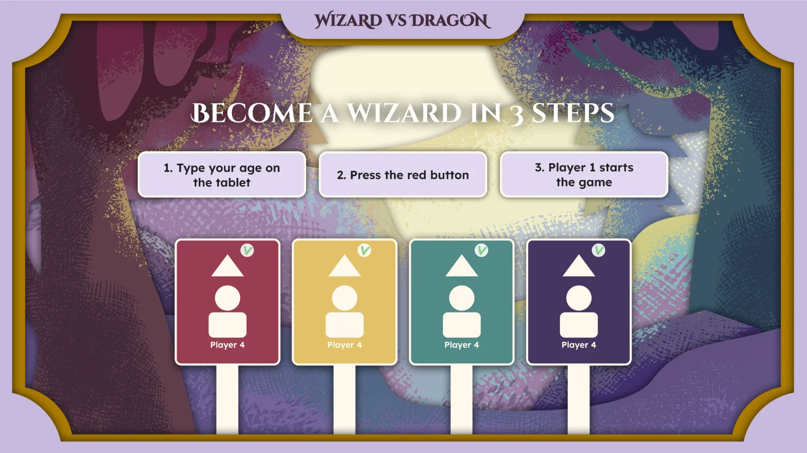
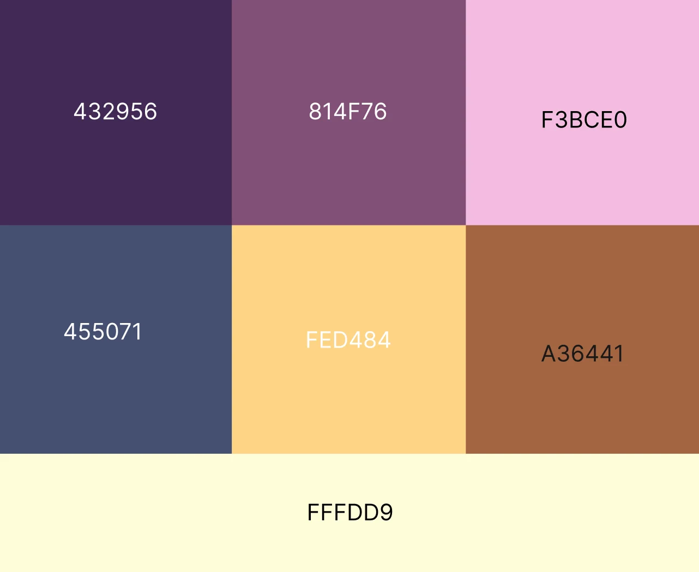
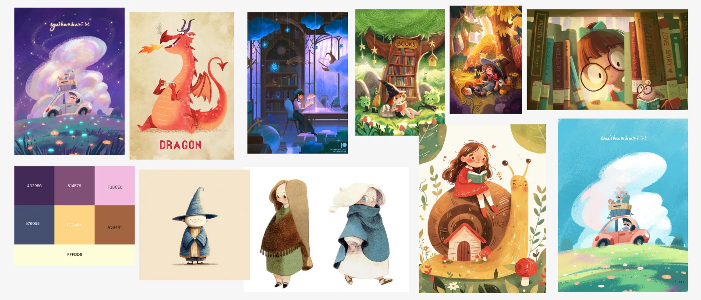
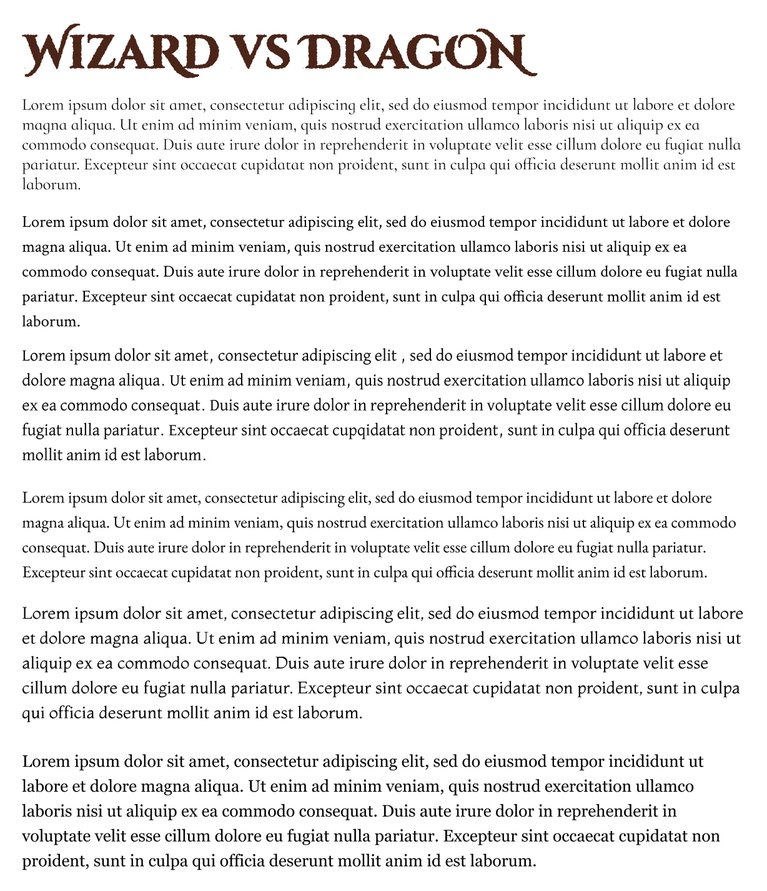

## Feedback:
- Pop-up book style is top of the mind
- Keep the stroke, hand-drawn feeling
- Characters should be differentiated by outfits too
- Bubbly - Cute - Magical
- No need to follow a realistic color palette like an autumn palette
- Lexend is not the most readable font. Should try serif fonts, sans-serif is not always the easiest to read.

## Color - Before
Last time, we picked this color palette for our design.

Yet, it was a little bit too realistic and didn't look magical enough, so through out the process we decided to implement purple in the design more and we had this before the consult:

## Color - Updated

After the first consult, I realized the issue. The color did look magical, yet it wasn't really for kids, because the color was in cool tone. Therefore I decided to change the hue to get warmer colors:

## Texture - Updated

We decided to do something different than the pop-up book/ paper texture because the client told us that it is "top of the mind" and go for something that has more brush-stroke/ hand-drawn feeling instead.

## Typography - Updated 

We tested multiple serif fonts for the body copy.

We picked the last option (Georgia) because it was the most readable. Why?
- The big difference between the X-height vs the Cap height/ Ascender line/ Descender line
- Sufficient contrast between thin and thick strokes
- The aperture of the lowercased letter "a" make it more different the the lowercased letter "o"
