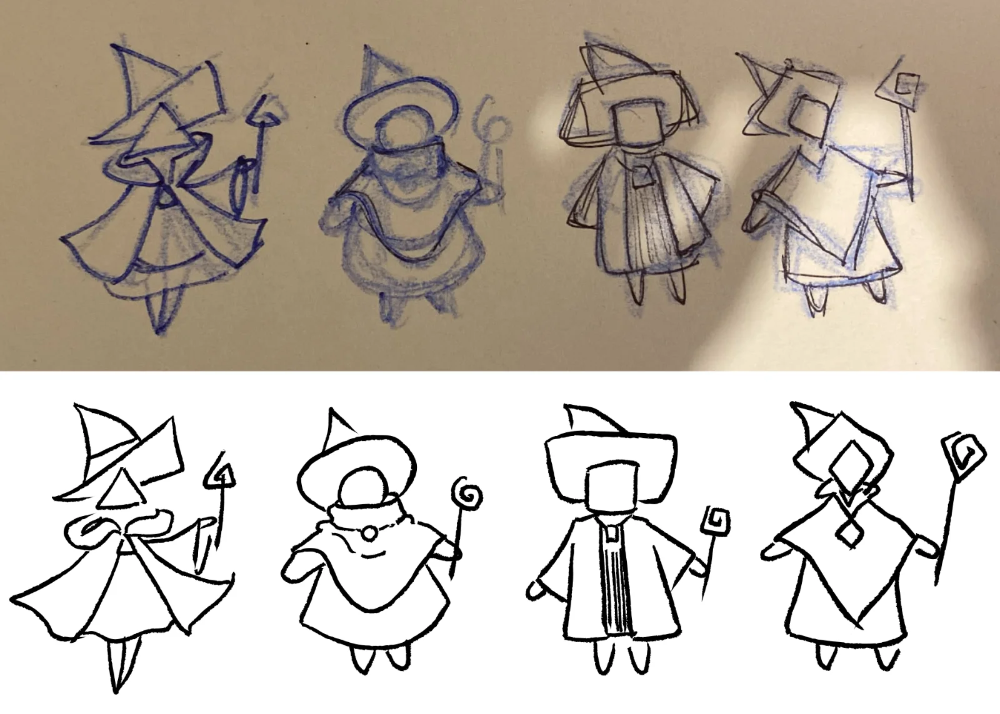
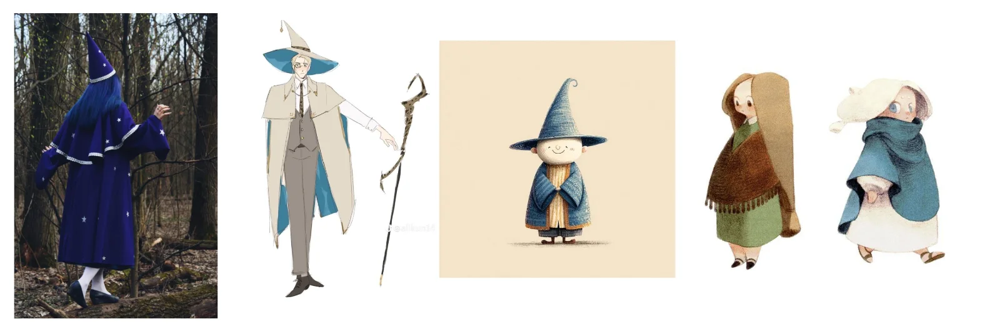
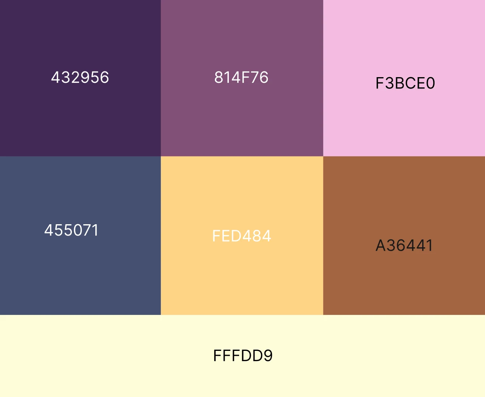
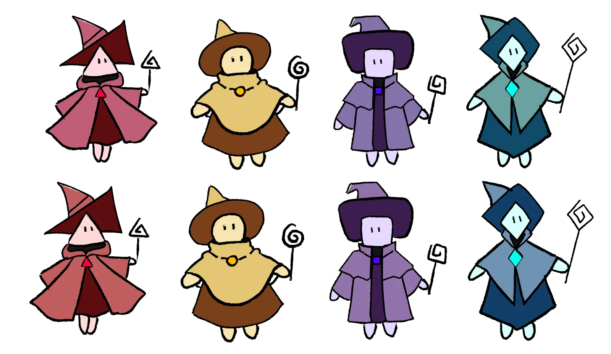
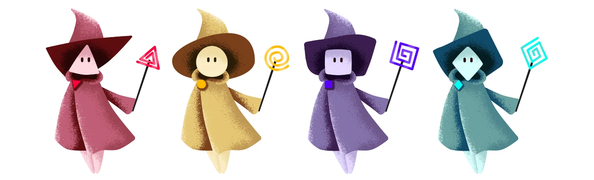
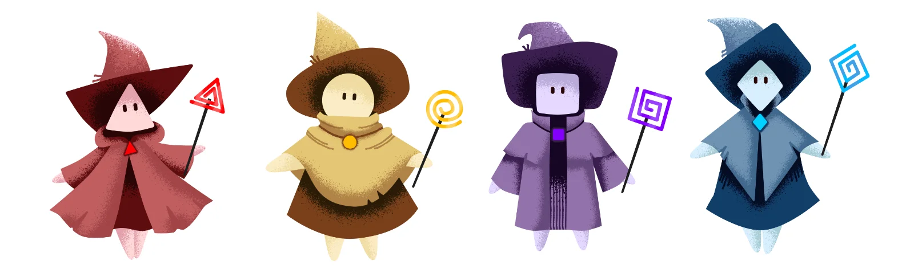
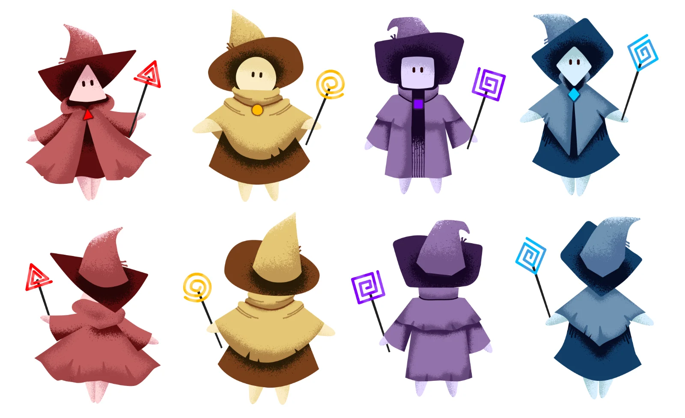

## Context
This is the redesign after receiving feedback from expert desk and client meeting. Feedback includes:
- Pop-up book style is top of the mind
- Keep the stroke, hand-drawn feeling
- Characters should be differentiated by outfits too
- Bubbly - Cute - Magical
- No need to follow a realistic color palette like an autumn palette

## Outfit
Last time we went to the expert desk and received a feedback that the characters need to be differentiated based on their outfits too.  Therefore, I started to sketch from the start again with the outfits while remaining their face shape. 

My goal with their outfit is to match the outfit’s silhouette to each character’s assigned shape.

I also added more details to each outfit.

Here are some references for this sketching process:

## Color
We changed the color palette. Therefore, we also changed the color of the characters.

The new color palette:

The old and new base color on the characters (Top - old base color, Bottom - new base color): 

We made the red and purple warmer. For the teal character, we made the color cooler, turning it into blue.

## Texture
Since we also changed the style board with more brush strokes, I also added more details with different strokes that looks hand-drawn  to the character's design instead of using only 1 stroke setting that looks like spray paint for shading. 

Before:

After:

## Back view
This time, since we are more sure about the characters, we finally did the back view of each character.

