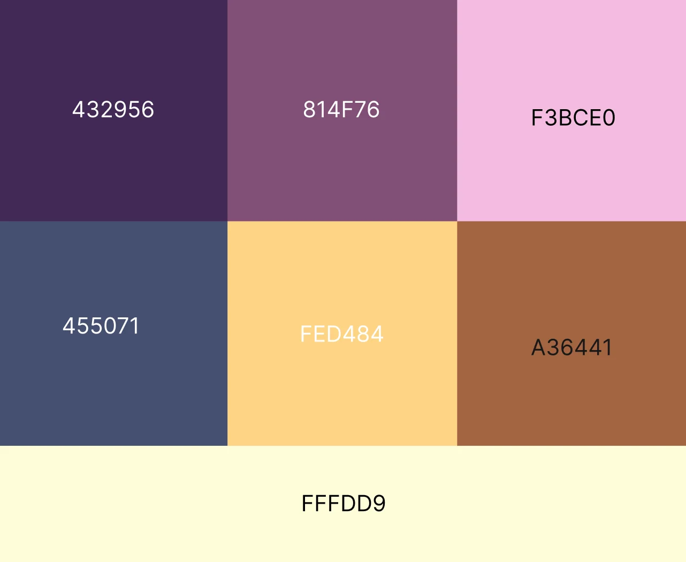
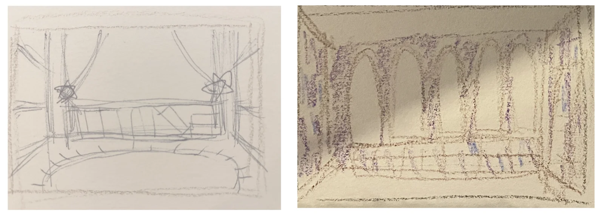
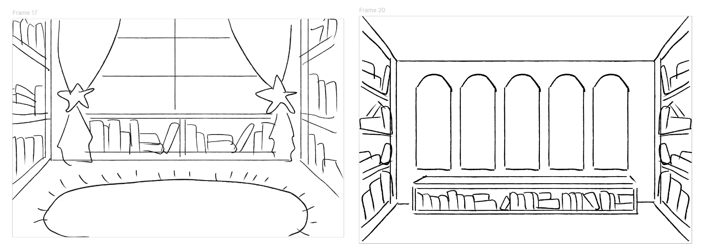
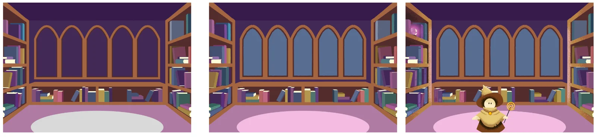
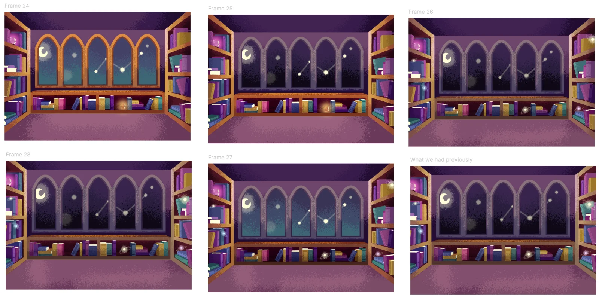
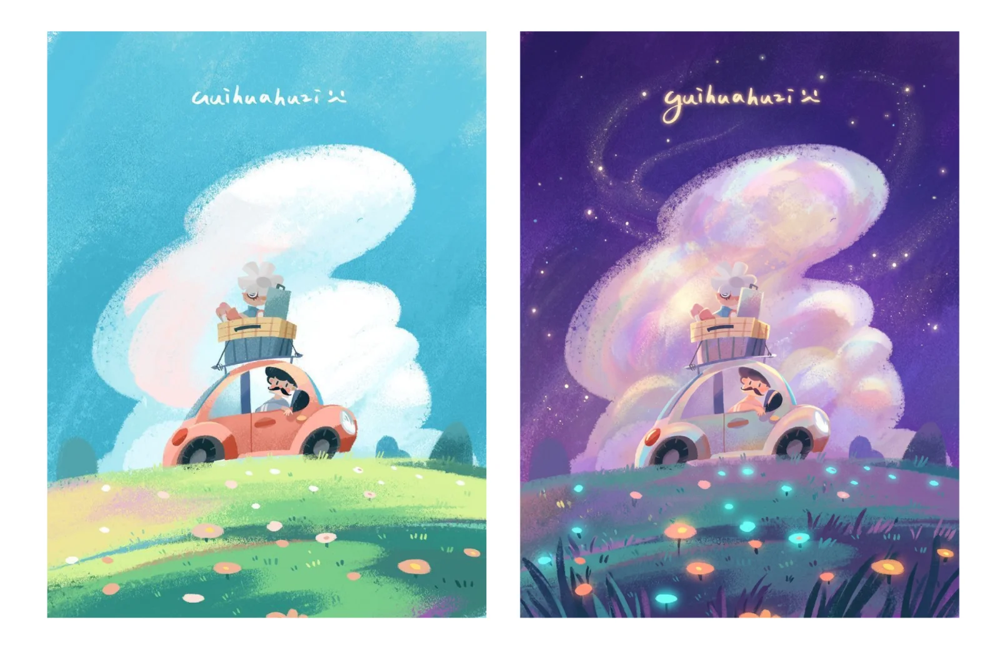
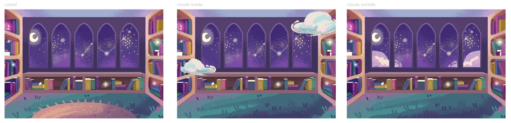
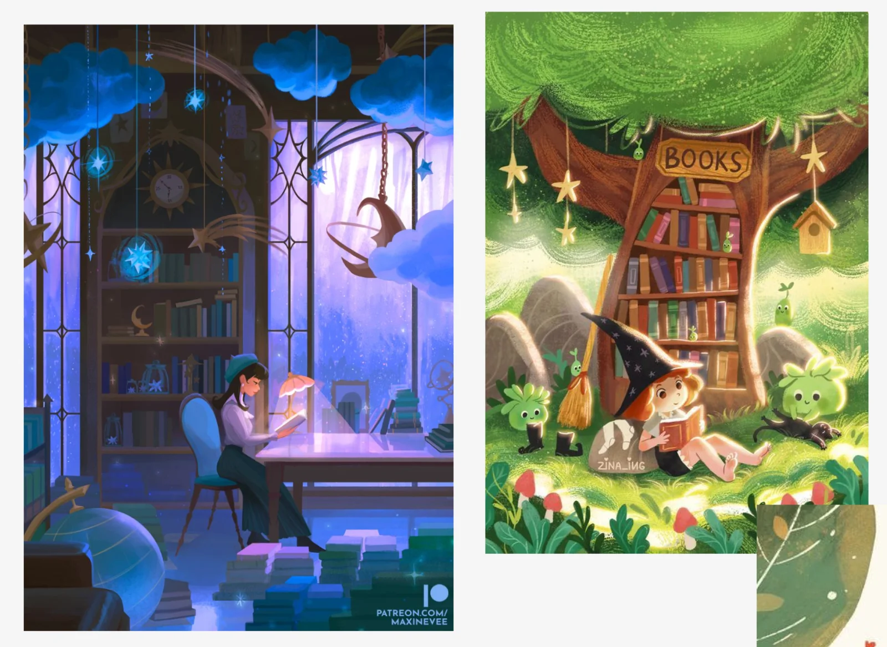
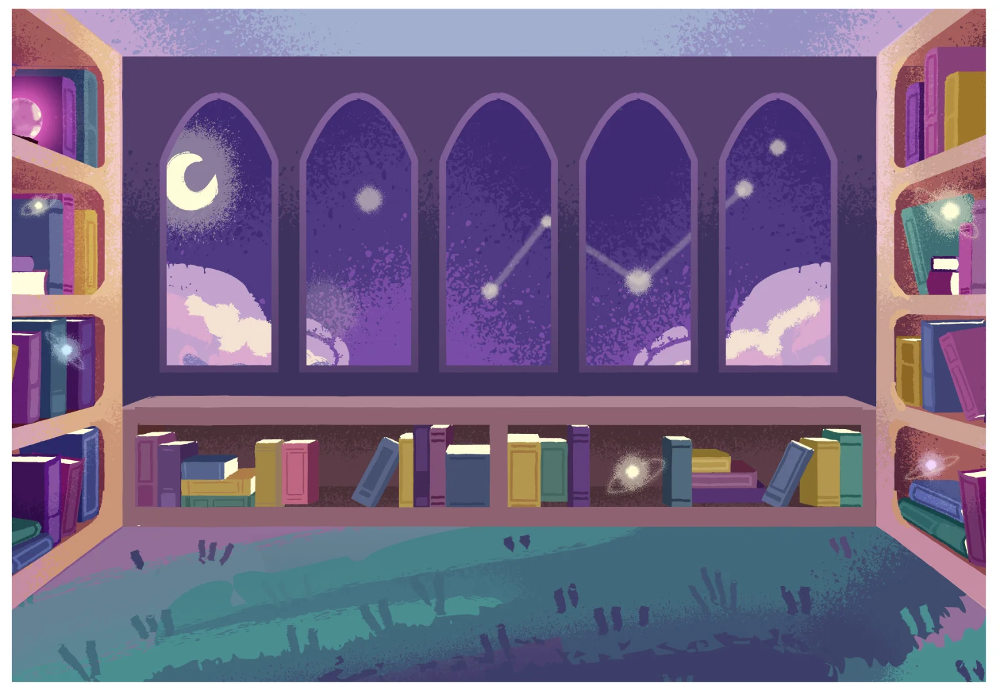
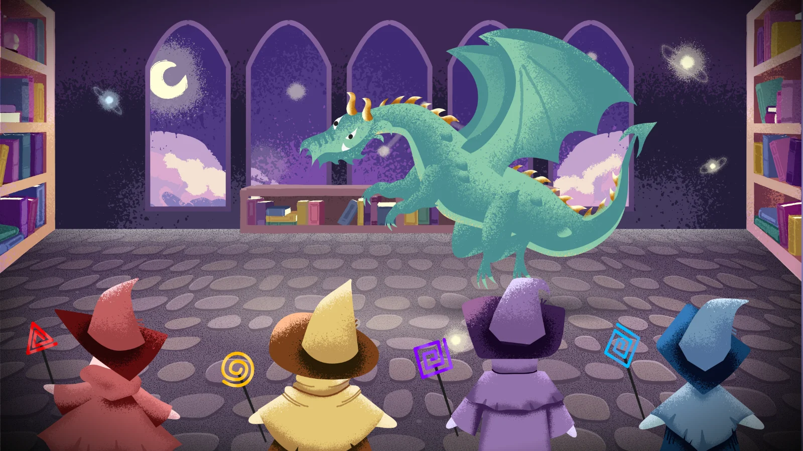

## Context: 
This is the redesign after receiving feedback from expert desk and client meeting. Feedback includes:
- Pop-up book style is top of the mind
- Keep the stroke, hand-drawn feeling
- Characters should be differentiated by outfits too
- Bubbly - Cute - Magical
- No need to follow a realistic color palette like an autumn palette
- New color palette:

## Changed settings
Since the concept is tweaked, the story itself was also changed. Originally, the dragon stole the books and brought them back to its cave. That’s why the original background was outdoor. However, now the fight between the dragon and the wizards happen inside the library, so basically everything for the background needs to be changed. 

## Sketch
I did the sketches again on paper.

Then I lined them again. We then discussed as a group and ended up with the sketch on the right.

## Color
We had a lot of trials for coloring.

### Base color

### Shading
In this process, we tried different colors, opacity settings to create depth and to keep everything cohesive.

However, we felt like the color was really off, so we decided to get some help from AI.  

### Help from AI
We use the reference photo and used AI to apply the color palette we wanted to use to see how would it look like. 

(Left - original, Right - Changed by AI)

Then we analyzed it and apply what we learned into our design.

### Redo most of the coloring
These are some of the options we had after changing most of the colors.

The idea of having grass and clouds inside the library was just experimental and it came from these references:

At first we were okay with the grass floor, we just decided to keep the clouds outside and keep the sky looking slightly simpler.

## Final touch:
However, over time we did not think the grass floor made sense, so we changed the floor again. Laura created a stone floor that matched everything else so well. It also makes the dragon stands out a lot more. 
(The dragon design process will be explained in the next post)

