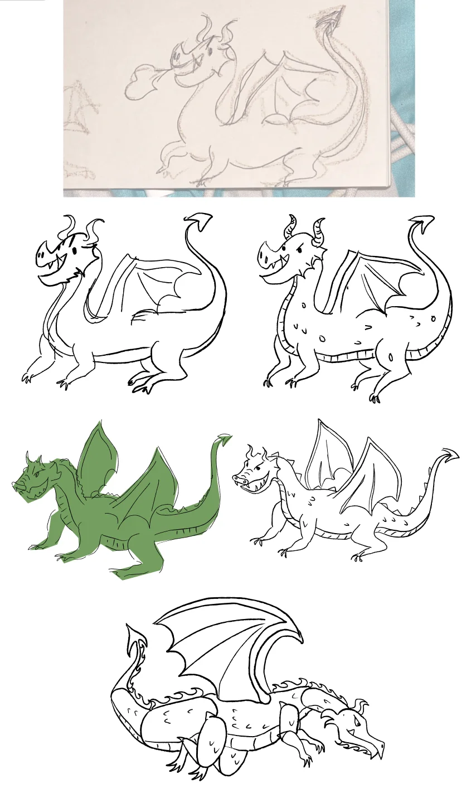
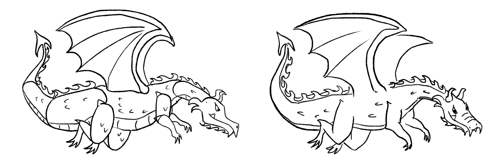
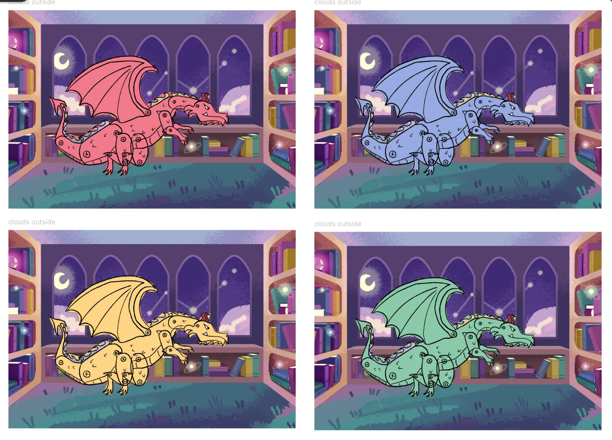
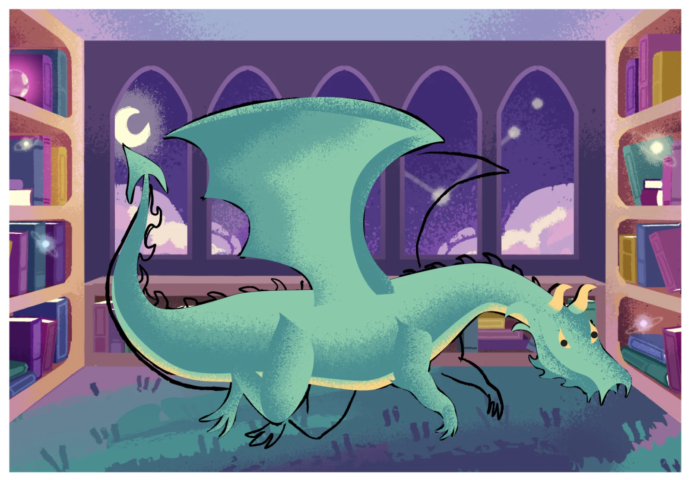
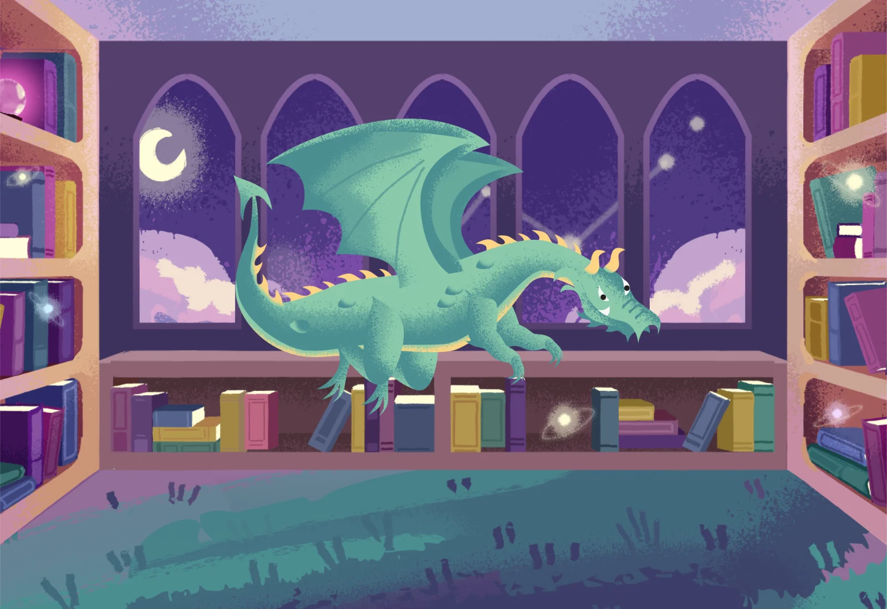
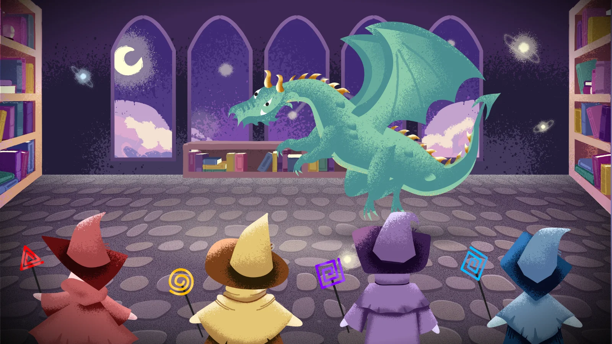

## Context
This is the redesign after receiving feedback from expert desk and client meeting. Feedback includes:
- Pop-up book style is top of the mind
- Keep the stroke, hand-drawn feeling
- Characters should be differentiated by outfits too
- Bubbly - Cute - Magical
- No need to follow a realistic color palette like an autumn palette

## Sketches
The style board is changed, I thought maybe I should also change the dragon design as well to match the new style board. That’s why I made new sketches of the dragon. (The bottom sketch was the old sketch, just without the pin at each joint.)

However, we still went for the original design but without the pin at each joints. To adapt this version, I sketched it again, but with more perspective so it doesn’t look flat like a paper puppet anymore. 

## Color

To test the color, we put the dragon on top of the background we had and tried different base colors.

We then went with green because it helps the dragon stands out more, and it’s dragon is also often associated with green. 

While shading the dragon, we also put the picture of the background underneath to make sure the dragon looks cohesive with the background while still standing out.

The shading of the dragon is done similarly with the wizards. 

## Final touch
Laura then polished it with small details on the head’s shading and the nails. (This was done while background was being adjusted.)

