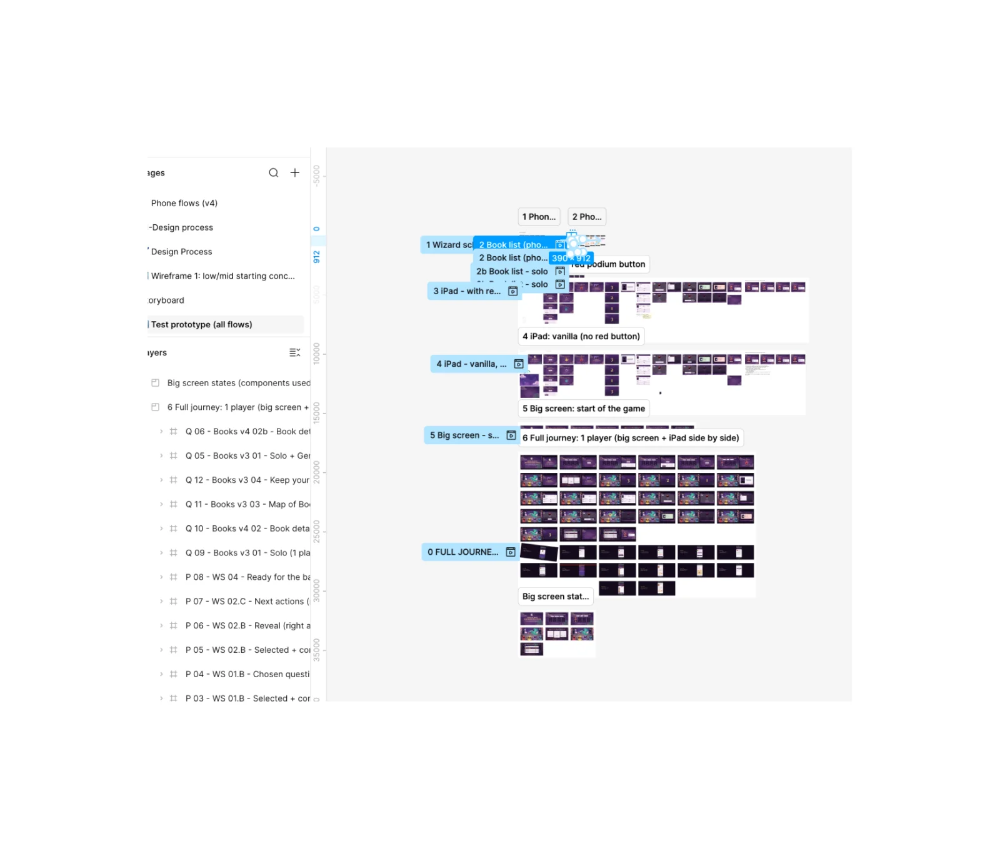
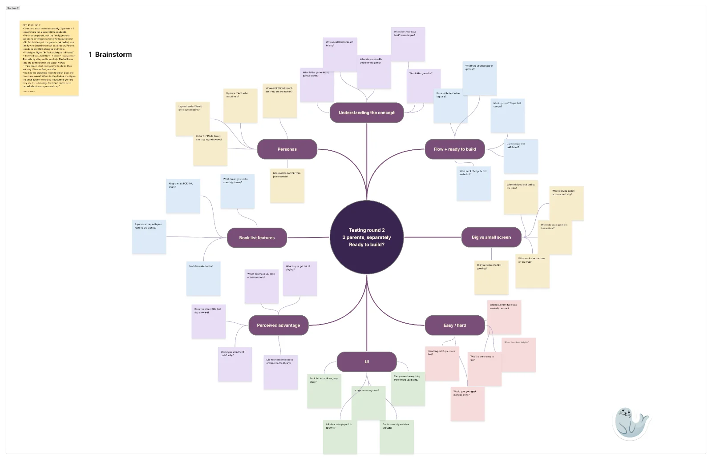
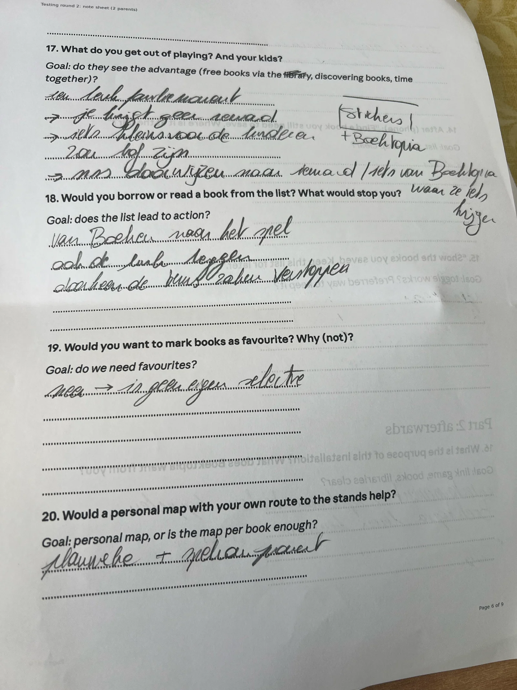

Who we tested with: 
We tested with 2 parents, each on their own. We deliberately did not test with full families yet. The game is not coded, so a family would need too much explanation from us, and that would say more about our explaining than about the design. 

A prototype that feels like the real thing:
Testers only get one first impression, so the prototype had to come as close to the real installation as possible. We built a separate test page in Figma, "Test prototype (all flows)", with one complete journey for 1 player:
• The big screen and the iPad side by side, so testers see both at once, just like at the fair.
• The whole journey: the warm-up in the queue on your phone, typing in your age, the instructions, three questions, the spell effect, the profile screen and the book list on your phone afterwards.
• 3 real question types: a character (shadow figure), an author and a genre, so we could hear which ones work.
• A real countdown, the wand moment, the hit on the dragon and the book counter going up.
• A working book list: switching between "still to save" and "saved", the book detail and the map.

Because each test was with one person, we tuned the whole flow to Speler 1. We also removed the countdown between questions: it slowed the game down without adding anything.

Two things we could not decide on our own went straight into the prototype:
• Where do the instructions go? We made a version A with the main instructions on the big screen and a version B with them on the iPad, so testers could compare.
• Does a hint nudge without pushing? When a player hesitates for 5 seconds, the hint button starts to glow. We wanted to see whether testers notice it, and whether it feels like help or like pressure.

From brainstorm to test plan: 

We started in FigJam with a mind map of everything we wanted to learn, grouped into 8 themes: understanding the concept, flow and readiness to build, big vs small screen, easy or hard, UI, perceived advantage, book list features and our personas.
=> That mind map became two tables. The first has 16 tasks and observations while going through the flow, the second has 13 questions for afterwards. Every question has its goal written next to it, so we know why we ask it. A few of them check our personas directly: would a parent who rarely reads (Tom) join, can a 6-year-old (Mats, Nora) follow, and what would help a child with dyslexia (Finn) or in a wheelchair (Noor)?

=> During the test we followed three rules: think out loud, give the task first and watch before asking why.

A note sheet on paper

Taking notes on a laptop while someone tests is distracting for both sides, so we printed a note sheet: one copy per tester, every question with its goal in small print and plenty of space to write. The answers go back into the FigJam tables afterwards, so all testers end up side by side.

