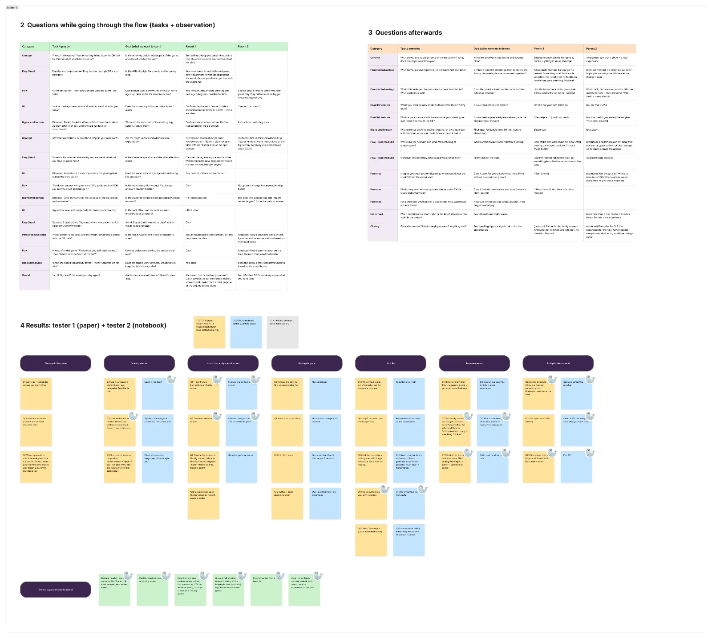

Who tested
The first tester is a parent of kids aged 10 to 14 who reads about one book a month and has been to Boektopia before. The second tester went through the same prototype, and we noted her answers in a notebook. 

What worked
• Typing in your age was clear right away. Tester 1 even preferred it over choosing an age category, and found it doable for kids.
• The wand instruction, the spell effect on the big screen and the author and genre questions were all clear.
• The glowing hint was noticed, and it did not feel like pressure.
• The book list, the tabs, the map and the saved / still-to-save toggle were all clear.
• Tester 2 scored the game 5/5 for fun. Both described it as a fun moment for the kids.

What both testers ran into
When both testers said the same thing without hearing each other, we took it seriously:
• "Leader" is confusing. Neither understood what the leader was. The crown and the gold border were clear, the word was not. One plain sentence like "Speler 1: jij start het spel" would do more.
• Instructions belong on the big screen. Both chose the big screen version over the iPad version.
• The next step is not always obvious. Tester 1 did not know where to look and did not look up at the big screen by herself after the wave. Tester 2 did not realise she could tap to continue, and scored clarity 3.5/5.
• There is no reward at the end. Both suggested something physical: a sticker at the Boektopia desk, or a coin. Tester 1 put it as: after beating the dragon, you get a sticker "Ik heb deze boeken gered".
• Favourites are not needed. Both said no, because the list is not your own selection. 

=> while analysing the results I marked the overlaps with a sticker to keep track, and afterwards I summarized them to present to the team

What only one of them noticed
• The warm-up in the queue feels like a different format from the real game (tester 1). Her ideas: practise the wand, choose your leader, take a picture with the wizard hat.
• The switch from the big screen to the iPad after the shadow figure is confusing. Her suggestion: "Klaar? Nu naar de iPad, het spel begint".
• The purpose of the QR code and the book list is not clear yet (tester 1). She would scan out of curiosity, not because she sees why.
• 3 minutes feels short, maybe 5 minutes would be better (tester 2).
• Tester 2 did not find the option to change her answer, and missed a skip button.
• The personal map is not that useful, because visitors already have a floor plan. The sector is what helps (tester 2).
• Book recommendations based on the saved books, a genre filter, and keeping the list by e-mail (tester 2).

Friday's pitch
On Friday we pitched the project at the round table: a short recap of our first concept, the client's feedback on it, and our new and improved concept. Our key message is "experiencing a story, while testing your knowledge about stories". The main feedback was to make something more creative out of the Wizard school part in the queue. That lines up with tester 1: right now the warm-up is a separate little quiz, not yet part of the story.

=> What we need to discuss next:
1.  Replace "leader". What do we call Speler 1, and which single sentence explains it at the podium?
2.  Instructions on the big screen. Both testers chose it. Do we commit, and what stays on the iPad as hints?
3.  Guiding attention between screens. How do we tell players to look up at the big screen after the wave, and back down to the iPad after the shadow figure?
4.  A physical reward. Can Boektopia give out stickers or a coin at their desk, and how does the game send families there?
5.  A more creative queue. How do we turn Wizard school into part of the story instead of a separate quiz? Practising the wand, choosing who starts and a wizard hat photo are starting points.
6.  Round length. Do we keep 3 minutes or move towards 5?
7.  Changing your answer. How do we make the change option easier to find?
8.  The book list. Drop favourites, swap the personal map for the sector, and make the purpose of the QR code clear. Are recommendations and a genre filter worth building?

Next up: students on campus, and families with kids on the physical setup.
