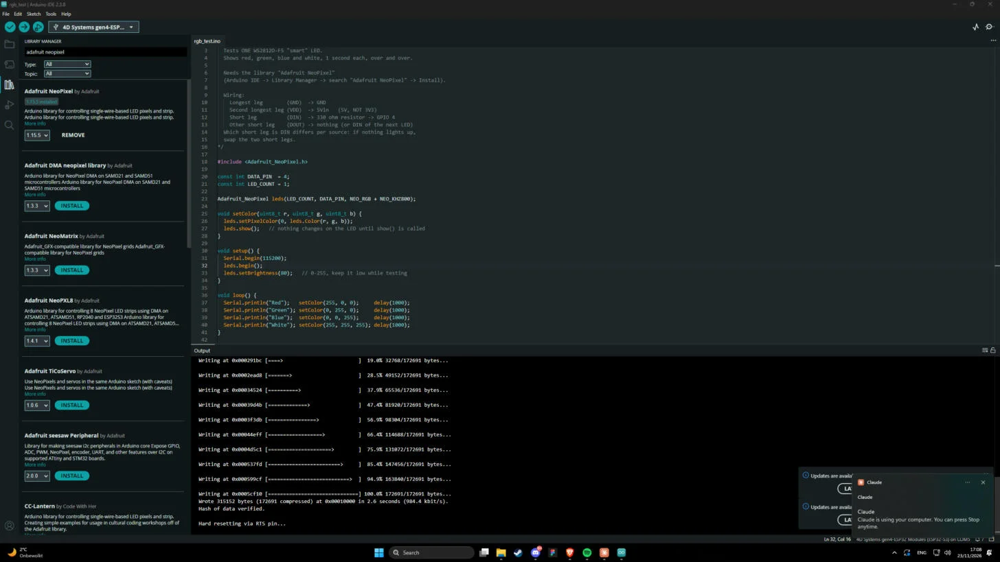

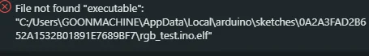

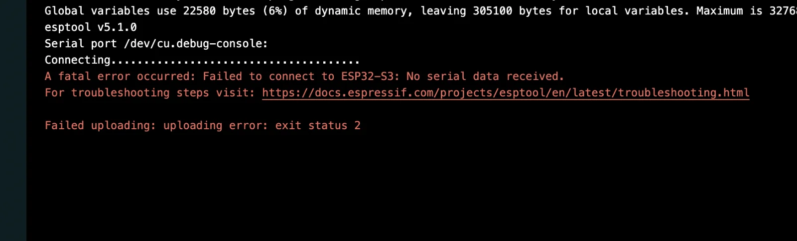

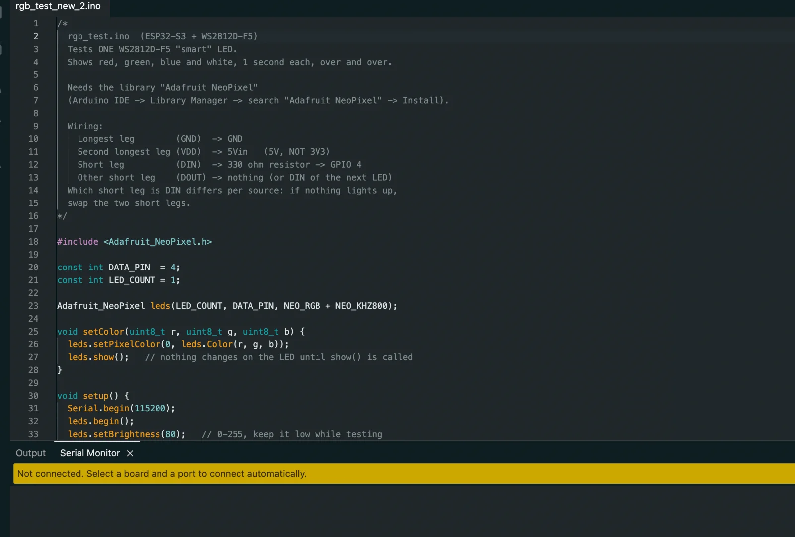

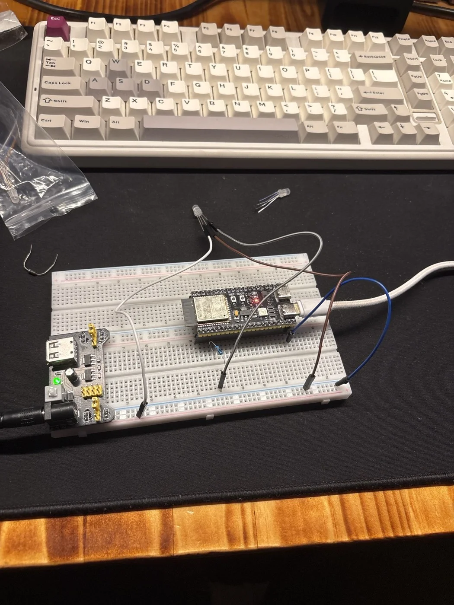

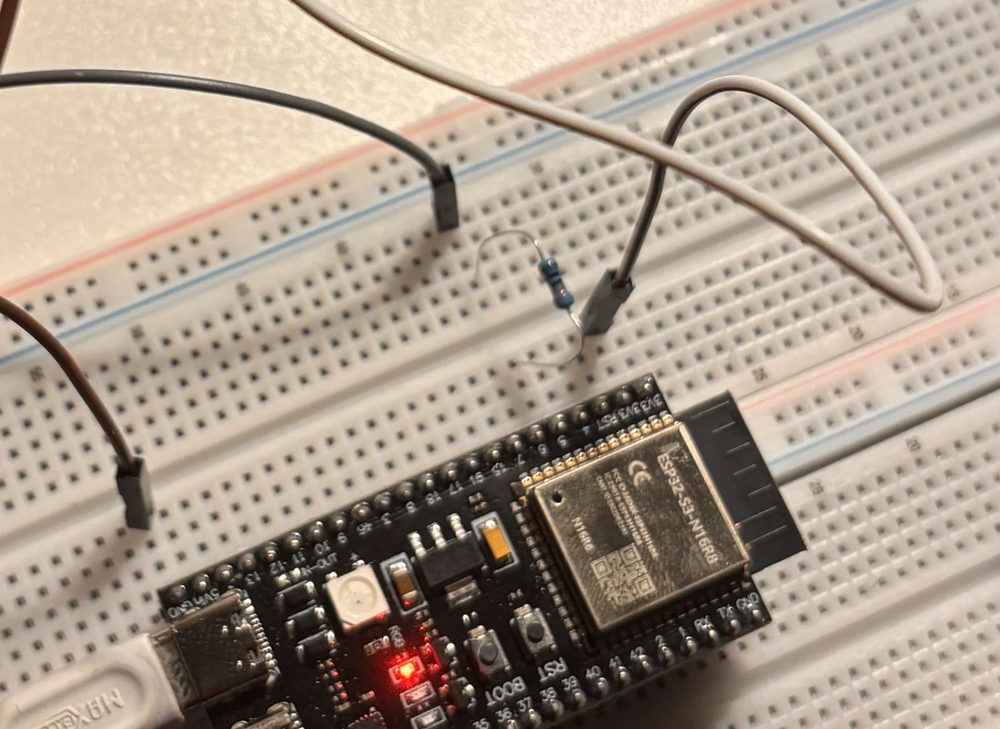

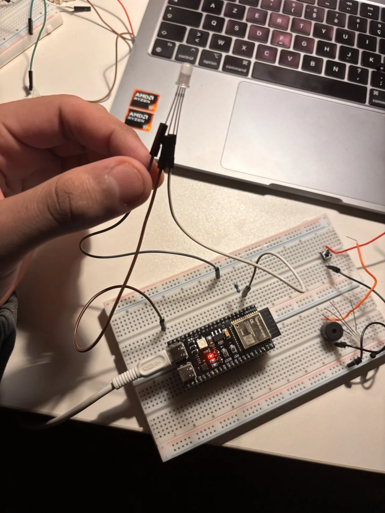

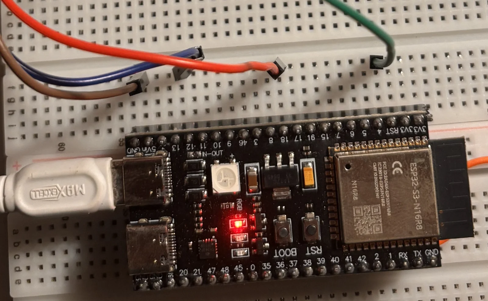

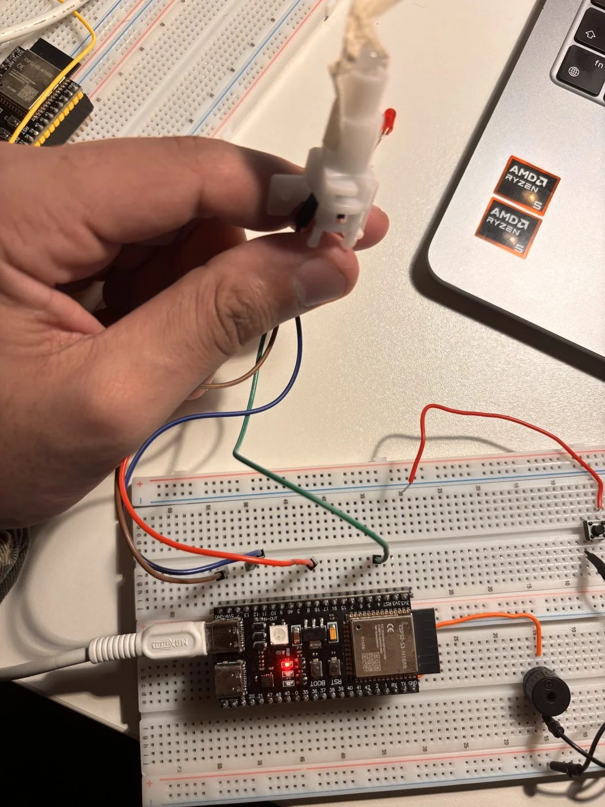

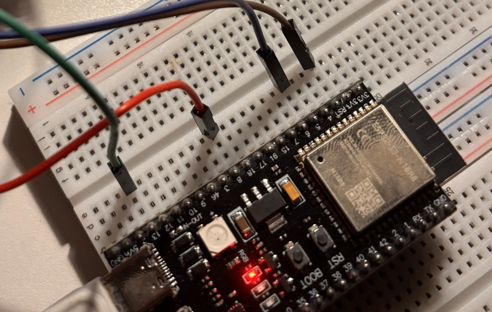

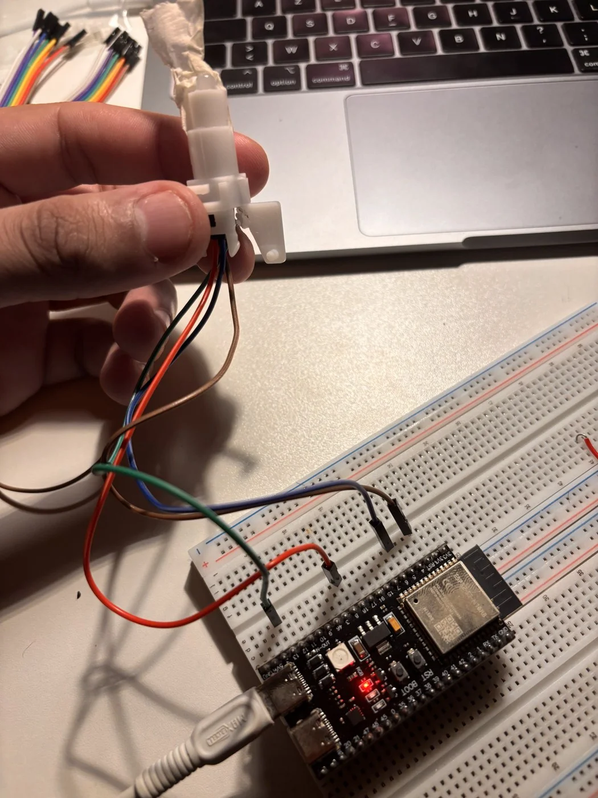

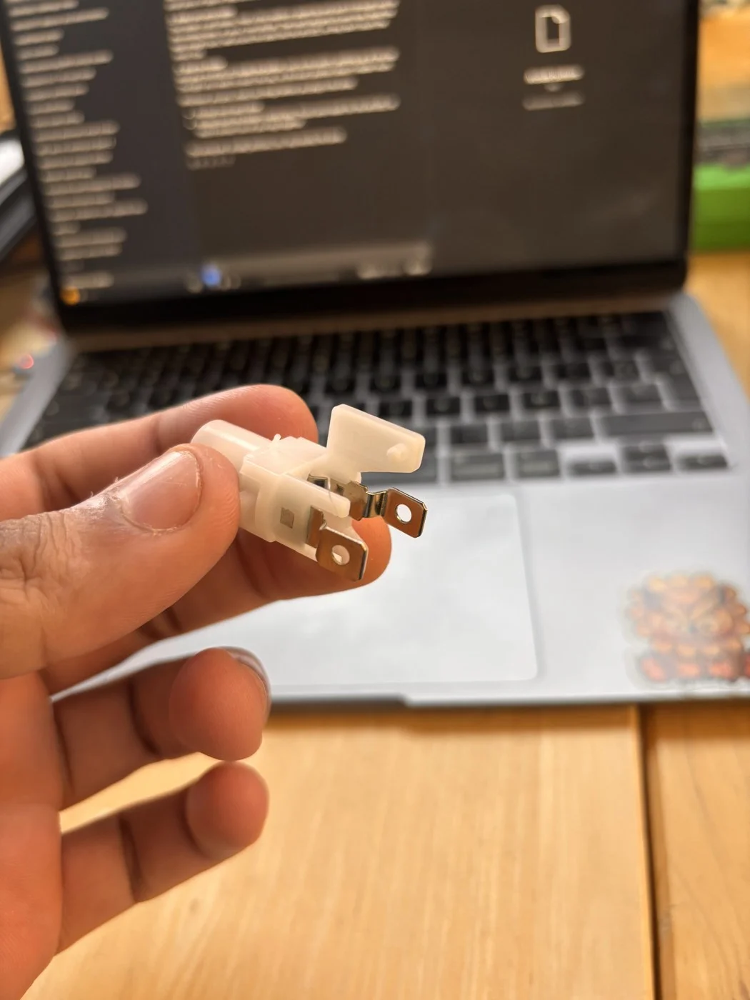

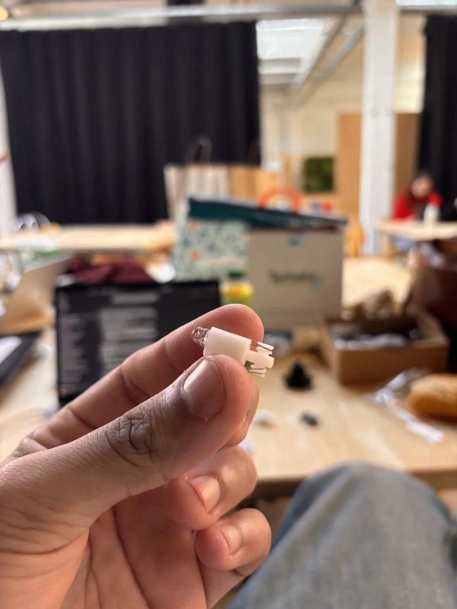

I started with a simple goal: four big arcade buttons, each with an RGB LED inside, controlled by an ESP32-S3. Every button gets an ID, and that ID picks one of four colours from an array. A day later, the LEDs still don't light up. This post is about everything I tried, and what I'm going to try next.

## The button and the switch

The Kiwi arcade buttons come in three parts: the button body, a plastic holder and a microswitch. The switch has three pins: COM, NO and NC. I only need COM to GND and NO to a GPIO pin with `INPUT_PULLUP`, which reads `LOW` when you press. The original LED is a small single-colour LED. Its legs are folded around the holder so two metal clips touch them.

To fit a 4-leg RGB LED, I pulled out the old LED, removed the two metal clips, since they would short the new legs together, and made extra holes so every leg has its own path. The holder now only keeps the LED in place.

## The wrong assumption

I assumed the 4-leg LED was a normal RGB LED: one leg per colour and one common leg, each colour driven by its own pin. That idea went through three versions:

1. An Arduino Uno version with every colour on or off, because the Uno doesn't have 12 PWM pins.
2. A classic ESP32 version with full PWM, on pins that turned out not to exist on my ESP32-S3.
3. An ESP32-S3 version with colours on or off again, because the S3 only has 8 PWM channels and four RGB LEDs need 12.

None of them could ever work. My LEDs turned out to be WS2812D-F5 "smart" LEDs, with a small chip inside. You don't drive them with three colour pins. You send colour data over one data wire, like a NeoPixel. The four legs are DIN, VDD, GND and DOUT. You chain them by connecting DOUT of one LED to DIN of the next, so all four buttons share one data pin, and the LED's place in the chain becomes its ID. That fits the project even better.

## Which leg is which?

This is where it got confusing. The datasheet, a SparkFun comment and the shop's own page don't completely agree on the pinout. The one thing every source agrees on is that the longest leg is GND, not plus like on a normal LED. I found that out too late. My first tests had the longest leg on 3V3 or 5V, so the power was reversed, which may have damaged those LEDs. The shop counts the legs from the flat side of the LED: DOUT, VDD, GND, DIN. Its specs also mention WS2811 instead of WS2812D.

## Ruling things out

To find the problem, I tested each part on its own:

1. The same NeoPixel code on GPIO 48 lights the ESP32-S3's own RGB LED, so the library and the protocol work.
2. A normal LED on GPIO 4 blinks, so the pin, the breadboard wiring and the upload work.
3. The Serial Monitor prints every colour change, so the code runs.

Only the WS2812D-F5 stayed dark. I tried powering it from 3V3, from 5Vin, from 5Vin through a 1N4007 diode and from an external 5V breadboard power module with a shared GND. I swapped the two short legs. I tried both data speeds (800 and 400 kHz), RGB and GRB colour order, and two libraries: Adafruit NeoPixel and FastLED. I also used my last, completely fresh LED, wired correctly from the start. Nothing lit up.

## Problems along the way

Uploading stopped working, because the Arduino IDE had picked `/dev/cu.debug-console`, an internal Mac port, instead of the ESP32. On my PC I got a "File not found .elf" error. That turned out to be only a follow-up error: compiling had failed earlier, so there was no file to upload. Another time my Serial Monitor stayed empty because the board profile and the USB CDC On Boot setting pointed to the other USB port. I also found that the 5Vin pin on my clone ESP32-S3 board doesn't output 5V over USB unless you solder the "IN-OUT" pad. That looked like the answer, but even with the external power module the LED stayed dark.

## What I learned

- **A 4-leg LED isn't always an RGB LED:** check the exact part number before writing any code. I wrote three versions for the wrong kind of LED.
- **On these smart LEDs the longest leg is GND:** on most LEDs the long leg is plus, and assuming that probably cost me a few LEDs.
- **Breadboards are less obvious than they look:** only the 5 holes in one column are connected, the middle groove separates the halves, and the long rails are sometimes split halfway.
- **Clone boards have their quirks:** my YD-ESP32-S3 needs a solder pad bridged before its 5V pin outputs 5V.
- **Test one thing at a time:** the board's own LED on pin 48 and a normal LED on pin 4 proved the code and pin work, which narrowed the problem to the LEDs themselves.

## How I used AI

I built and wired everything myself and ran all the tests on the breadboard. I used Claude to write the Arduino sketches and the test files, to look up the datasheet, the shop page and forum posts, and to talk through every failed test. It also checked my Arduino IDE settings directly on my PC. Some of its advice turned out to be wrong, like which short leg is DIN and that I'd need a diode for the data signal, so I had to keep checking the sources myself.

## Next up

I feel like i waisted the day on something that was more of cool to have thn a must have, I will shift my focus to the LED strip now because that was one of our selling points. I can come back to this later if time allows it. 
