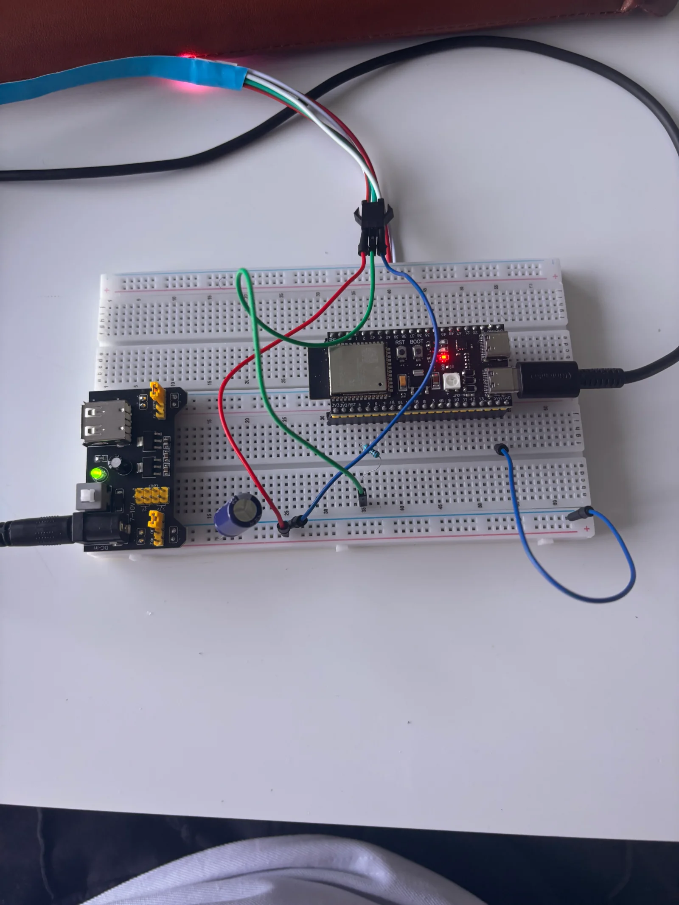
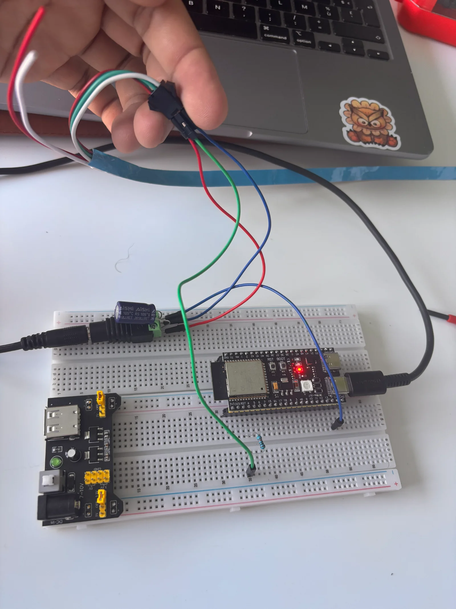
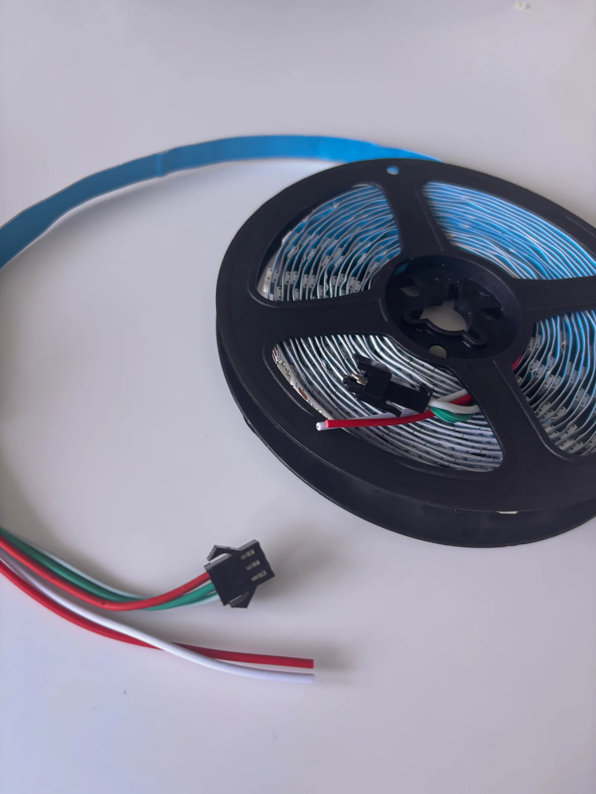

After a full day of loose WS2812D-F5 LEDs that never lit up, I switched to something I had already ordered: a 5-metre WS2812B LED strip with 60 LEDs per metre, so 300 LEDs. This time it worked. This post covers how I wired it, the mistakes I made along the way, how I connected it to the game, and what I'll change for the final booth.

## Finding the right end

A WS2812B strip only accepts data in one direction. Small arrows on the strip show which way the data flows, and you have to connect your wires at the end where the arrows point away from you. The plug on a roll isn't always at the input end, so I checked the arrows instead of trusting the plug.

At the right end, the copper pads are labelled **+5V, Din and GND**, and the wires match by colour:

- **Red** → +5V
- **Green** → Din (data)
- **White** → GND

## The first test: 8 LEDs

I kept the setup as small as possible:

1. The breadboard power module, with its jumper on 5V, powers the + and − rails.
2. The strip's red wire goes to the + rail, and the white wire to the − rail.
3. The ESP32's GND also goes to the − rail. Without that shared ground, the strip can't read the data signal.
4. The green data wire goes through a 330Ω resistor to GPIO 4.
5. A 1000µF capacitor sits across the + and − rails, with the long leg on + and the striped leg on −. It works like a small water tank for sudden peaks in current.

My test sketch, `strip_test.ino`, uses the Adafruit NeoPixel library. It lights the first 8 LEDs one by one, then shows red, green, blue and white, a preview of my 4 button colours and a rainbow. It worked straight away, which also proved that my ESP32, the code and GPIO 4 had been fine all along. The problem yesterday was the loose LEDs, not the board.

## Scaling up to 100 LEDs

For the booth I need about 100 LEDs. That's where power becomes important:

1. One LED can draw up to 60 mA at full white, so 100 LEDs can draw up to 6 A.
2. The breadboard power module can only deliver about 700 mA.
3. So I replaced the module with a DC jack with screw terminals, so the adapter could feed the strip directly.

That's where I made my biggest mistake. I plugged my adapter straight into the DC jack, and the LEDs started flashing randomly. When I finally read the label, it said **12V 1.5A**. The power module had been converting that 12V down to 5V the whole time, but without it the strip got the full 12V, more than double what it's rated for. I unplugged it right away, went back to the power module, and luckily the strip still worked.

## Random flashes

Even at 5V, some LEDs at the far end of the strip sometimes flashed on and off. That happened because my code only sent data to the LEDs I was using. When the 3.3V data signal from the ESP32 was occasionally misread, data slipped further down the strip, and the LEDs nobody controlled picked up random colours.

I fixed it in the code by making a difference between the LEDs that light up (`LED_COUNT`) and all the LEDs on the strip (`STRIP_LEDS = 300`). On every update, the code now also sends "off" to all the unused LEDs, so a stray flash is corrected right away. The real fix is a 74AHCT125 level shifter that turns the 3.3V signal into a clean 5V one. I already ordered those, but haven't wired one in yet.

## Choosing the right adapter

For 100 LEDs I need a **5V** adapter with enough current, and a plug that fits my 5.5×2.1mm DC jack. I compared a few options:

- **Kiwi 5V 2.4A:** enough for 100 LEDs at low brightness, and the plug fits exactly.
- **TinyTronics 5V 4A:** more headroom, and the plug also fits exactly.
- **JZK 5V 5A on Amazon:** cheap and powerful, but it has a 5.5×2.5mm plug. The outside fits, but the hole is slightly wider than the pin in my DC jack, so it can sit a bit loose.

A loose power plug can cause flickering, which is exactly what you don't want in a booth. If I use the 2.5mm plug, I'll test it by wiggling it and tape the cable down so nobody can pull on it.

## Connecting the strip to the game

Once the strip worked with the test sketch, I moved it into the real booth code. Two things changed.

**1. I took the strip code from `strip_test.ino` and put it in the ESP32 sketch that already talks to the game server.** The setup (`strip.begin()`, brightness, clear) and the chase animation came straight from the test. A block of LEDs runs along the strip, with the head at `i` and a tail trailing behind it. I added a colour for each booth, taken from the wizard characters: red, gold, purple and blue.

```cpp
void stepChase() {
  for (int i = 0; i < LED_COUNT + TAIL; i += 5) {
    strip.clear();
    for (int t = 0; t < TAIL; t++) {
      int pixel = i - t; // the head is at i, the tail trails behind it
      if (pixel >= 0 && pixel < LED_COUNT)
        strip.setPixelColor(pixel, PLAYER_COLORS[BOOTH - 1]);
    }
    strip.show();
  }
  strip.clear();
  strip.show();
}
```

**2. The server can now talk back to the ESP32.** Before, the ESP32 could only say "the button was pressed". Now the server can send it a message too. When a player answers correctly, the server casts the spell and sends the text `castSpell` to the ESP32 of that booth. The ESP32 reads the message and starts the chase in the colour of that booth.

On the server:

```js
const sendToEsp = (boothNumber, message) => {
  const esp = esps[boothNumber];
  if (esp && esp.readyState === 1) esp.send(message); // only if the ESP is connected
};
```

On the ESP32:

```cpp
case WStype_TEXT: {
  String message = String((char *)payload);
  if (message == "castSpell")
    stepChase(); // light the strip in this booth's colour
  break;
}
```

So the game now decides when the light shows. The ESP32 doesn't judge anything. It only does what the server says, which is the same idea as the rest of the installation.

## What I learned

- **Read the label before you plug anything in:** "my 5V adapter" was actually 12V. The power module had been hiding that from me.
- **Data only flows one way:** always check the arrows on the strip, not where the plug is.
- **Shared ground is essential:** the ESP32 and the strip need the same GND, or the data signal means nothing.
- **The server stays in charge:** the ESP32 only reports a press and shows what the server tells it.

## How I used AI

I did all the wiring and testing on the breadboard myself. I used Claude to write `strip_test.ino`, to look up WS2812B wiring guidelines and the specs of the power module and adapters, and to draw wiring diagrams. It also found my earlier orders for the strip, capacitors and level shifters in my mailbox, so I knew what parts I already had.

Not all of its advice was right. It had me plug the adapter straight into the DC jack without asking me to check the voltage first, which put 12V on the strip. Since then I check every label myself before plugging anything in.

## Next up

Wait for the 5v adaptor to arrive, and continue with game assets for now.
