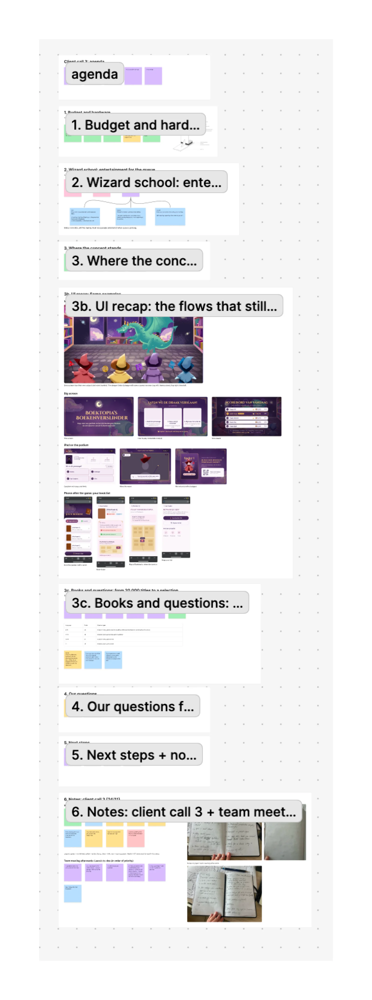
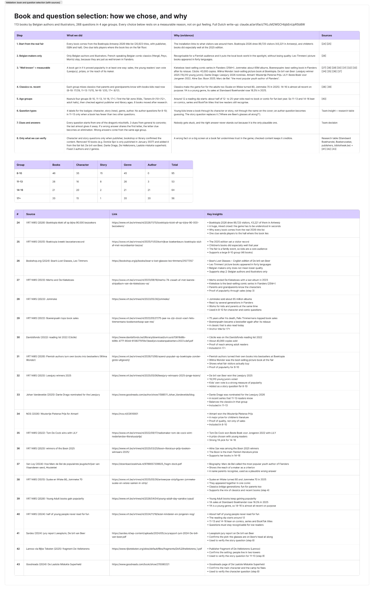

We had our third call with Boektopia on november 24. Since the last call we knew there was no budget, the wizard school had to become more creative, and our client hadn't yet seen the game properly. So we prepared four things: what we build with no budget, the new wizard school, a recap of the UI, and how we chose the books and questions.

Building with no budget

For the demo we want to build one nice example podium to show how we imagine the installation. The other iPad stands come from what is available on campus, and we borrow the big screen from school. The showpiece is made from one sheet of MDF, cut to size at Brico with a 20% discount through a contact, so the wood costs us only about €25 to €30. 

Wizard school: from practice quiz to three mini games

Our first idea for the queue was practice questions. In testing round 2 testers found that a bit bland: it felt like playing the same game twice. At Friday's pitch we also heard that the queue should be more creative. So before the call, Pham and I brainstormed what a wizard school could be. We put everything on the table: hat try-ons, an owl, making potions, drawing on a cloak on a mannequin, designing your own wand by dragging tops and bottoms, a wand warm-up and even "you are the dragon". That last one we dropped straight away.

We ended with three mini games, one for each part of the wizard outfit:
• Wand: A warm-up where you just wave, the same movement as in the game, shown with an illustration of a hand. Players reach the podium already knowing the gesture.
• Hat: Tap to randomise, so everyone gets a hat for a photo with a filter. A hashtag in the filter makes it shareable and a fun family moment.
• Cloak: Draw your own cloak design. This one is optional.
What we showed

We showed the in-game screen with the dragon and the four wizards, the start screen, the iPad flow (questions with clues, waving the wand, the mini wizard profile), and the phone flow after the game: the book list, a book detail, the map of Boektopia and keeping your list. We also explained how we narrowed the Boektopia list of about 20,000 titles down to 113 books by Belgian authors and illustrators. 

We used sales, reviews, Leesjury votes and prizes, with a mix of classics and recent books, and only books whose content we could check. That gives 268 questions in four age groups. I'm building and checking the questions now so they can go straight into the code. (with some help from Claude of course, 20k books is a lot to check) 

What the client said
• The concept is good, and so is the idea for the queue.
• In the wizard school, uploading a picture works well, and something personalised is a nice to have. Could it even be printed?
• The queue itself is not ideal. Families could scan a digital ticket, and we could combine the wizard school with that ticket, so the waiting becomes more valuable.
• Variety matters: include titles from the six publishers who fund Boektopia.
• For the hardware they always work with 4U, a technical production company.
• Show in the instructions how many books you saved.
• Look for something other than the wand movement as an alternative. We noted this one as not feasible for now.

What we do next
After the call we split the work. For testing round 3 we need a makeshift podium (chairs will do), the button and LEDs working, the vanilla version working, and the whole flow working up to the book list at the end. We time every activity and show just the stand name. We also want to look at an animation of the video and improve our testing sheet. One question we add to round 3: do testers think they need to be able to change their answer while waving the wand? Our last tester didn't.

My own list, in order: finish and check the questions; the concept ideation, validation, UI and prototype for the wizard school, plus concept testing and a PDF view of the book list; ordering the podium materials; a detailed blog post that sums up all testing and insights so far with our decisions and where to find them to make things easier for the teachers to navigate; cleaning up and restructuring the figma file to make things easier to navigate. 

Ux log: 97 - 102
