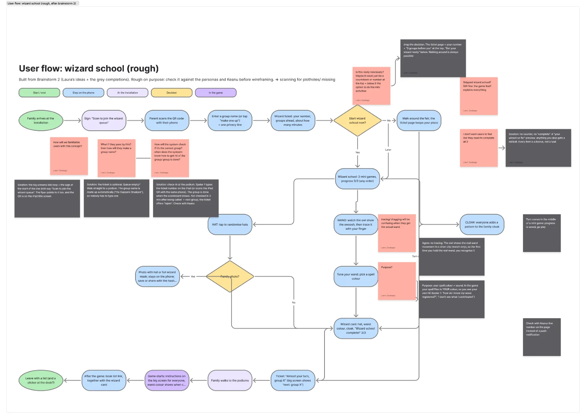
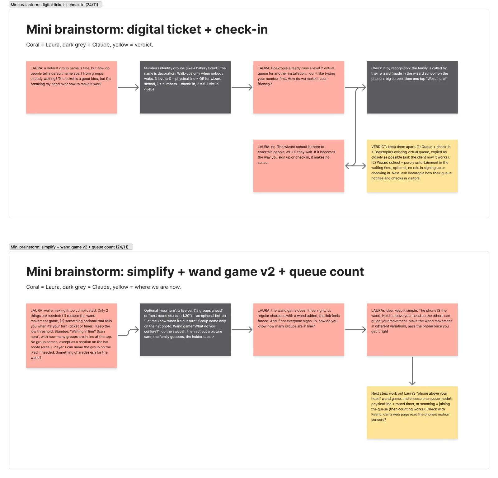
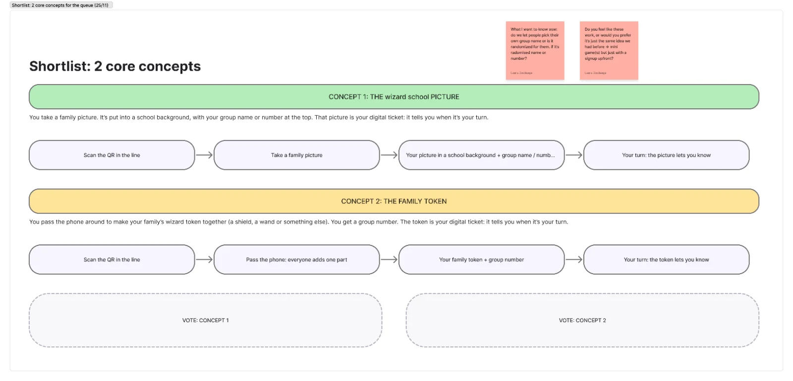
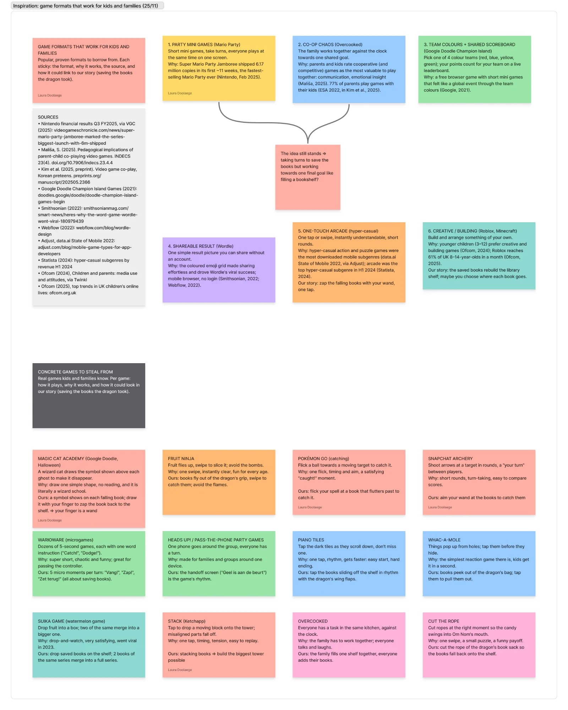
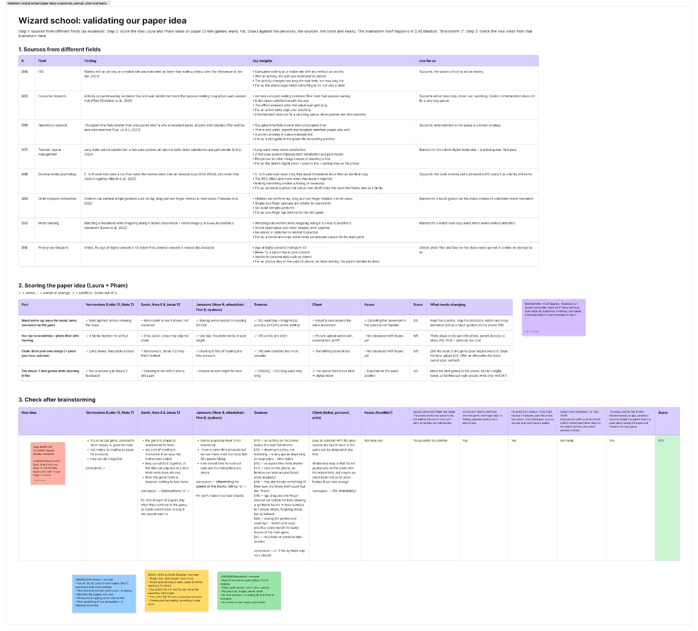

November 24th
After client call 3, our three wizard school mini games (wand, hat, cloak) didn't hold up anymore. Boektopia asked for a digital ticket instead of a physical queue, and Keanu told us that detecting the wand movement in the queue isn't feasible. So I went back to the drawing board, this time with a clear goal: keep families entertained while they wait, in a way that works for one player and for a whole family.

Validating the paper idea first

Before brainstorming, I checked our paper idea against our three persona families, the client, Keanu and 8 sources from different fields. The wand warm-up scored only 2/5, mainly because it can't be built. 

The sources gave us a few things to hold on to:
• Waiting with an activity feels shorter than waiting without one 
• Active waiting works better than passive waiting, but it can't fix a very long queue 
• A virtual queue lets people do other things and makes them more satisfied
• Kids can reliably tap, drag and rotate with one finger

Brainstorm rounds
The brainstorm took several rounds, and a lot of ideas didn't make it:
1.  Brainstorm 2 with a mind map. The original concept in the middle, the three features around it, the feedback on each feature, and our ideas to improve them.

I tried to map them out in a user flow, but stumbled across some plotholes. I tried to have claude come up with solutions (dark gray sticky notes) but I wasn't convinced at all 

2.  Mini brainstorms between me and claude. Or better Claude giving me basic ideas and me arguing with it. The phone as a wand (the buttons didn't make sense, so we dropped it), a digital ticket with check-in, simplifying everything, and a start screen at the podium to enter your group number.

Here are some examples: 

3.  a shortlist of two concepts: a family picture with your group number as a ticket, and designing a family wand or shield together.

Along the way we set some boundaries. Tickets with numbers, animals or emblems got too complicated and mixed two goals. Magical animals belong to another group's concept. Physical tokens felt too gimmicky. I got stuck in the idea that everything needed to be connected (the qeue system, signing up,...)

Keep it simple

On 25/11 I decided to stop adding and start removing based on my teammate's advice. The ticket and the entertainment became two separate things to look at. The top of the phone screen always shows your place in line and the waiting time, with a notice when it's your turn. 
Below it there is one simple start button for a mini game about saving books, with a score and a picture to share, inspired by Keanu's example of a Snapchat archery game. Players can choose how many play and pass the phone between turns.

From our conclusions, the testing, the client and the personas, I wrote 5 requirements for the solution:
1.  The queue is separate from the game, so families can walk around.
2.  Waiting is active but simple: one finger, no reading, playable seated, not a second quiz.
3.  It works for 1 player or a family, together.
4.  There is something personal to take home.
5.  It is feasible for Keanu and fits the story of saving the books.

Learning from games that work

To avoid reinventing the wheel, I looked at game formats that work for kids and families: party mini games (Mario Party), co-op games (Overcooked), team colours with a shared score (Google's Champion Island), a shareable result (Wordle) and one-touch arcade games. Then I collected concrete games to borrow from, like Fruit Ninja, Pokémon GO and WarioWare. 

I afterwards selected my top picks for the team to chose between. The one that clicked for me and the team was Magic Cat Academy, a Google Doodle where a wizard cat draws the symbol above each ghost. It's simple, needs no reading, and it already feels like a wizard school.

The concept

Our new idea: books fall around a wizard on the top half of the screen, each with a symbol above or on it. On the bottom half you draw that symbol with your finger. Draw it right and the book disappears in a puff of magic: rescued. Miss it and the book falls through the floor. With more players, everyone gets a hat colour and the phone goes round every 30 seconds; the handoff screen shows the score so far. Playing alone, you just keep going. 

After a while more books fall at the same time and faster, but every new turn starts slow again, so a 6-year-old never takes over at the hardest part. You can stop any time, and when your number comes up, the game pauses and the family goes to the podiums.

I drew this as user flow v3 and checked it against the same sources. It scores well on active waiting, the integration with the virtual queue. It's only missing the sharability that the original mini games had. This can be solved with a simple photo add-on at the end, if there is time left.

