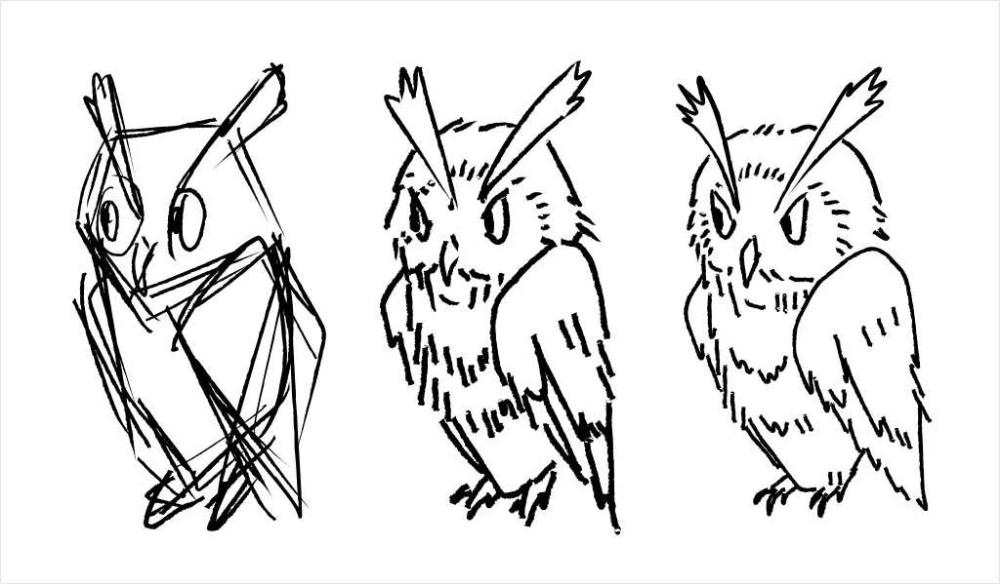
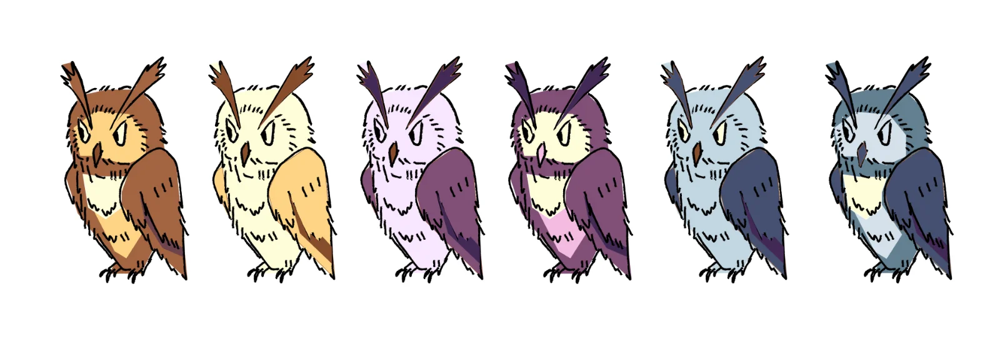
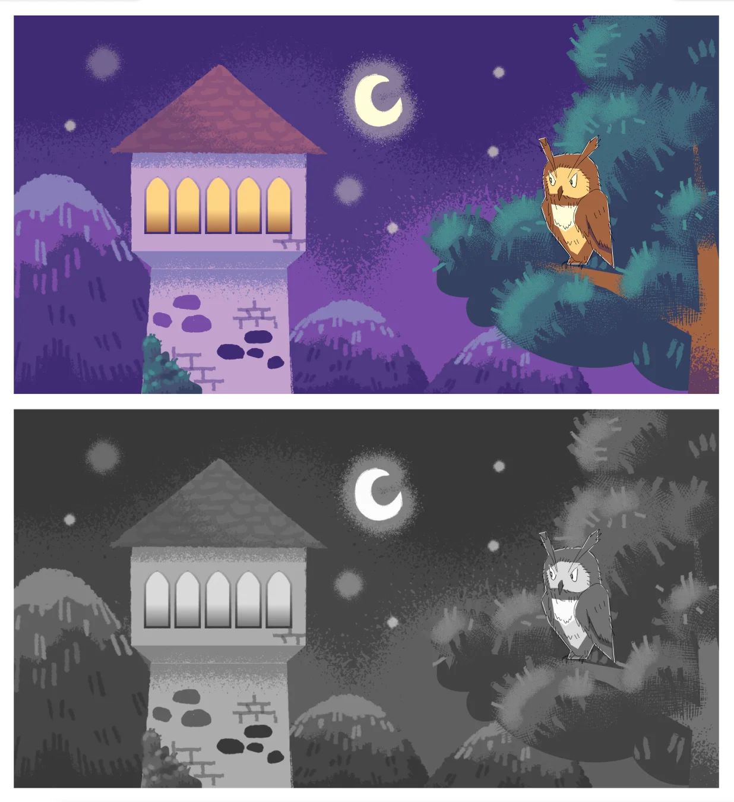
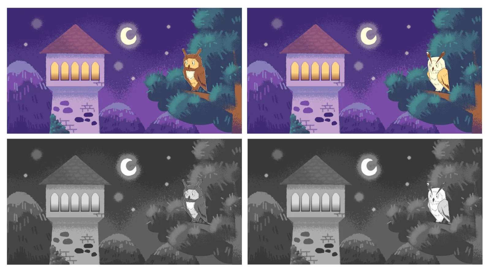
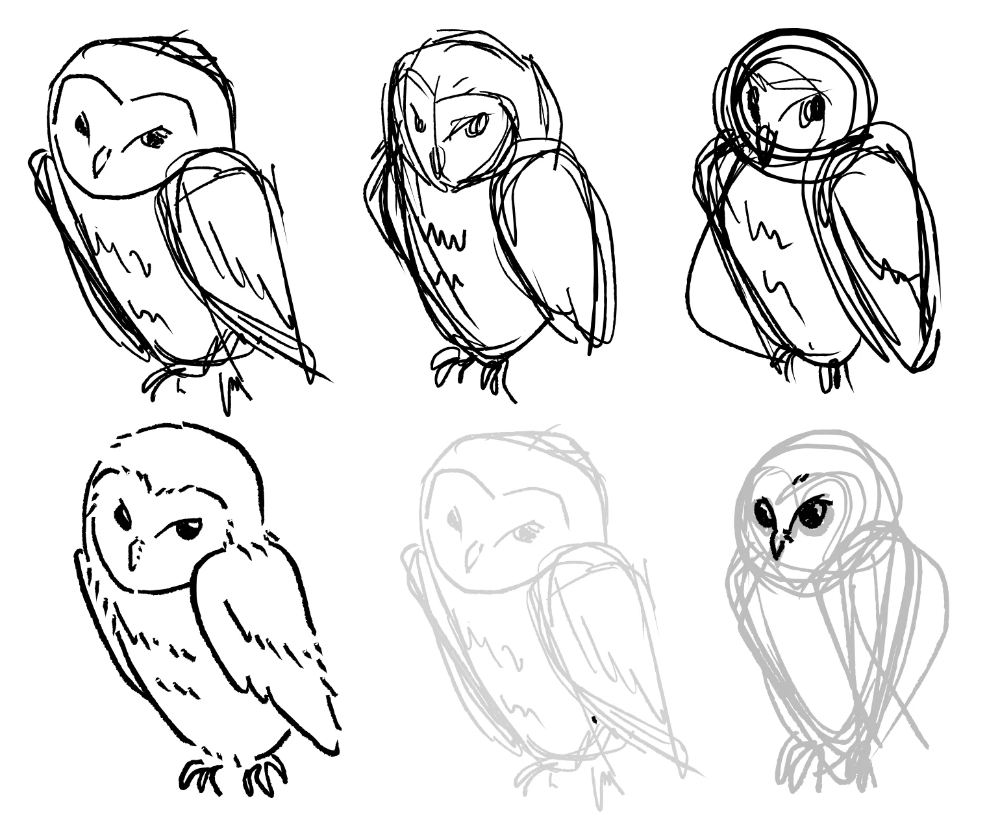
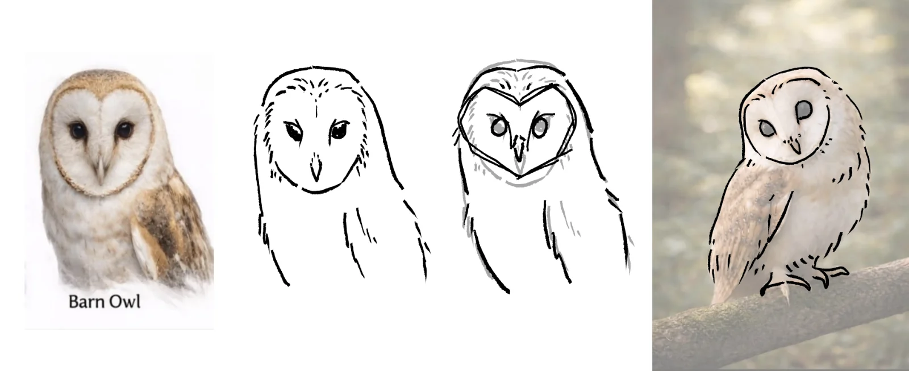
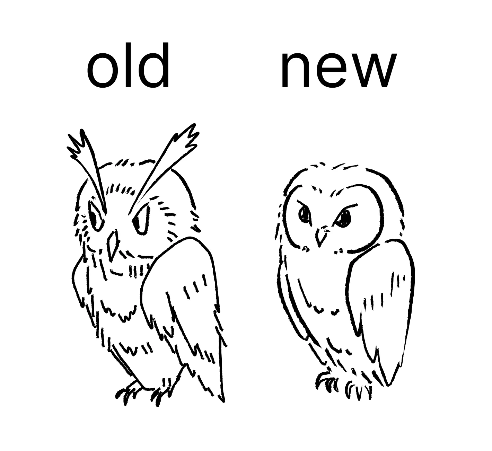
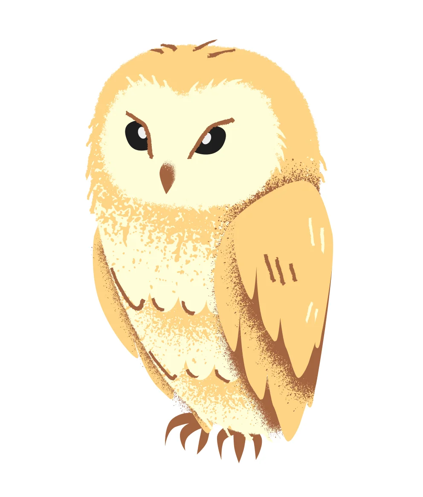
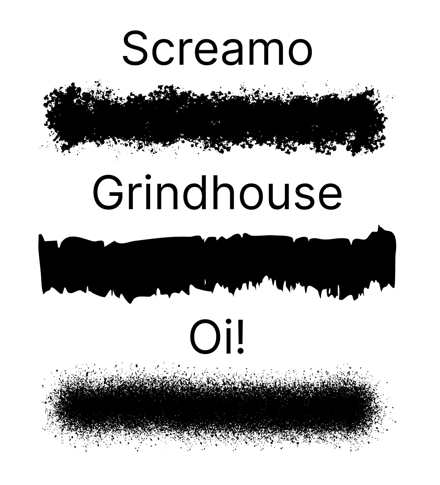
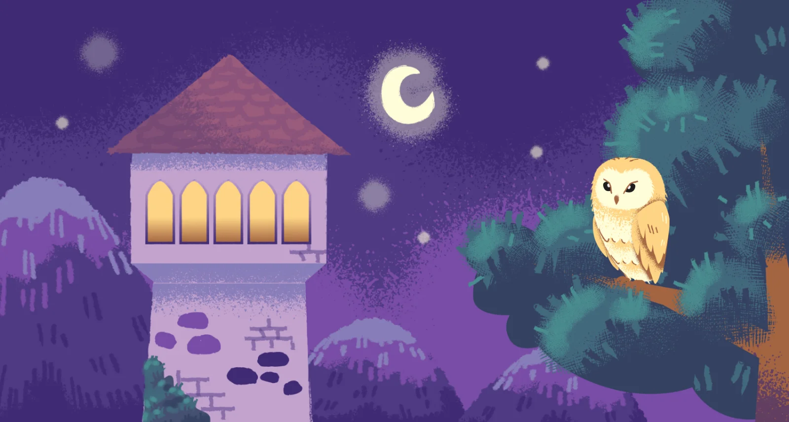

## What we had before

## Color testing

### Color testing 1: Testing different colors on the owl

I tested the owl with the colors from the color palette.

My team decided to go with the first option, as the colours look more natural and harmonious.

### Color testing 2: Testing the color of the owl on the background

With the selected color palette, I placed the owl against the background to see how well it stands out from its surroundings.

It's clear that the owl doesn't really stand out. That's why I tried the 2nd most natural color we had in the previous step.

My teammates were happy with how the cream-colored owl stands out against the background. However, they felt that the color wasn't realistic, as great horned owls don't naturally have this coloring.

To address this, we decided to switch to a different owl species: the barn owl, which has a more naturally cream-colored appearance.

## Switching to barn owl

### Sketch

I tried to sketch the barn owl with a reference on a side while trying to stylize it. 

This didn't turn out the way I had hoped. The sketch ended up reflecting my personal interpretation of a barn owl, with more feminine features and a pose that doesn't quite fit the direction we want for the project.

To address this, I decided to sketch directly from the reference first to better understand the barn owl's features before attempting to stylize it.

Once I had a better understanding of the barn owl's features, I tried sketching it again, using the silhouette of my previous sketch as a starting point.

### Color

Once I have the sketch, I add the colors and the shading.

These are the brushes I used for the owl:

## Final: Barn owl on the background

