## Purpose

This landscape will be used in the introduction video to give players the context they need before starting the game.

In this scene, the owl observes from the outside and witnesses the destruction caused by the dragon. The owl then addresses the players, who take on the role of wizards, explaining what has happened and asking for their help to protect the book from the dragon.

Below is what we had for the storyboard.
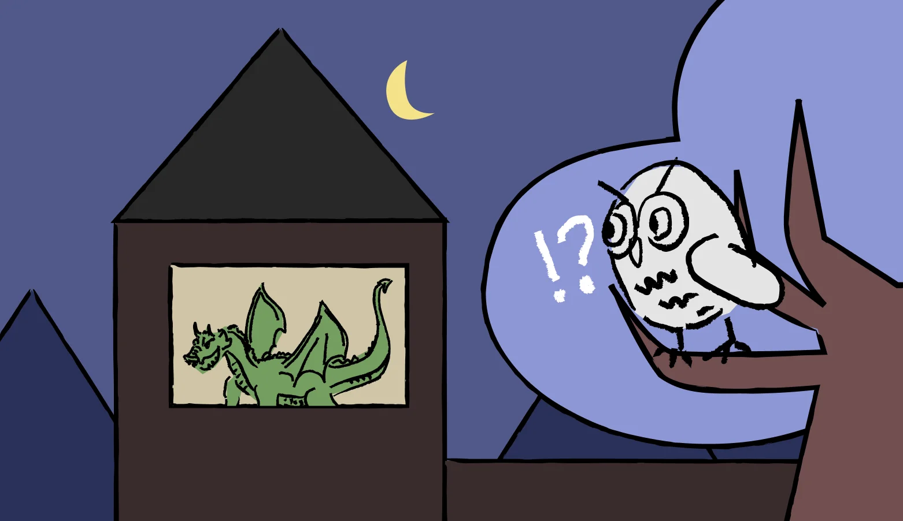

## Reference

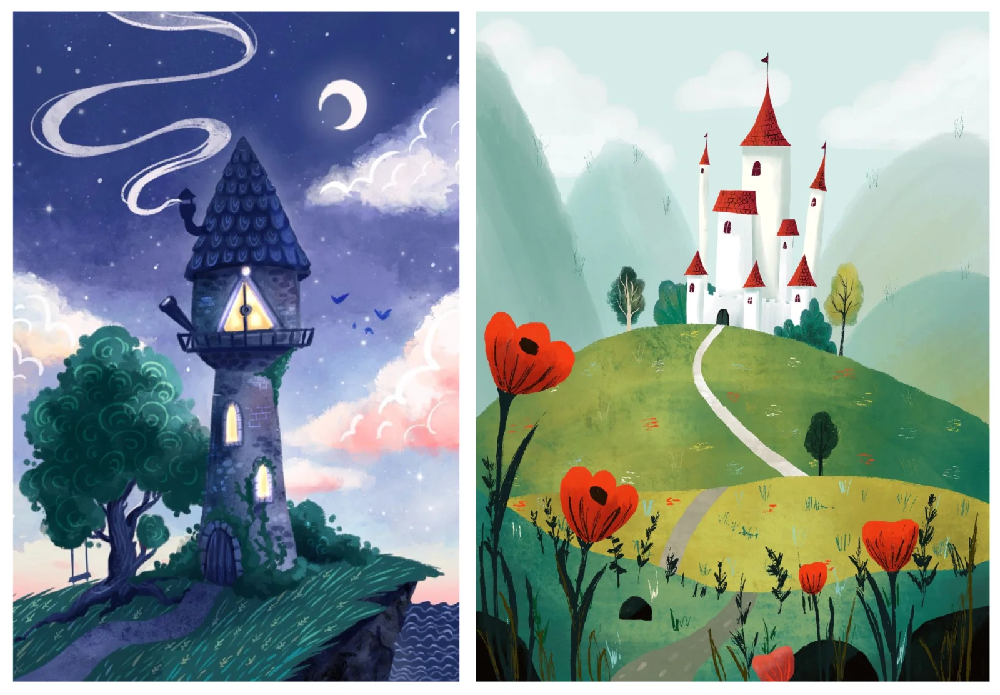

## Sketch

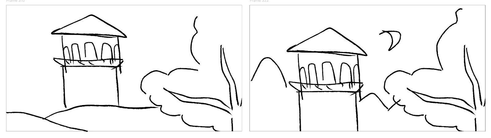

I decided to go with the sketch on the right because, with a horizontal canvas, we don't have much vertical space to stack multiple layers of land and hills.

Also, the mountains in the background help fill the empty white space better.

## Back-ground

### Sky, moon, stars

I reused the same sky, moon, and stars from the library interior perspective illustration for this background.

### Clouds

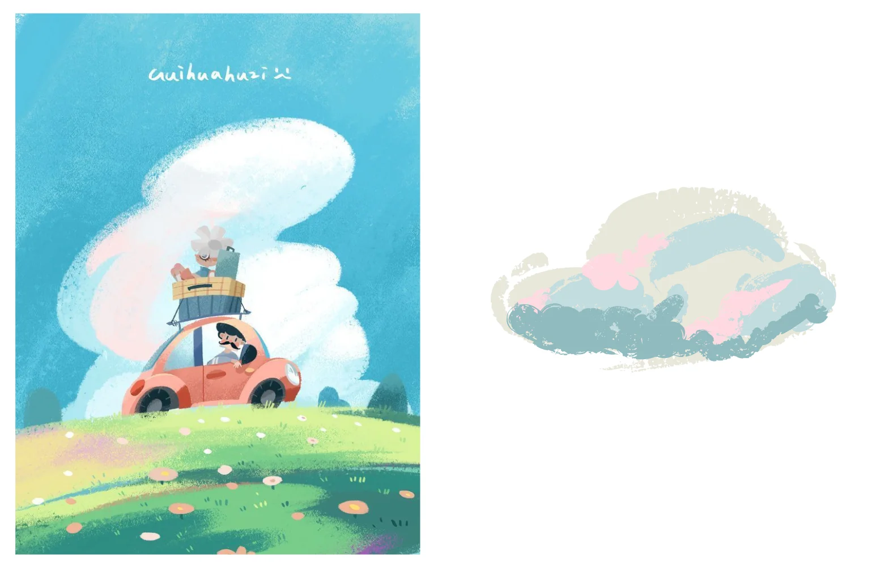

*Left - reference, Right - my work.*

I like how the reference uses subtle hints of pink in the clouds. The shadows also help define their shapes and add more depth to the illustration.

### Mountains

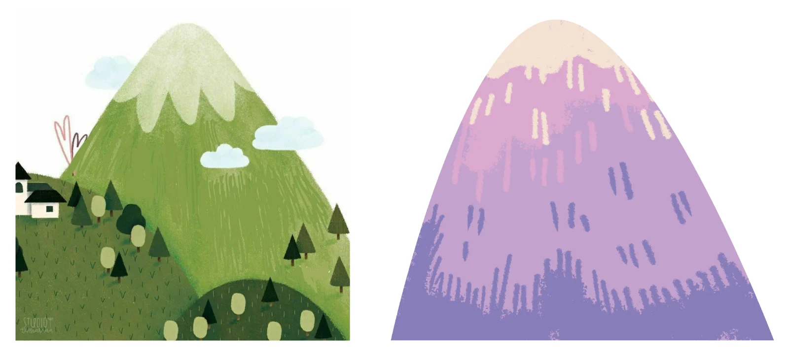

*Left - reference, Right - my work.*

I like how the tallest mountain in the reference uses a brush-grain texture, with multiple monochromatic strokes layered on top to create a subtle undertone of gradient. However, using such densely placed strokes wouldn't match the style of the other illustrations. So, I decided to keep the strokes but use them more sparingly to help create a smoother color transition.

## Mid-ground - Tower (Library)

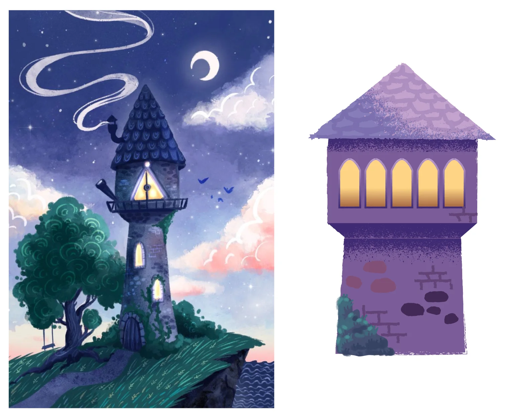

*Left - reference, Right - my work.*

I chose to use a tower instead of an entire building because I feel it works best to draw the viewer's focus towards a single point: the library windows. I don't think a wider building is necessary for this composition.

I made the tower slightly wider to accommodate all five windows. I also used groups of small blocks and lines to illustrate the stone and brick textures like how it's done in the reference.

## Put everything together

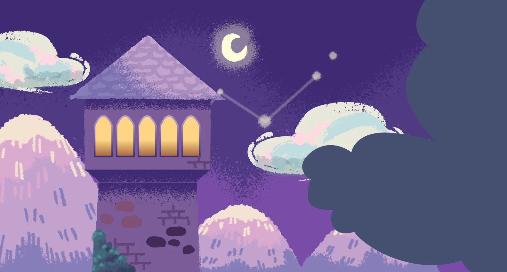

When I put the elements together, I noticed that the colors weren't working very well. The tower didn't stand out enough and was being overshadowed by the mountains. This becomes even more noticeable when I convert the illustration to greyscale. We can see that the value contrast isn't working in our favor, as it doesn't help the tower stand out as the focal point.

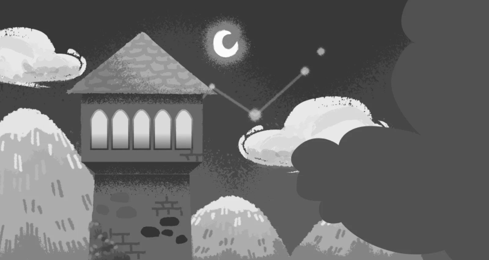

## Testing out different colors for Tower and Mountains

Below are some of the colour variations I experimented with. I know it might have been quicker to simply increase the contrast right away, but I wanted to experiment with different colors and values to see how they would work together.

**The scale:**

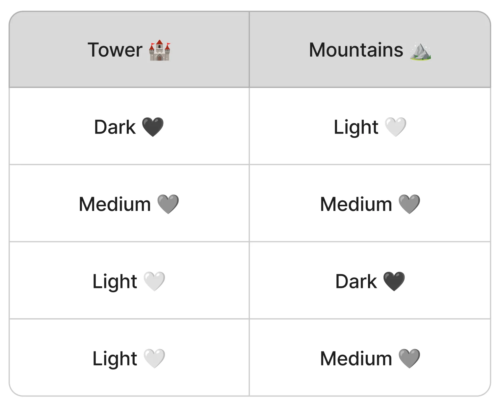

**The result:**

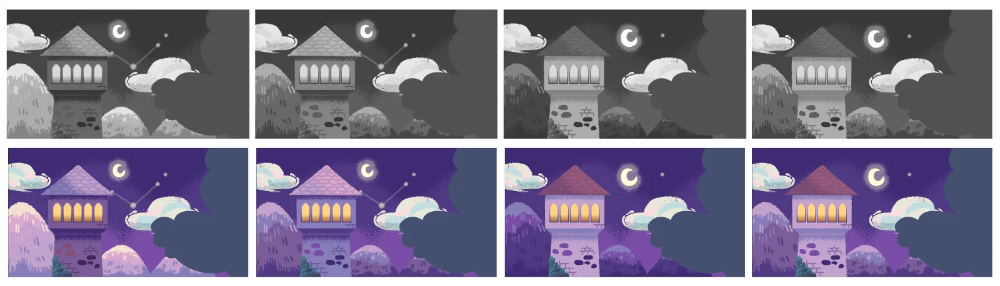

We can see, as expected, the Light Tower - Dark Mountains combo works the best. 

## Foreground - Tree

This is my favorite thing to illustrate so far through out the whole process.

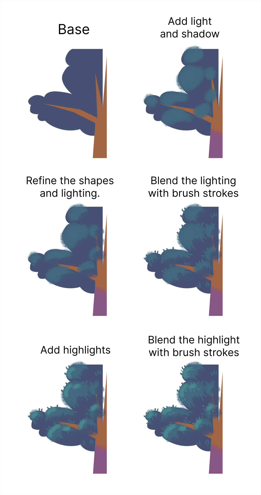

These are the brush I used to illustrate the tree:

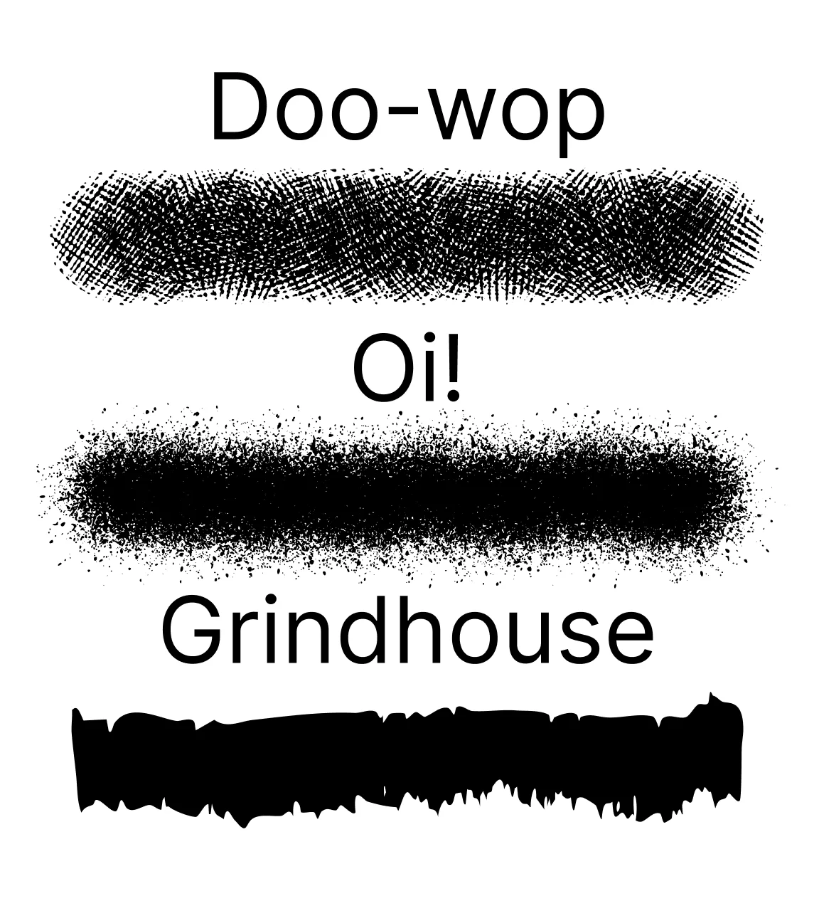

## Put everything together 2

I put the tree in the landscape and do the value test.

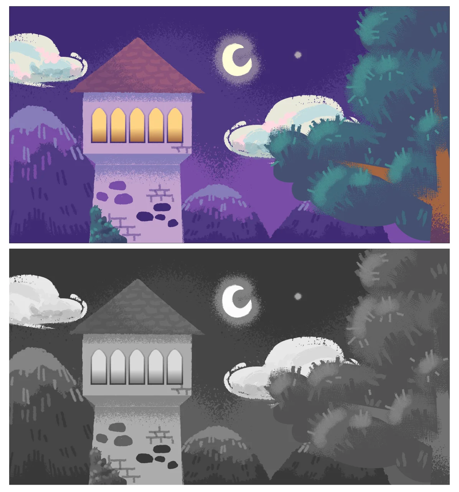

There are 2 issues:
- The tree looks flat because there is not enough contrast.
- The clouds are too bright.

### Issue 1: the tree

I noticed that the shadows on the tree weren't dark enough, making it look flat. To fix this, I darkened the shadow color to create more contrast.

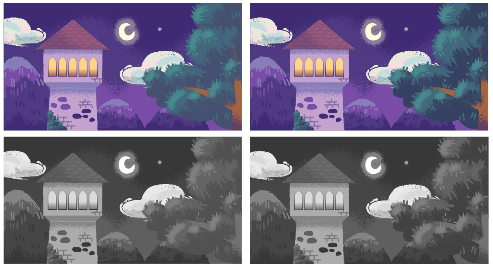

With the darker shadows, the tree now has much more depth and dimension.

### Issue 2: the clouds

The clouds are too light, taking away the highlight from the tower.

To solve it, I tried 2 options: 
- Make the clouds darker
- Remove the clouds and replace them with small stars

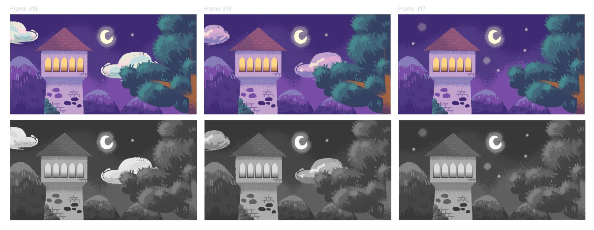

We decided to go with the second option, as it makes the tower stand out more clearly as the main focal point of the scene.

## Final work

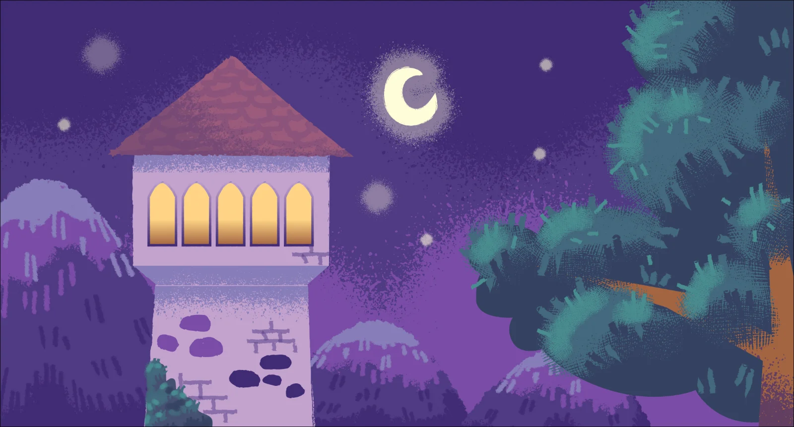
