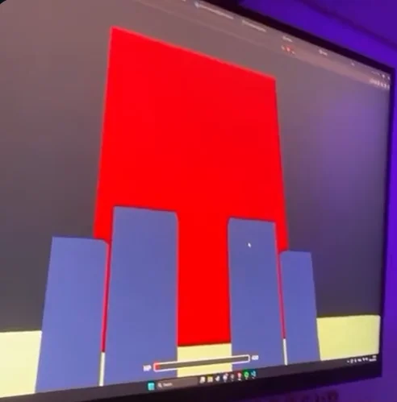
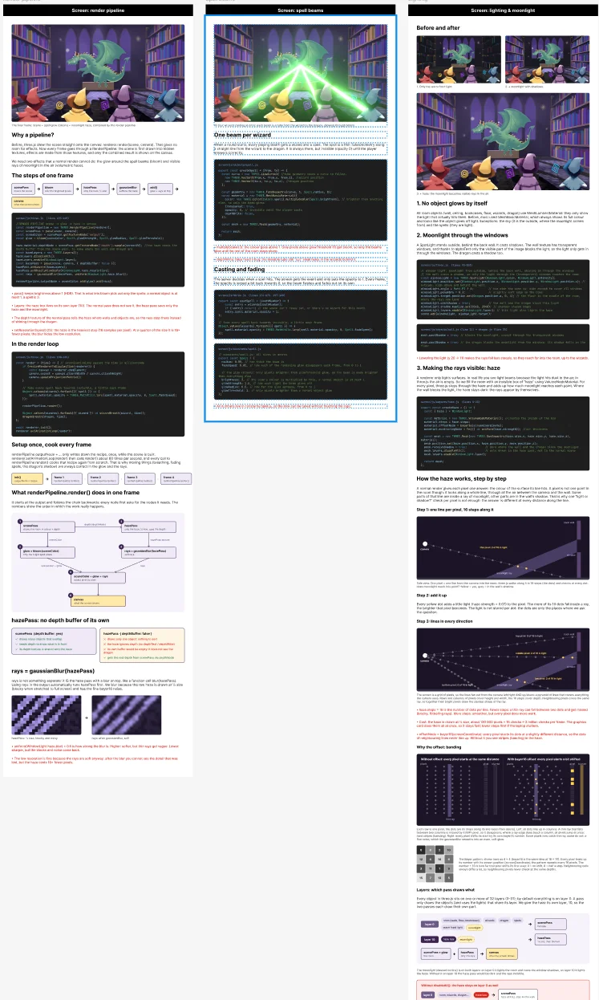
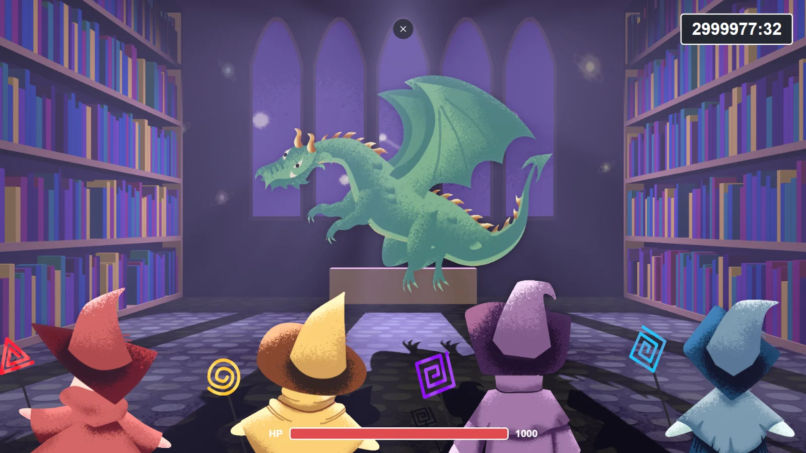
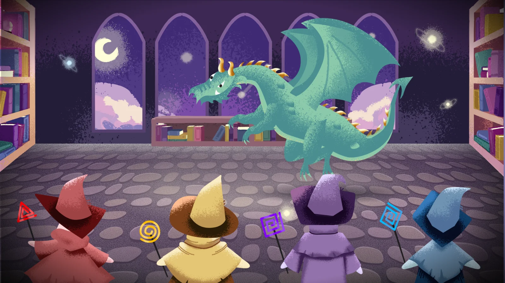

This sprint I took the big screen from grey boxes to something that finally looks like the design: a dark library at night, with the dragon floating in front of the windows and our four wizards standing in the foreground.

## From boxes to art
The wizards and the dragon are now flat image planes with our own drawings on them. The tricky part was making the transparent edges of the images actually invisible, and keeping the images from stretching. Each plane now scales to its picture's own proportions. I also gave everyone a slow "breathing" animation, so the scene doesn't feel frozen while the players are answering riddles.

## Building the room
I built the room out of simple planes and boxes: a back wall with windows, a sky behind it, a ceiling, and two big bookcases full of coloured books. Every object got its own constants file, so tweaking sizes and colours doesn't mean digging through the logic. It took a few rounds to get the proportions right. At first the room was too narrow, and you could look over the walls.

## Making the light come from the moon
This was the part I learned the most from. I wanted the light to come in through the windows, like in our concept art. With Claude's help I put a spotlight *outside*, behind the back wall, and let the wall cast shadows. Because the windows in the wall texture are transparent, only light through the windows gets in. That gives window-shaped patches on the floor, and the dragon now casts a shadow too.

But you still couldn't see the *rays* in the air. Claude's first attempt was fake beams: see-through strips from each window to the floor. Honestly, they looked bad. That's when I learned why: a renderer only lights surfaces, and in a 3D scene the air is empty. You only see light beams in real life because of dust in the air.

The real solution was volumetric light: an invisible box of "haze" that fills the room. For every pixel, three.js walks along its line of sight in 16 steps and checks at each step whether moonlight reaches that point. Where the wall blocks the light, the haze stays dark, so the rays appear on their own. To keep it fast, the haze is rendered in a separate pass at a quarter of the resolution and then blurred. We tested it on a separate page first, and only built it into the game once it worked.

## What I'm taking away
I used AI a lot this sprint, but not blindly. I made Claude explain every line of the haze code until I really understood it: the steps, the Bayer offset against banding, the layers, the depth texture. Then I turned those explanations into diagrams in our Figma documentation. The fake rays were a good reminder that the first AI answer isn't always the right one. Because I kept pushing on what *I* wanted to see, we ended up with a better technique.

Next up: checking the frame rate on the actual fair laptop, because that haze is the heaviest thing on screen.
