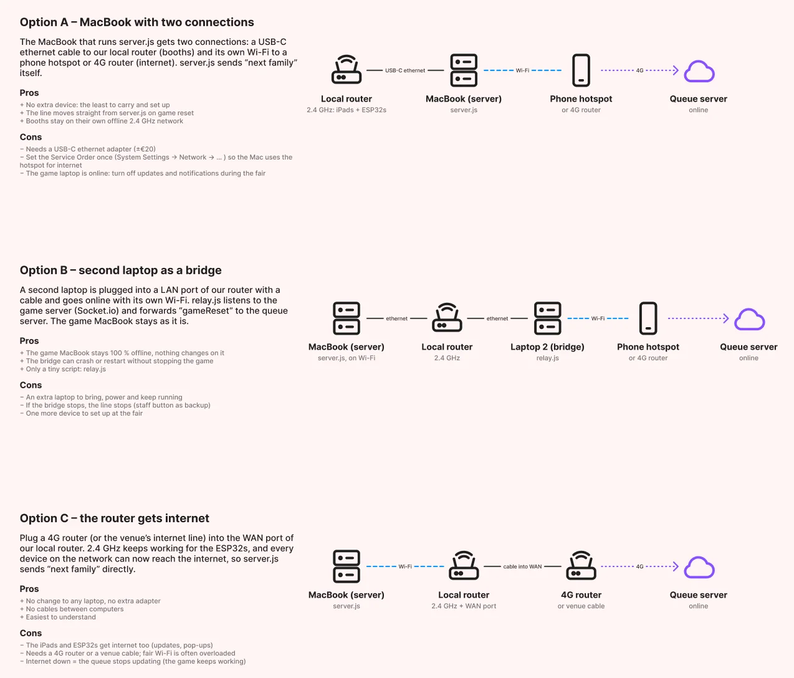
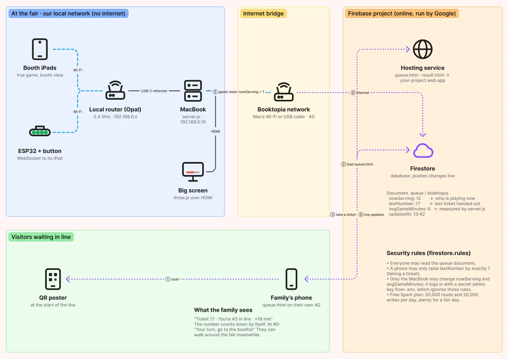

## Why a digital queue
People waiting in line weren't excited about our first idea: scanning a code and answering some preparation questions. It felt too much like the game itself. Boektopia proposed a digital queue instead. A family scans a QR code in the line and sees on their own phone their place in line and the estimated time until it's their turn. That way they don't have to stand next to the booths, and can walk around the fair in the meantime.

## The problem: how does the line move?
The queue only works if it moves forward by itself:
- **Families say they're done themselves:** people forget, and the whole line stops.
- **Someone at the installation moves the line by hand:** they'll lose count during a busy day.
- **The game server moves the line when a game resets:** the most reliable, because the server already knows when a family is done.

The catch: our game server (`server.js` on the MacBook) runs on its own private 2.4 GHz router network, because the ESP32s only work on 2.4 GHz. That network has no internet, while the queue page lives online on the families' phones. So the offline game server has to reach the internet somehow.

## Three ways to connect the game server to the internet
In every option, `server.js` sends one message out ("next family") when a game resets. The online queue never reaches into our local network, so no port forwarding is needed.

| Option | How it works | Pros | Cons |
| --- | --- | --- | --- |
| **A. MacBook with two connections** | USB-C ethernet cable to our router (booths) + Wi-Fi to a phone hotspot (internet) | No extra device; `server.js` sends the message itself; booths stay offline | Needs a USB-C ethernet adapter; network order has to be set once on the Mac |
| **B. Second laptop as a bridge** | A second laptop is plugged into the router and goes online through its own Wi-Fi; `relay.js` forwards the message | Game MacBook stays completely offline | Extra laptop to bring and keep running; if it stops, the line stops |
| **C. The router gets internet** | A 4G router or the venue's line goes into our router's WAN port | No change to any laptop | iPads and ESP32s get internet too (updates, pop-ups); fair Wi-Fi is often overloaded |

We checked online that an M3 MacBook Air can use two networks at once, as long as they come in through different connections (cable + Wi-Fi). In the network settings you choose which one is used for the internet.

## Teacher feedback
Our teacher liked the idea and approved **option A**. He told us to plan ahead and named what matters most now:
1. **Hosting:** where the online part of the queue will live, because not every host can run a socket server.
2. **The ticket system:** how families join the line and how their place is kept.
3. **Notifications:** whether families get a notification when it's almost their turn.

We discussed notifications with our UX colleague. She didn't plan on adding them, so we're leaving them out.

## Where we're heading: hosting and tickets
We're looking at **Firebase** (Google's ready-made backend) instead of hosting our own socket server. Render's free plan sleeps after 15 minutes without traffic, and Railway costs about $5 a month. With Firebase there's no server of our own that can fall asleep or crash during the fair, and the free plan is enough for a fair day.

The queue works like a ticket machine at the bakery:
- **Taking a ticket:** a family scans the QR code, enters a made-up group name and gets the next number.
- **"Now serving":** when a game resets, `server.js` adds 1 to this counter in Firestore, through the hotspot.
- **Place and waiting time:** each phone works these out itself (place = ticket − nowServing, time = place × average game time). The page updates live, without refreshing.

What we store:

| Where | Fields |
| --- | --- |
| `queue/boektopia` (one document) | `nowServing`, `lastNumber`, `avgGameMinutes` (optional), `nowPlaying` (optional), `updatedAt` |
| `groups` (one document per group) | `name`, `ticket`, `createdAt` |

Only a made-up group name is stored, no real names or contact details, and the groups list is cleared after every fair day.

**Next steps**
- building the game itself for now, and after building the ticketing system.
